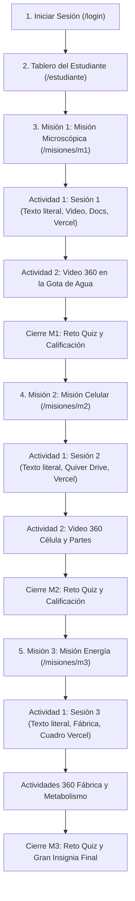

# 🧭 Guía Maestra de Navegación y Trazabilidad Pedagógica
## Implementación de la «Estrategia Indagación» en Laboratorio 360

> **Propósito de esta guía**: Servir como manual de navegación paso a paso para estudiantes, docentes y evaluadores, demostrando la correspondencia exacta entre el documento curricular `Estrategia Indagación.docx` y las pantallas, actividades y servicios interactivos de la aplicación **Laboratorio 360**.

---

## 1. Tabla de Correspondencia Curricular

| Sesión Curricular (Word) | Misión en la App | Ruta en Plataforma | Tipo de Actividad Principal | Recursos Obligatorios Integrados |
|:---|:---|:---|:---|:---|
| **Sesión 1**: ¡Misión microscópica! Exploradores en busca de los secretos de la célula | **Misión 1**: ¡Misión microscópica! | `/misiones/m1` $\rightarrow$ `/misiones/m1/inicio` | **Actividad 1**: Lectura e Indagación unificada con Espacio de Participación | • Video YouTube: *La extraña historia de la teoría celular* • Lectura Google Docs oficial • 4 Postulados literales • Línea de tiempo de científicos |
| **Sesión 2**: Construyendo el concepto de célula | **Misión 2**: ¡Misión celular! | `/misiones/m2` $\rightarrow$ `/misiones/m2/inicio` | **Actividad 1**: Comparación celular y Participación | • Video 360 de la célula y sus partes • Plantillas Quiver en Google Drive (Vegetal y Animal) • Tabla comparativa animal vs vegetal |
| **Sesión 3**: Procesos metabólicos de la célula | **Misión 3**: ¡Misión energía! | `/misiones/m3` $\rightarrow$ `/misiones/m3/inicio` | **Actividad 1**: Metabolismo celular y Cuadro de estructuras en plataforma | • Lectura Google Docs oficial • Video 360 Fábrica celular • Video 360 Metabolismo • Herramienta Canva • Cubo Merge • Cuadro de estructuras celulares |

---

## 2. Credenciales Rápidas para la Navegación

Para recorrer la aplicación y probar los flujos interactivos, se pueden utilizar las siguientes cuentas preconfiguradas:

| Rol | Usuario | Contraseña | Vista Inicial | Permisos de Navegación |
|:---|:---|:---|:---|:---|
| **Estudiante** | `estudiante01` | `Cito2026*` | `/estudiante` | Flujo guiado de aprendizaje, registro de respuestas y quizzes. |
| **Docente** | `docente01` | `Docente2026*` | `/docente` | Tablero de control, revisión y calificación de evidencias entregadas. |
| **Administrador** | `admin` | `Admin2026*` | `/admin` | Acceso irrestricto de verificación a todas las vistas y misiones. |

---

## 3. Arquitectura y Herramientas de Orientación en la App

Para que la navegación sea intuitiva y nunca se pierda el hilo pedagógico, la plataforma dispone de cuatro mecanismos persistentes:

1. **Barra Superior de Cabecera (`AppShell`)**:
   - Presente en la parte superior fija con el logo del Laboratorio 360, selector de misiones y perfil de usuario interactivo.
   - **Acceso a Administración en el Perfil**: El enlace general de «Administración» fue retirado de la barra de navegación superior y se integró directamente en el nombre e icono de la cuenta del Administrador (`/admin`).
   - **Página de Perfil (`/perfil`)**: Para docentes y estudiantes, hacer clic sobre su nombre en la cabecera abre su página de perfil con sus datos de usuario, aula y un formulario de edición de datos personales (sin fotografía por ahora).
   - **Botón Brújula (Mapa del Sitio)**: Botón interactivo principal para desplegar el modal con todas las fases, estaciones y enlaces rápidos.
2. **Barra de Migas de Pan (`BreadcrumbBar`)**:
   - Situada debajo del encabezado principal (`Atrás, Home, Lab 360, Sesión...`).
   - **Botón Atrás inteligente**: Calcula la ruta anterior jerárquica para no quedar atrapado en bucles.
   - **Migas de pan dinámicas**: Por ejemplo: `Laboratorio 360 > Misiones > Sesión 1`.
   - Limpia de duplicados: no repite el botón del mapa del sitio, manteniendo el foco en el rastro de navegación.
3. **Modal del Mapa del Sitio (`SiteMapModal`)**:
   - Muestra el diagrama de las 3 misiones (Inicio, Desarrollo, Cierre).
   - Incluye el indicador interactivo **«📍 Estás aquí»** para saber la ubicación exacta.
   - Permite saltar directamente a cualquier estación disponible.
4. **Barra de Navegación Continua (Pie de Actividad)**:
   - Botón **Anterior**: Regresa a la actividad previa.
   - Indicador de progreso: Ejemplo: `Inicio · 1 de 8`.
   - Botón **Siguiente**: Avanza automáticamente a la siguiente estación.
   - Sugerencias inteligentes al completar una estación (ej. *«Ir al Quiz»* o *«Siguiente Misión»*).

---

## 4. Guía de Navegación Paso a Paso

---

### Misión 1: ¡Misión microscópica! (Sesión 1)

#### Paso 1: Ingreso a la Misión y Nivel Superior
1. Inicia sesión como `estudiante01` o `admin`.
2. En el mapa de `/estudiante`, pulsa sobre la tarjeta **¡Misión microscópica!** o ingresa a `/misiones/m1`.
3. Verás la cabecera de la misión con la gran pregunta:
   *«¿Sabías que tu cuerpo, las plantas y los animales están formados por millones de pequeñas estructuras que no podemos ver a simple vista? ¿Se imaginan cómo son y qué hacen para mantenernos vivos?»*
4. **Nivel Superior de la Sesión**: El contenido general de **«La extraña historia de la teoría celular»** se despliega **directamente en el nivel superior** de la sesión mediante una barra de **6 pestañas interactivas** (`1.1 Aportes`, `1.2 Concepto`, `1.3 Video`, `1.4 Lectura y participación`, `1.5 Reto Final`, `1.6 Contenidos extras`) con navegación fluida, botones de avance entre pestañas y selector de modo (*Pestañas* o *Ver todo continuo*).

#### Paso 2: Las 6 Pestañas de la Sesión 1 en el Nivel Superior
* **Pestaña 1.1: Aportes y socialización**:
  * **Texto literal**: *«La docente inicia la sesión motivando a los estudiantes a dar respuesta a la pregunta ¿Sabías que tu cuerpo, las plantas y los animales están formados por millones de pequeñas estructuras que no podemos ver a simple vista? ¿se imaginan cómo son y qué hacen para mantenernos vivos?»*
  * **Dinámica de participación**: *«Los estudiantes participan de forma oral y escrita en la plataforma, dan a conocer sus aportes y socializan con el grupo sus ideas, la docente, proyecta un recurso multimedial que explica los aportes, sus inicios y representantes en la construcción del conocimiento de lo que actualmente se reconoce como teoría celular,»*
  * **Interacción en plataforma**: Área de redacción donde el estudiante escribe su hipótesis inicial, botón para registrar su aporte y muro de ideas compartidas del grupo.
  * **Pie de navegación**: Botón directo `Siguiente: 1.2 Aporte conceptual →`.

* **Pestaña 1.2: Aporte conceptual**:
  * **Texto literal**: *«La docente realiza un aporte conceptual explicando que La Teoría celular explica por qué razón la célula es la unidad estructural y funcional de todos los seres vivos que habitan el planeta, excepto los virus que son acelulares. Incluye los siguientes postulados:»*
  * **4 Postulados literales**:
    1. *Todos los seres vivos que habitan el planeta se componen de una (unicelulares) o más células (pluricelulares).*
    2. *Toda célula procede de otra preexistente, que ha copiado su información genética antes de dividirse en dos células hijas.*
    3. *Toda célula se compone básicamente de las mismas sustancias químicas: agua, trazas de minerales, carbohidratos, lípidos, proteínas y ácidos nucleicos, conocidas como "moléculas de la vida o biomoléculas".*
    4. *La célula es la unidad funcional de los seres vivos, porque independientemente del organismo al cual se haga referencia, es en ella donde ocurre las reacciones químicas que se necesitan para vivir.*
  * **Maquetación interactiva (React Bits · Drift Wall)**: Integración del componente `DriftWall.tsx` (`https://reactbits.dev/components/drift-wall`) con perspectiva 3D inmersiva y deriva continua infinita en doble riel que despliega las opciones fundamentales de la teoría celular (Unidad Estructural, Unidad Funcional, Unidad de Origen, Composición Química) y el Mensaje Final de exclusión de los virus acelulares. Cuenta con elevación espacial (`translateZ`) al interactuar, pausa al hover, selector de velocidad (0.6x, 1x, 1.5x), conmutador a cuadrícula estática, `ClickSpark` y panel de inspección activa profunda.
  * **Pie de navegación**: Botones `← Anterior: 1.1` y `Siguiente: 1.3 Video YouTube →`.

* **Pestaña 1.3: Visualización del video multimedial**:
  * **Texto literal**: *«Se solicita los estudiantes visualizar el video Video YouTube la extraña historia de la teoría celular https://youtu.be/OOXO3fGImoU»*
  * **Reproductor interactivo**: Video embebido sin cookies y botón para abrir en YouTube.
  * **Descripción y Propósito pedagógico**: Sección explicativa que detalla de qué trata el video y **para qué se mira** (importancia de la tecnología, origen del término célula por Hooke, animálculos de Leeuwenhoek y consenso de Schleiden, Schwann y Virchow).
  * **Pie de navegación**: Botones `← Anterior: 1.2` y `Siguiente: 1.4 Lectura y participación →`.

* **Pestaña 1.4: Lectura oficial adaptada y Espacio de participación**:
  * **Texto literal**: *«Realizar la lectura que se aloja en la plataforma Lectura https://docs.google.com/document/d/1sP7mzPT9L0z-RH3FDHUBztziEnZ56rqG/edit?usp=sharing&ouid=107395200434224073532&rtpof=true&sd=true, adaptarla la lectura y maquetarla aquí en 1.4 para dar respuesta a la siguiente pregunta en el espacio de participación.»*
  * **Carrusel Circular 3D con Gráficos 2D Animados (React Bits)**: Los 5 hitos históricos de la teoría celular maquetados interactivamente con el componente oficial `CircularCarousel` (`https://reactbits.dev/components/circular-carousel`) ajustado con física de profundidad 3D (`translateZ(-dynamicRadius)`) para que las tarjetas se visualicen completas sin cortes ni sobredimensionamiento, y opción de alternar a vista acordeón, cada uno ambientado con su ilustración vectorial 2D animada (`HistoryGraphics2D.tsx`):
    1. *Zacharias Janssen (~1590-1608)* (`JanssenMicroscopeGraphic2D`): Primer microscopio compuesto de doble lente convexa con haz óptico refractado, tubo corredizo de latón y marcas de medición.
    2. *Robert Hooke (1665)* (`HookeCorkGraphic2D`): Observación de finas láminas de corcho vegetal (*Micrographia*), panal poliédrico de celdillas y bautizo de la «célula» (*cell*).
    3. *Anton van Leeuwenhoek (1674)* (`LeeuwenhoekAnimalculesGraphic2D`): Microesferas de vidrio pulido de 200 aumentos, gota de agua viva con «animálculos» móviles (bacterias, paramecios ciliados, espirilos y flagelados).
    4. *Matthias Schleiden & Theodor Schwann (1838-1839)* (`SchleidenSchwannGraphic2D`): Unión de botánica y zoología bajo la universalidad de la teoría celular (célula vegetal con cloroplastos + célula animal con mitocondrias y puente energético central).
    5. *Rudolf Virchow (1855)* (`VirchowDivisionGraphic2D`): Aforismo *«Omnis cellula e cellula»*, mitosis celular con cromosomas duplicados, huso acromático y anillo contráctil de citocinesis.
  * **Espacio de participación**:
    * Pregunta: *«Identifique dos ideas mencionadas en la lectura que usted considera importantes para el estudio de la biología. Argumente cada una de ellas.»*
    * Selector orbital de ideas clave basado en **React Bits Orbit Images** (`OrbitCards.tsx`), donde cada panel orbita como una tarjeta interactiva; incluye instrucción destacada de selección al clic, botón para insertar ideas seleccionadas en el texto, editor con contador de caracteres, autoguardado en borrador (`Guardar borrador`) y envío formal calificado a MongoDB (`Enviar respuesta a la docente`).
  * **Pie de navegación**: Botones `← Anterior: 1.3` y `Siguiente: 1.5 Reto Final de Evaluación →`.

* **Pestaña 1.5: Reto final de evaluación: Teoría celular (Obligatorio)**:
  * **Evaluación gamificada**: Examen interactivo oficial de 6 preguntas «Los secretos de la teoría celular».
  * **Cito como tutor**: Mensaje de ánimo y orientación para el examen.
  * **Checklist de preparación**: Verificación de los 4 postulados fundamentales, científicos históricos y exclusión de los virus acelulares.
  * **Botón de inicio**: Acceso directo al cuestionario en `/misiones/m1/quiz`. Puntaje aprobatorio: 70%.
  * **Pie de navegación**: Botones `← Anterior: 1.4` y `Siguiente: 1.6 Contenidos extras →`.

* **Pestaña 1.6: Contenidos extras y actividades complementarias (Opcional)**:
  * Agrupa en la última estación todos los recursos de profundización y actividades complementarias exclusivas de la Sesión 1:
    1. *Dentro de una gota de agua* (Video 360 y microscopía acuática con paramecios y bipartición).
    2. *El microscopio y la célula* (Modelo 3D Three.js con aumentos 10x, 40x, 100x).
    3. *Cubo de la teoría celular* (Simulador 3D Merge Cube con científicos).
    4. *Zoom microscópico: del organismo a la célula* (Animación 3D del cuerpo al núcleo).
    5. *Línea de tiempo de los científicos* (Cronología interactiva con vista desplegable).
    6. *Glosario científico interactivo* (Diccionario interactivo con vista desplegable).
    7. *Mosaico de Actividades Complementarias de M1* mediante `ComplementaryMissionCard` (integradas directamente en la estación sin duplicidad al final de la página).
  * **Pie de navegación**: Botón `← Anterior: 1.5` y botón de reinicio `Repasar desde el inicio (1.1)`.

---

### Misión 2: ¡Misión celular! (Sesión 2)

#### Paso 1: Ingreso a la Misión y Nivel Superior
1. Desde `/estudiante` o el menú de misiones, abre `/misiones/m2`.
2. Verás la cabecera de la misión con la gran pregunta:
   *«¿Creen que las células de nuestro cuerpo son iguales a las de una planta? ¿Qué diferencias imaginan que existen entre ellas y qué partes creen que necesitan para poder vivir y funcionar?»*
3. **Nivel Superior de la Sesión**: El contenido general de **«Construyendo el concepto de célula»** se despliega **directamente en el nivel superior** de la sesión mediante una barra de **8 pestañas dinámicas** (`2.1 Saberes previos`, `2.2 Célula Vegetal`, `2.3 Célula Animal`, `2.4 Modelo 360 y Video`, `2.5 Pregunta e Indagación Vercel`, `2.6 Quiver y Comparación`, `2.7 Reto Final Quiz`, `2.8 Actividades complementarias`).
4. **Carga dinámica sin scroll infinito**: Cada pestaña se carga de manera aislada y dinámica (evitando tener que desplazarse por toda la página verticalmente), con botones de avance secuencial `← Anterior` y `Siguiente →` en cada estación, y un selector opcional para alternar entre *Modo Pestañas* o *Ver todo continuo*.

#### Paso 2: Las 8 Estaciones Oficiales (2.1 a 2.8) en el Nivel Superior
* **Pestaña 2.1: Introducción y reconocimiento de saberes previos**:
  * **Texto literal de la docente**: *«A partir de la identificación de la célula como unidad estructural y funcional de los seres vivos, la docente, busca reconocer los saberes previos de los estudiantes de grado 5.º sobre la clasificación de las células, especialmente las animales y vegetales, así como identificar sus conocimientos acerca de las principales estructuras celulares y sus funciones, promoviendo la curiosidad, la participación y la construcción colectiva del conocimiento»*
  * **Maquetación inmersiva con React Bits**: Tarjetas dinámicas `SpotlightCard`, brillo metálico `ShinyText`, y 3 detonadores de curiosidad científica (sostén sin huesos, cocinas solares verdes, elasticidad celular).
  * **Interacción del estudiante**: Formulario para registrar saberes previos, autoguardado y muro de aportes colectivos con ejemplos de compañeros de clase.
  * **Pie de navegación**: Botón directo `Siguiente: 2.2 Célula Vegetal →`.

* **Pestaña 2.2: Célula Vegetal (Plantilla educativa oficial)**:
  * **Enlace oficial de Google Drive**: `https://drive.google.com/file/d/1Rc_5xG1CsOAcfSwXpzT3dA5aBwOfNMMa/view?usp=sharing`.
  * **Carrusel Circular 3D de React Bits (`CircularCarousel.tsx`)**: Experiencia interactiva de rotación cilíndrica tridimensional con arrastre táctil y del cursor, snap al centro y selector para alternar a vista de cuadrícula.
  * **Ilustraciones científicas 2D dedicadas (`CellGraphics2D.tsx`)**: Cada tarjeta del carrusel incluye un gráfico vectorial 2D detallado de alta definición:
    1. *Pared celular de celulosa* (`CellWallGraphic2D`): Lámina media, pared primaria y red de microfibrillas con plasmodesmos; color ocre/café (#b45309).
    2. *Cloroplastos con clorofila* (`ChloroplastGraphic2D`): Doble membrana, estroma y pilas de tilacoides (grana); color verde intenso (#16a34a).
    3. *Gran vacuola central* (`CentralVacuoleGraphic2D`): Tonoplasto, jugo vacuolar y vectores de presión de turgor; color celeste (#0284c7).
    4. *Membrana plasmática* (`PlasmaMembraneGraphic2D`): Bicapa fosfolipídica con canales y plasmodesmos; color esmeralda (#059669).
    5. *Núcleo y nucleolo* (`NucleusGraphic2D`): Envoltura nuclear con poros y cromatina periférica; color azul real (#2563eb).
    6. *Mitocondrias vegetales* (`MitochondriaGraphic2D`): Crestas mitocondriales y matriz respiratoria; color naranja (#ea580c).
    7. *Citoplasma y citosol* (`CytoplasmGraphic2D`): Microfilamentos y corrientes de ciclosis; color verde menta (#10b981).
  * **Guía de coloreado Quiver**: Código de colores oficial para imprimir y pintar en clase.
  * **Pie de navegación**: Botones `← Anterior: 2.1` y `Siguiente: 2.3 Célula Animal →`.

* **Pestaña 2.3: Célula Animal (Plantilla educativa oficial)**:
  * **Enlace oficial de Google Drive**: `https://drive.google.com/file/d/1euCki6yPm4LXeIMCyWAKvnBfRPPVmJmu/view?usp=sharing`.
  * **Carrusel Circular 3D de React Bits (`CircularCarousel.tsx`)**: Carrusel inmersivo 3D con física de arrastre, tarjetas estilizadas con brillo y alternancia de vistas.
  * **Ilustraciones científicas 2D dedicadas (`CellGraphics2D.tsx`)**: Cada estructura animal cuenta con su gráfico vectorial 2D interactivo:
    1. *Membrana celular elástica* (`AnimalMembraneGraphic2D`): Bicapa fluida con colesterol y glucocáliz, sin pared rígida; color morado (#9333ea).
    2. *Núcleo esférico central* (`NucleusGraphic2D`): Núcleo prominente en posición central con ADN y poros; color azul (#2563eb).
    3. *Mitocondrias activas* (`MitochondriaGraphic2D`): Alta densidad de crestas para síntesis masiva de ATP; color naranja (#ea580c).
    4. *Centríolos y centrosoma* (`CentriolesGraphic2D`): Cilindros perpendiculares con tripletes de microtúbulos (9x3); color ámbar (#d97706).
    5. *Aparato de Golgi* (`GolgiGraphic2D`): Dictiosomas de cisternas apiladas y vesículas de secreción; color rosa magenta (#db2777).
    6. *Lisosomas digestivos* (`LysosomeGraphic2D`): Membrana con enzimas hidrolíticas para autofagia; color escarlata (#e11d48).
    7. *Vacuolas pequeñas transitorias* (`AnimalVacuolesGraphic2D`): Vesículas dinámicas dispersas; color amarillo (#ca8a04).
  * **Guía de coloreado Quiver**: Código de colores oficial para imprimir y pintar en clase.
  * **Pie de navegación**: Botones `← Anterior: 2.2` y `Siguiente: 2.4 Modelo 360 y Video →`.

* **Pestaña 2.4: Presentación del modelo 360 y video interactivo**:
  * **Video interactivo oficial YouTube**: Embebido directo de `https://www.youtube.com/watch?v=h1gryskdtmk` (sin cookies: `https://www.youtube-nocookie.com/embed/h1gryskdtmk`).
  * **Descripción y propósitos pedagógicos**: Detalle de qué muestra el video y los 4 propósitos para los estudiantes (tridimensionalidad, especialización fotosintética, función de pared y evidencias para la argumentación).
  * **Modelo 360 y 3D de la célula**: Presentación pedagógica y accesos directos al visor 3D interactivo (`cell-compare`) y a la simulación panorámica 360.
  * **Pie de navegación**: Botones `← Anterior: 2.3` y `Siguiente: 2.5 Participación →`.

* **Pestaña 2.5: Participación**:
  * **Pregunta literal de la docente**: *«¿Creen que las células de nuestro cuerpo son iguales a las de una planta? ¿Qué diferencias imaginan que existen entre ellas y qué partes creen que necesitan para poder vivir y funcionar?»*
  * **Dinámica pedagógica**: Los estudiantes integran lo observado en los modelos 3D, el video interactivo y las plantillas para redactar su respuesta en la plataforma.
  * **Espacio de participación**:
    * Selector orbital de ideas clave basado en **React Bits Orbit Images** (`OrbitCards.tsx`), donde cada panel orbita como una tarjeta interactiva sobre las semejanzas, diferencias y necesidades celulares; incluye instrucción destacada de selección al clic, botón para insertar ideas seleccionadas en el texto, editor con autoguardado en borrador y envío formal a MongoDB.
    * Botón para insertar ideas seleccionadas en el borrador con un solo clic.
    * Editor con autoguardado en borrador (`Guardar borrador`) y envío formal calificado a la base de datos MongoDB (`Enviar respuesta a la docente`).
  * **Pie de navegación**: Botones `← Anterior: 2.4` y `Siguiente: 2.6 Quiver y Comparación →`.

* **Pestaña 2.6: Material impreso Quiver y Análisis Comparativo**:
  * **Texto literal**: *«A fin de afianzar el concepto de la célula y sus partes, la docente proporciona material impreso de Quiver y solicita a los estudiantes colorear la estructura de la célula vegetal y animal, posterior a ello, cada grupo de estudiantes proyecta la imagen a través de la aplicación de Quiver e identifican las semejanzas y diferencias de la estructura entre la célula animal y vegetal»*
  * **Protocolo de Realidad Aumentada Quiver**: 4 pasos para el aula (descarga/impresión, coloreado por tonos, escaneo en 3D y debate grupal).
  * **Tabla comparativa interactiva completa**: Comparación de 7 estructuras (Membrana, Núcleo, Citoplasma, Mitocondrias, Vacuolas, Pared celular y Cloroplastos) con filtro interactivo por tipo (Todas, Compartidas, Solo Vegetal, Solo Animal).
  * **Comparador deslizante de diferencias anatómicas**: Conmutador animado entre vacuolas, pared celular y cloroplastos.
  * **Glosario científico desplegable**: Términos clave con `DecryptedText`.
  * **Pie de navegación**: Botones `← Anterior: 2.5` y `Siguiente: 2.7 Reto Final Quiz →`.

* **Pestaña 2.7: Reto final de evaluación (Quiz obligatorio)**:
  * **Evaluación gamificada**: Examen interactivo oficial de 8 preguntas «Células bajo la lupa».
  * **Cito como tutor**: Mensaje de ánimo y orientación para el examen.
  * **Checklist de preparación**: Verificación de conceptos clave (pared, cloroplastos, vacuola central, nutrición autótrofa vs heterótrofa).
  * **Botón de inicio**: Acceso directo al cuestionario en `/misiones/m2/quiz`. Puntaje aprobatorio: 70%.
  * **Pie de navegación**: Botones `← Anterior: 2.6` y `Siguiente: 2.8 Actividades complementarias →`.

* **Pestaña 2.8: Actividades complementarias (Exclusivas de la Sesión 2)**:
  * Agrupa en una pestaña dedicada todas las experiencias de apoyo y profundización exclusivas de M2:
    1. **Video 360 de la célula y sus partes** (`video360` · Opcional): Escena inmersiva con rotación panorámica (+20 XP).
    2. **Células animal y vegetal en 3D** (`model3d` · Opcional): Visor 3D Three.js con capas y hotspots (+20 XP).
    3. **Recorrido por organelos** (`animation3d` · Opcional): Animación secuencial comparativa (+15 XP).
    4. **Cubo celular Merge** (`ar_cube` · Opcional): Exploración virtual de las 6 caras celulares (+15 XP).
    5. **Estación Quiver RA** (`quiver` · Opcional): Verificación de modelo con cámara (+10 XP).
    6. **Comparador y animación 2D de pared celular** (`animation2d` · Opcional): Simulación interactiva 2D (+10 XP).
    7. **Mi mapa de la célula (Bitácora)** (`evidence` · Opcional): Registro extendido de evidencias (+20 XP).
  * Integración mediante tarjetas interactivas `ComplementaryMissionCard`, sin duplicados al final de la página.
  * **Pie de navegación**: Botón `← Anterior: 2.7 Reto Final` y botón de reinicio `Repasar desde el inicio (2.1)`.

---

### Misión 3: ¡Misión energía! (Sesión 3)

#### Paso 1: Ingreso a la Misión y Nivel Superior
1. Desde `/estudiante` o el menú de misiones, abre `/misiones/m3`.
2. Verás la cabecera de la misión con la gran pregunta:
   *«¿Qué creen que sucedería si una fábrica dejara de recibir materiales o energía para funcionar? ¿Pasaría algo parecido en nuestras células si no recibieran los nutrientes que necesitan?»*
3. **Nivel Superior de la Sesión**: Al igual que en las Sesiones 1 y 2, el contenido general de **«Procesos metabólicos de la célula»** se despliega **directamente en el nivel superior** de la sesión mediante una barra de **8 pestañas dinámicas** (`3.1 Saberes previos`, `3.2 Fábrica y Video 360`, `3.3 Preguntas motivadoras`, `3.4 Video 360, Lectura y Canva`, `3.5 Cubo Merge`, `3.6 Cuadro Estructuras Vercel`, `3.7 Reto Final Quiz`, `3.8 Actividades complementarias`).
4. **Carga dinámica sin scroll infinito**: Cada estación se carga de manera aislada y dinámica, con botones de avance secuencial `← Anterior` y `Siguiente →` en cada estación, y un selector opcional para alternar entre *Modo Pestañas* o *Ver todo continuo*.

#### Paso 2: Las 8 Estaciones Oficiales (3.1 a 3.8) en el Nivel Superior
* **Pestaña 3.1: Activación de saberes previos y situación cotidiana**:
  * **Texto literal de la docente**: *«Al inicio la docente, activa los saberes previos de los estudiantes mediante una situación cercana a su realidad, promoviendo la reflexión sobre la importancia de los nutrientes, la energía y las transformaciones que ocurren dentro de las células, como punto de partida para comprender el metabolismo celular»*
  * **Maquetación inmersiva con React Bits**: Tarjetas dinámicas `SpotlightCard`, brillo metálico `ShinyText`, y 3 situaciones cotidianas para reflexionar (el combustible diario de los alimentos, transformaciones invisibles en micromoléculas, y el motor celular que nunca duerme).
  * **Interacción del estudiante**: Formulario para registrar saberes previos, ideas sugeridas para inspirarse, autoguardado y muro de ideas compartidas del grupo.
  * **Pie de navegación**: Botón directo `Siguiente: 3.2 La Fábrica y Video 360 →`.

* **Pestaña 3.2: Presentación del video 360 de una fábrica de producción y Analogía Celular**:
  * **Texto literal de la docente**: *«presenta el video 360 de una fábrica de producción, comparando a la célula con una pequeña fábrica que trabaja día y noche. En esta fábrica llegan materiales que son transformados para elaborar productos, se utiliza energía para que las máquinas funcionen y cada trabajador cumple una tarea especial, de manera parecida, las células de nuestro cuerpo reciben nutrientes, los transforman, obtienen energía y producen sustancias necesarias para mantenerse vivas y realizar sus funciones. A todo este conjunto de procesos lo llamamos metabolismo celular”.»*
  * **Simulador panorámico de la fábrica celular en 360°**: Visor interactivo con controles de giro (`← Girar Izq`, `Girar Der →`, restablecer ángulo) y exploración de 6 estaciones clave:
    1. *Puerta y aduana* (Membrana celular): Control de acceso de materias primas y salida de desechos.
    2. *Planta central* (Citoplasma): Nave de montaje donde operan las maquinarias biológicas.
    3. *Central eléctrica* (Mitocondrias): Generadores que queman glucosa con O2 para producir energía ATP.
    4. *Paneles solares* (Cloroplastos): Captación de energía solar limpia para fabricar glucosa.
    5. *Torre hidráulica* (Gran vacuola central): Depósito de reserva de agua que mantiene la turgencia firme.
    6. *Oficina de gerencia* (Núcleo): Archivo de planos maestros de ADN y dirección de la célula.
  * **Concepto de Metabolismo Celular**: Cuadro explicativo con `DecryptedText` desglosando el **Catabolismo** (degradación y liberación de ATP) y el **Anabolismo** (construcción y síntesis de moléculas).
  * **Pie de navegación**: Botones `← Anterior: 3.1` y `Siguiente: 3.3 Preguntas Motivadoras →`.

* **Pestaña 3.3: Planteamiento de preguntas motivadoras y respuesta en plataforma**:
  * **Texto literal de la docente**: *«La docente plantea los siguientes cuestionamientos ¿Qué creen que sucedería si una fábrica dejara de recibir materiales o energía para funcionar? ¿Pasaría algo parecido en nuestras células si no recibieran los nutrientes que necesitan? Los estudiantes dan respuesta a pregunta motivadora en la plataforma»*
  * **Dos cuestionamientos centrales**: Tarjetas destacadas con resplandor dorado.
  * **Selector de argumentos científicos**: 4 ideas guía para insertar en la respuesta con un clic (paralización de maquinarias, falta de ATP, pérdida de turgencia/plasmólisis, colapso metabólico).
  * **Espacio de redacción en plataforma**: Textarea con contador de caracteres, autoguardado y muro colaborativo del salón de clase.
  * **Pie de navegación**: Botones `← Anterior: 3.2` y `Siguiente: 3.4 Video 360, Lectura e Infografía Canva →`.

* **Pestaña 3.4: Video 360 del Metabolismo, Lectura oficial adaptada e Infografía en Canva**:
  * **Texto literal de la docente**: *«La docente presenta el video el video 360 y solicita a los estudiantes visualizarlo y dar respuesta al siguiente cuestionamiento: ¿De qué manera las células vegetales y animales llevan a cabo sus actividades para conservar la vida? ¿Cómo se llama el proceso mediante el cual las células adquieren energía y eliminan desechos?, se solicita los estudiantes apoyarse en el contenido del recurso multimedial como también en la lectura “El metabolismo celular: Lectura el metabolismo celular (maquetar lectura desde este enlace: https://docs.google.com/document/d/1RNF1OnvpUMINXE-p-D-T9ZF2B6ycDj3x/edit?usp=sharing&ouid=107395200434224073532&rtpof=true&sd=true), luego decir: ¿Cómo obtienen y utilizan la energía las células?” para dar respuesta a los cuestionamientos a través de la elaboración de una infografía en la herramienta Canva»*
  * **Lectura adaptada completa maquetada en plataforma**: 4 capítulos editoriales (Metabolismo y catabolismo, Respiración celular y ATP en mitocondrias, Fotosíntesis en cloroplastos, y Equilibrio del agua: ósmosis, turgencia y plasmólisis), más enlace a Google Docs.
  * **Tabla comparativa interactiva**: Fotosíntesis vs. Respiración celular con filtro interactivo.
  * **Taller de Infografía en Canva**: Checklist obligatorio de 4 puntos, enlace directo a Canva y campo para registrar el enlace público de la infografía.
  * **Pie de navegación**: Botones `← Anterior: 3.3` y `Siguiente: 3.5 Cubo Merge y Estructuras →`.

* **Pestaña 3.5: Cubo Merge: estructuras celulares y metabolismo**:
  * **Texto literal de la docente**: *«A partir de la visualización, la docente, presenta y proporciona a los estudiantes un cubo Merge e indica las funcionalidades de la herramienta y propone hacer uso del cubo superponiendo la imagen de la célula vegetal con el propósito de identificar las estructuras celulares para llevar a cabo el metabolismo celular»*
  * **Simulador interactivo del Cubo Merge en 3D (CSS 3D)**: Selector interactivo para girar entre las 6 caras del cubo (Mitocondria, Cloroplasto, Gran vacuola, Núcleo, Membrana y Citoplasma), con su función metabólica y su rol en la célula vegetal.
  * **Contador de caras exploradas**: Indicador dinámico y acceso a la experiencia completa en pantalla completa.
  * **Pie de navegación**: Botones `← Anterior: 3.4` y `Siguiente: 3.6 Cuadro de Estructuras →`.

* **Pestaña 3.6: Cuadro de la estructura celular en la plataforma**:
  * **Texto literal de la docente**: *«Los estudiantes completan el cuadro de la estructura celular en la plataforma: Membrana celular, Cloroplastos, Mitocondrias, Citoplasma, Vacuola central y Núcleo con su respectiva función principal»*
  * **Carrusel de Cards Reflectivas (`ReflectiveCard` de React Bits)**:
    * Efecto 3D interactivo con inclinación al movimiento del cursor, destello especular dinámico (*glare overlay*) y resplandor metálico iridiscente.
    * 6 tarjetas metabólicas para cada una de las partes de la célula:
      1. *Membrana celular* (`AnimatedMembrane2D`): Bicapa de fosfolípidos con canales activos e iones animados transitando; control de acceso selectivo.
      2. *Cloroplastos* (`AnimatedChloroplast2D`): Tilacoides en granas, rayos solares animados y síntesis de glucosa; fotosíntesis vegetal.
      3. *Mitocondrias* (`AnimatedMitochondria2D`): Crestas plegadas internas y estallido continuo de moléculas de ATP animadas; respiración celular aeróbica.
      4. *Citoplasma* (`AnimatedCytoplasm2D`): Citosol coloidal con corrientes de ciclosis rotatorias y organelos en suspensión; piso de ensamblaje celular.
      5. *Vacuola central* (`AnimatedVacuole2D`): Depósito de agua con oscilación de presión de turgencia hidrostática; soporte y firmeza vegetal.
      6. *Núcleo* (`AnimatedNucleus2D`): Envoltura con poros nucleares, nucleolo denso y hebras de ADN/ARN con pulso luminoso; comando central genético.
    * Cada card incluye: título, tag de rol metabólico, gráfico 2D animado de alta resolución, descripción contextualizada para 5.º grado, analogía de fábrica, y un cajón de texto interactivo (`textarea`) para que el estudiante redacte la función principal.
    * Tira superior de píldoras con marcas de verificación (`CheckCircle2`), medidor porcentual de avance y selector para alternar entre *Modo carrusel animado* y *Ver todas en cuadrícula*.
    * Sincronización inmediata con el borrador en la nube y el envío formal a MongoDB para calificación docente.
  * **Espacio de participación (`VercelResponseSection`)**:
    * Selector de ideas científicas para inspirar la argumentación.
    * Campo para adjuntar el enlace de la infografía en Canva.
    * Autoguardado en borrador (`Guardar borrador`) y envío formal calificado a la base de datos MongoDB (`Enviar respuesta a la docente`).
  * **Pie de navegación**: Botones `← Anterior: 3.5` y `Siguiente: 3.7 Reto Final de Evaluación →`.

* **Pestaña 3.7: Reto final de evaluación: La fábrica de la vida (Obligatorio)**:
  * **Evaluación gamificada**: Examen interactivo oficial de 8 preguntas sobre metabolismo celular, respiración, fotosíntesis y ósmosis.
  * **Cito como tutor**: Mensaje de aliento para la gran evaluación final.
  * **Checklist de preparación**: Revisión de conceptos clave (ATP, fotosíntesis, respiración celular, turgencia y plasmólisis).
  * **Botón de inicio**: Acceso directo al cuestionario en `/misiones/m3/quiz`. Puntaje aprobatorio: 70%.
  * **Gran Insignia Final**: Desbloqueo de **Guardián de la Energía** y consagración con la insignia maestra de **Científico 360**.
  * **Pie de navegación**: Botones `← Anterior: 3.6` y `Siguiente: 3.8 Actividades complementarias →`.

* **Pestaña 3.8: Actividades complementarias (Exclusivas de la Sesión 3)**:
  * Agrupa en una pestaña dedicada todas las experiencias de apoyo y profundización exclusivas de M3:
    1. **Video 360 de la fábrica de producción** (`video360` · Opcional): Escena inmersiva de la fábrica celular (+15 XP).
    2. **Video 360 del Metabolismo celular** (`video360` · Opcional): Escena inmersiva del flujo energético (+15 XP).
    3. **La célula de la energía** (`model3d` · Opcional): Modelo 3D con sliders de agua, luz y nutrientes (+20 XP).
    4. **Plasmólisis, turgencia y producción de ATP** (`animation3d` · Opcional): Secuencia animada 2D (+15 XP).
    5. **Cubo fábrica celular** (`ar_cube` · Opcional): Exploración virtual de las 6 caras del Cubo Merge (+15 XP).
    6. **La danza del metabolismo: Partículas ATP, agua y CO2** (`animation2d` · Opcional): Simulación de partículas React Bits (+5 XP).
    7. **Taller de infografía en Canva** (`infographic` · Opcional): Plantilla guiada (+10 XP).
    8. **Mi bitácora de energía** (`evidence` · Opcional): Cuaderno científico de reporte adicional (+20 XP).
    9. **Laboratorio optativo: la papa y la ósmosis** (`lab` · Opcional): Experimento virtual con tubérculos y concentraciones de salinidad (+15 XP).
  * Integración mediante tarjetas interactivas `ComplementaryMissionCard`, sin duplicados al final de la página.
  * **Pie de navegación**: Botón `← Anterior: 3.7 Reto Final` y botón de reinicio `Repasar desde el inicio (3.1)`.

---

## 5. Guía de Navegación para el Docente (Seguimiento y Calificación)

Para comprobar que las respuestas se guardaron efectivamente en la base de datos:

1. Inicia sesión con la cuenta docente: `docente01` / `Docente2026*`.
2. Accede a la ruta `/docente/evidencias` desde la barra de navegación superior.
3. En la lista de evidencias pendientes de revisión aparecerán las entregas de los estudiantes para las actividades de **Misión 1**, **Misión 2** y **Misión 3**:
   - Se muestra el nombre del estudiante, la misión, el texto redactado y los enlaces adjuntos.
4. Pulsa sobre **Revisar evidencia**:
   - Asigna una calificación en la escala oficial: **Bajo**, **Básico**, **Alto** o **Superior**.
   - Escribe una retroalimentación formativa y pulsa **Aprobar** o **Solicitar ajustes**.
5. Al volver a iniciar sesión como el estudiante, este verá la calificación y la retroalimentación de la docente reflejada en su propia pantalla.

---

## 6. Mapa Completo de Rutas y Navegación de la Aplicación

| Ruta URL | Descripción y Pantalla | Perfil de Usuario |
|:---|:---|:---|
| `/` | Landing page principal con resumen de misiones y bienvenida de Cito. | Público / Todos |
| `/login` | Pantalla de inicio de sesión con selector rápido de roles. | Público |
| `/estudiante` | Tablero del estudiante, avance de nivel, XP y mapa de misiones. | Estudiante / Admin |
| `/misiones/:code` | Estación de la misión (M1, M2 o M3) con fases y requisitos. | Estudiante / Admin |
| `/misiones/:code/:phase` | Pestaña específica de fase (`inicio`, `desarrollo`, `cierre`). | Estudiante / Admin |
| `/misiones/:code/actividades/:id` | Reproductor interactivo de actividad (Lectura, 360, 3D, AR, Evidencia). | Estudiante / Admin |
| `/misiones/:code/quiz` | Reto evaluativo final de la misión con Cito y retroalimentación. | Estudiante / Admin |
| `/logros` | Vitrina de insignias y medallas obtenidas a lo largo del laboratorio. | Estudiante / Admin |
| `/docente` | Tablero de control docente con analíticas de avance y aula. | Docente / Admin |
| `/docente/evidencias` | Bandeja de entrada para revisar, calificar y retroalimentar respuestas. | Docente / Admin |
| `/docente/reportes` | Reportes consolidados de desempeño escolar y progreso grupal. | Docente / Admin |
| `/admin` | Consola de administración general y verificación de contenidos. | Administrador |

---

> ✅ **Conclusión**: Todo el contenido pedagógico de `Estrategia Indagación.docx` está plenamente integrado en el sistema, es navegable a través de rutas deterministas y seguras, interactúa en tiempo real con los servicios de backend y persiste ordenadamente en la base de datos de MongoDB.
