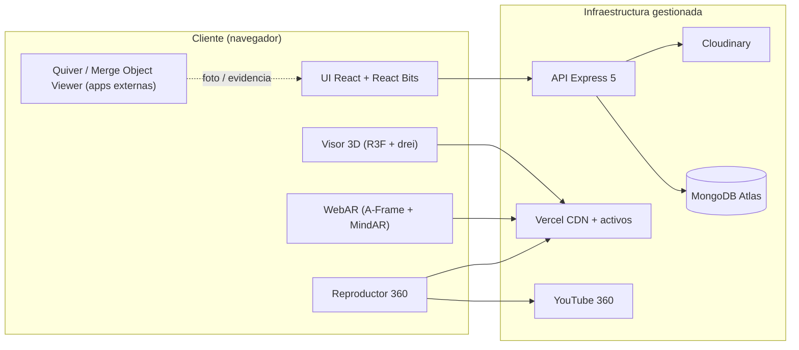
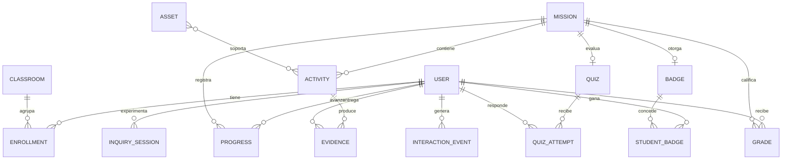

# Laboratorio 360 — Plan estratégico de desarrollo de software

> **Proyecto:** aplicación web educativa de indagación y gamificación sobre la célula para 5.º de primaria.
> **Stack objetivo:** React (frontend) · Node.js + Express (backend) · MongoDB (base de datos).
> **Versión:** 1.0 · **Fecha:** 11 de noviembre de 2026 · **Estado:** propuesta para validación con el equipo pedagógico y técnico.
> **Insumos analizados:** `instrucciones.txt`, `Estrategia Indagación.docx`, `GUIA_TECNICA_OPENCODE.pdf` y los referentes `plataforma Gira` y `sistema circulatorio`.
> **Entregable:** plan de producto, arquitectura, experiencias interactivas, contenido, calidad, cronograma y riesgos.

---

## Contenido

1. [Resumen ejecutivo](#1-resumen-ejecutivo)
2. [Análisis de insumos y referentes](#2-análisis-de-insumos-y-referentes)
3. [Visión, usuarios y alcance](#3-visión-usuarios-y-alcance)
4. [Experiencia de aprendizaje y gamificación](#4-experiencia-de-aprendizaje-y-gamificación)
5. [Diseño de experiencias interactivas](#5-diseño-de-experiencias-interactivas)
6. [Arquitectura técnica](#6-arquitectura-técnica)
7. [Contenido y activos 1-1-1-1](#7-contenido-y-activos-1-1-1-1)
8. [Calidad, accesibilidad y seguridad](#8-calidad-accesibilidad-y-seguridad)
9. [Roadmap, equipo y presupuesto de esfuerzo](#9-roadmap-equipo-y-presupuesto-de-esfuerzo)
10. [Riesgos y mitigaciones](#10-riesgos-y-mitigaciones)
11. [KPIs y criterios de éxito](#11-kpis-y-criterios-de-éxito)
12. [Decisiones, supuestos y preguntas abiertas](#12-decisiones-supuestos-y-preguntas-abiertas)
13. [Anexos](#13-anexos)

---

## 1. Resumen ejecutivo

**Laboratorio 360** será una aplicación web para estudiantes de 5.º de primaria que convierte la estrategia de indagación sobre la célula en tres misiones gamificadas. Cada misión combina observación de videos 360, manipulación de modelos 3D, realidad aumentada con Cubo Merge, actividades con Quiver, lectura, evidencia y un reto final. El objetivo no es reemplazar al docente, sino darle un laboratorio digital inmersivo, con evidencia trazable y un panel para acompañar el aprendizaje.

La aplicación se construirá con el stack solicitado —**React** en el frontend, **Node.js + Express** en el backend y **MongoDB** como base de datos— y tomará lo mejor de los dos referentes analizados:

- De **Gira**: el flujo de misión en tres fases, la gamificación con insignias y trofeos, la implementación probada de **WebAR con A-Frame + MindAR** sobre las seis caras del Cubo Merge, la estación de **Quiver** con evidencia fotográfica, el sistema de turnos para aulas con pocos dispositivos y el panel de resultados.
- De **Sistema Circulatorio**: la arquitectura **React + Vite + React Three Fiber**, el visor 3D con etiquetas y líneas de flujo, el lenguaje de **controles navegables** (estados predefinidos, sliders, métricas, gráficas, botones de registro), los carruseles de actividades con evidencia autoguardada y la evaluación con calificación del lado del servidor.

La estrategia pedagógica se organiza en tres misiones con sus insignias: **Explorador Celular**, **Constructor del Conocimiento Celular** y **Guardián de la Energía Celular**. La guía técnica aporta la regla **1-1-1-1** —un modelo 3D manipulable, una animación 3D, un Cubo Merge AR y una animación 2D con React Bits por unidad— y un modelo de datos para el laboratorio físico de la papa, que se conserva como **reto optativo de ósmosis** dentro de la tercera misión.

El alcance del MVP es: tres misiones completas, autenticación y roles, progreso secuencial, insignias y XP, visor 3D, reproductor 360, WebAR del Cubo Merge, estación Quiver, quizzes, evidencia, panel docente y reportes básicos. La estimación es de **14 semanas** con un equipo de 8 a 9 personas en el pico (incluida la producción de activos), o de 18 a 20 semanas con un equipo de 6 a 7 personas. La decisión técnica más importante es adoptar un modelo **híbrido de realidad aumentada**: WebAR embebida para el Cubo Merge y apps externas (Quiver y Merge Object Viewer) cuando aporten valor, con evidencia capturada dentro de la plataforma.

| Decisión clave | Recomendación |
|---|---|
| Alcance pedagógico | 3 misiones de la estrategia + laboratorio de ósmosis optativo |
| Frontend | React 19 + Vite + React Router + React Three Fiber |
| Backend | Node.js 22 + Express 5 + Mongoose 9 |
| Base de datos | MongoDB Atlas |
| RA | Híbrida: WebAR con A-Frame + MindAR + apps externas Quiver/Merge |
| Video 360 | YouTube 360 para el MVP; HLS autoalojado en fase 2 |
| Contenido | Misiones y quizzes en MongoDB, sembrados desde JSON versionado |
| Gamificación | Insignias, XP y desbloqueo secuencial; sin ranking público |
| Evaluación | Quiz 60 % + evidencia 40 %, configurable; escala MEN |
| Hosting | Vercel (frontend) + Render o Railway (backend) + Atlas + Cloudinary |

---

## 2. Análisis de insumos y referentes

### 2.1 Instrucciones y estrategia de indagación

El archivo de instrucciones define una experiencia de **gamificación con videos 360**, tres sesiones y una insignia por conquistar. La estrategia detalla el tema, los subtemas, la actividad, los recursos y el producto esperado. La siguiente tabla resume la trazabilidad pedagógica:

| Sesión | Tema principal | Actividad clave | Recursos | Evidencia | Insignia |
|---|---|---|---|---|---|
| S1. ¡Misión microscópica! | Teoría celular | Responder qué tienen en común todos los seres vivos; ver video y lectura; argumentar dos ideas importantes | Video de YouTube, lectura, plataforma | Respuesta argumentada en la plataforma | 🏅 Explorador Celular |
| S2. ¡Misión celular! | Concepto de célula, partes y funciones | Comparar célula animal y vegetal; colorear plantillas y proyectarlas con Quiver; identificar semejanzas y diferencias | Video 360, app Quiver, plantillas de célula vegetal y animal, plataforma | Registro fotográfico de Quiver + comparación | Constructor del Conocimiento Celular |
| S3. ¡Misión energía! | Metabolismo celular, catabolismo y estructuras | Explicar cómo obtienen energía las células; elaborar infografía en Canva; superponer la célula vegetal con el Cubo Merge; completar tabla de estructuras | Video 360 de fábrica, lectura, Canva, Cubo Merge, plataforma | Enlace de Canva + tabla de estructuras y funciones | Guardián de la Energía Celular |

**Implicaciones directas para el software:** se necesita un reproductor de video 360 con capítulos y preguntas; un visor 3D con manipulación y anotaciones; una estación Quiver con captura de evidencia; una experiencia WebAR del Cubo Merge; un editor de evidencia con texto, imagen y enlace; un motor de quizzes con retroalimentación; y un sistema de insignias con desbloqueo secuencial.

La estrategia también revela un principio importante: **cada misión debe cerrar con una producción del estudiante**, no solo con consumo de contenido. Esa producción es la que alimenta la evaluación formativa y el panel docente.

### 2.2 Guía técnica: qué se adopta y qué se adapta

La guía técnica “Laboratorio 360 Junior” es un documento de ingeniería para 5.º de primaria. Sus aportes principales son:

- **Arquitectura MERN** con React, Node/Express y MongoDB.
- **Regla 1-1-1-1 por unidad**: un modelo 3D manipulable, una animación 3D, un Cubo Merge AR y una animación 2D con React Bits.
- **Esquema Mongoose `InquirySession`** para registrar el experimento físico de la papa: vaso, longitud inicial y final, flexibilidad, hipótesis, explicación, exploración del cubo y calificación docente con escala MEN.
- **Endpoints REST esenciales** para guardar el laboratorio, consultar el progreso, ver el muro colectivo del aula y calificar.
- **Pipeline de activos**: modelos GLB low-poly, peso total menor a 12 MB, componentes React Bits concretos (`SpotlightCard`, `ElasticSlider`, `ParticlesBackground`, `AnimatedList`) y librerías `three`, `@react-three/fiber`, `@react-three/drei`, `framer-motion`, `clsx`, `tailwind-merge` y `lucide-react`.

Para este proyecto la guía se usa como **referencia de arquitectura y de estándares de activos**, no como contenido literal. El experimento de la papa se conserva como **reto optativo de ósmosis** en la misión 3, porque encaja con el metabolismo y el movimiento de agua, pero la columna vertebral son las tres sesiones de la célula. El esquema `InquirySession` se mantiene para ese reto, y el resto del modelo de datos se adapta a misiones, actividades, evidencias, quizzes e insignias.

| Elemento de la guía | Uso en este proyecto |
|---|---|
| Regla 1-1-1-1 | Se aplica a las tres misiones, con un inventario por misión |
| Esquema `InquirySession` | Se conserva para el laboratorio optativo de la papa |
| Endpoints de laboratorio | Se adaptan a `/api/v1/inquiry/...` |
| Modelos GLB low-poly | Se adoptan con presupuesto de peso y triángulos |
| React Bits | Se usan como capa de animación 2D con propósito pedagógico |
| Escala MEN | Se usa para la calificación docente de evidencias |
| MERN | Se adopta como arquitectura base |

### 2.3 Referente Gira: AR, Quiver, Cubo Merge y gamificación

**Arquitectura observada.** Gira es una SPA en **Angular 16** con backend **Express 5 + Mongoose 9** sobre MongoDB. El contenido de las misiones vive en un único archivo `sessions-config.ts` (`GIRA_SESSIONS`) que define tema, subtemas, fases, preguntas, entregables, recursos, gamificación y criterios. El frontend se despliega en Vercel y el backend en Render.

**Flujo pedagógico.** Cada una de las 10 misiones se organiza en tres fases —Inicio, Desarrollo y Cierre— y reutiliza los mismos componentes (`LabInicio`, `LabDesarrollo`, `LabCierre`) parametrizados por `sesionId`. En Inicio se presenta la narrativa, el video y las preguntas de saberes previos; en Desarrollo se realizan las actividades con la tecnología (QR, Cubo Merge, Quiver, Actionbound, Arloopa); en Cierre se reflexiona, se sube evidencia y se completa el quiz.

**Implementación de RA.** Gira implementa una RA web propia para el Cubo Merge con **A-Frame + MindAR**:

- Las seis caras del cubo impreso se rastrean por **image tracking** desde un archivo `targets.mind`.
- Cada cara se asocia a un modelo GLB o a primitivas de A-Frame; la escena se monta en un overlay a pantalla completa.
- Se controla la escala y posición del modelo con un `Box3` de Three.js; se agregan zoom con rueda y pinza, HUD de diagnóstico, eventos `targetFound`/`targetLost`, y una limpieza cuidadosa de la cámara y de los recursos al salir.
- Las librerías se sirven localmente (`aframe.min.js`, `mindar-image-aframe.prod.js`, `aframe-extras.min.js`) para evitar fallos de CDN en móviles.
- **Quiver no está embebido**: Gira entrega plantillas imprimibles, enlaces a la app y documenta el paso a paso; la evidencia se sube a la plataforma. Lo mismo ocurre con **Merge Object Viewer** cuando se usa la app externa.

**Gamificación.** Gira otorga trofeos y coleccionables con upserts idempotentes, medallas por precisión, trofeos por parejas de misiones y XP por misión (150 XP; nivel cada 300 XP). El progreso se guarda en localStorage por usuario y se fusiona con el backend, desbloqueando la siguiente misión. Es una referencia muy valiosa de mecánicas, pero también de complejidad: la lógica de fusión local/remoto y los totales hardcodeados son una fuente de deuda técnica.

**Evidencia y evaluación.** El modelo `Participation` guarda texto, imagen y URL de Canva; `EvaluationResult` guarda intentos, puntaje y respuestas; el docente califica con escala MEN y la nota final combina quiz (60 %) y participación (40 %). El sistema de turnos permite que el docente sortee estudiantes, asigne temas y controle quién usa el dispositivo o el cubo en cada momento.

**Qué adoptar de Gira:**

- El flujo de tres fases y la narrativa de misión.
- La RA web con A-Frame + MindAR para el Cubo Merge.
- La estación Quiver con evidencia fotográfica y enlace a la app.
- El sistema de insignias, XP y desbloqueo secuencial.
- El panel de resultados y el sistema de turnos.
- La separación entre contenido, evidencia, evaluación y gamificación.

**Qué evitar de Gira:**

- Archivos monolíticos de más de 3 000 líneas, con plantillas HTML de tamaño similar; en React se deben dividir por dominio y por experiencia.
- Totales y contenidos hardcodeados (por ejemplo, `TOTAL_LABS = 5` cuando hay 10 misiones).
- Contraseñas en texto plano y ausencia de JWT en el backend; el nuevo proyecto debe usar hash y autenticación robusta.
- Depender de una sola fuente de verdad en el frontend sin versionado de contenido.
- Rankings públicos o comparaciones que puedan afectar a menores.

### 2.4 Referente Sistema Circulatorio: animaciones y controles navegables

**Arquitectura observada.** Es una SPA en **React 19 + Vite 8** con **React Three Fiber 9**, `@react-three/drei`, `three`, `recharts`, `framer-motion`, `gsap` y React Router 7. El backend es **Express 5 + Mongoose 9** con **JWT**, `bcryptjs` y roles `student`, `teacher` y `admin`.

**Flujo de laboratorio.** Cada laboratorio usa un `SimulationWrapper` con pestañas **Inicio / Desarrollo / Cierre**. El simulador se muestra dentro de Desarrollo; el cierre lleva a la evaluación. En Inicio se presenta un video, un diagrama anatómico interactivo (`OrganDiagram`) y un carrusel de preguntas; en Desarrollo se combinan el simulador, carruseles de preguntas por lineamiento y evidencias autoguardadas; en Cierre se realiza el examen.

**Visor 3D y animaciones.** `ModelViewer` y `ModelWithLabels` cargan un GLB, normalizan su escala con `Box3`, lo centran y lo animan con `useAnimations` y un `mixer`. Soportan tres modos:

- `animation`: reproduce el clip del GLB y ajusta la velocidad con `timeScale`.
- `breathe`: escala el modelo con un ciclo respiratorio.
- `pulse`: escala el modelo con un pulso cardíaco.

Además, `ModelWithLabels` agrega etiquetas HTML ancladas al modelo (`Html` de drei) y líneas de flujo animadas (`Line` con `dashOffset`). Es una base directamente reutilizable para el visor celular.

**Lenguaje de controles navegables.** El referente demuestra un patrón muy claro:

- **Estados predefinidos** (Normal, Descansado, Agitado, Nervioso, Hipotensión, Hipertensión) que cambian el modelo, las métricas y las gráficas.
- **Sliders** de frecuencia cardíaca, presión sistólica, frecuencia respiratoria, oxígeno, CO₂, PEEP, compliance y demanda de O₂, conectados a la animación 3D.
- **Métricas** en tarjetas (frecuencia, presión, gasto cardíaco) con categorías de color.
- **Gráficas** de línea y área con zonas de referencia, umbrales y botones “Registrar punto” y “Limpiar gráfica”.
- **Audio** de latidos, monitor ECG y leyendas.
- **Diagramas anatómicos** con etiquetas al pasar el mouse.
- **Carruseles** de preguntas con `EvidenciaTextarea` autoguardado.
- **Evaluación** con preguntas de selección simple y múltiple, calificada en el servidor.

**Qué adoptar del Sistema Circulatorio:**

- La arquitectura React + Vite + R3F, que es exactamente el stack del nuevo proyecto.
- El visor 3D con normalización, etiquetas, líneas de flujo y modos de animación.
- El patrón de estados + sliders + métricas + gráficas + evidencia.
- El `SimulationWrapper` con pestañas y el carrusel de actividades.
- La evaluación calificada en el servidor y el manejo de intentos.
- Los modelos `Progress`, `Exam`, `Evidencia` e `InteractionLog`, y el middleware JWT con roles.

**Qué adaptar:**

- Los controles de órganos se convierten en controles celulares: agua, luz, nutrientes, temperatura, tipo de célula y estado de turgencia.
- Las métricas cardíacas se convierten en ATP, agua en la vacuola, oxígeno y dióxido de carbono.
- El diagrama anatómico se convierte en diagrama celular y en hotspots 3D.
- El carrusel de lineamientos se convierte en pasos de indagación: preguntar, explorar, explicar, aplicar y reflexionar.

**Qué evitar:**

- Contenido pendiente o simulado sin validación pedagógica.
- Depender solo de sliders: para 5.º de primaria se necesitan estados predefinidos, botones grandes y explicaciones cortas.
- Modelos 3D sin presupuesto de rendimiento para tablets.
- Dejar la evaluación únicamente en el cliente.

### 2.5 Síntesis: adoptar, adaptar y evitar

| Categoría | Decisiones |
|---|---|
| **Adoptar** | React + Vite + R3F; JWT con roles; misiones configurables; tres fases; gamificación con insignias; turnos de aula; evidencia con texto/imagen/enlace; RA web con MindAR; reproductor 360; estación Quiver; evaluación en servidor; gráficas y métricas. |
| **Adaptar** | La RA de Gira (Angular) a un componente React con ciclo de vida y limpieza; las 10 misiones de Gira a 3 misiones celulares; los controles de órganos a controles celulares; la regla 1-1-1-1 y el esquema `InquirySession` de la guía al contenido de la célula; el modelo de progreso local/remoto a un progreso autoritativo en servidor con caché optimista. |
| **Evitar** | Archivos monolíticos; contenido y totales hardcodeados; contraseñas sin hash; progreso solo en localStorage; dependencia de CDN para RA; activos sin licencia; rankings públicos; rutas legacy duplicadas; evaluación solo en cliente. |

---

## 3. Visión, usuarios y alcance

### 3.1 Problema y oportunidad

La célula es un concepto abstracto para estudiantes de 10 y 11 años. Los libros de texto muestran dibujos planos, y muchas veces la evaluación se limita a memorizar partes. La estrategia de indagación ya propone una respuesta pedagógica sólida: partir de preguntas, observar, manipular, comparar y explicar. La oportunidad de software es **darle cuerpo digital a esa secuencia** con experiencias que no se pueden lograr en un cuaderno: un video 360, una célula que se gira y se desarma, un cubo que se convierte en modelo 3D y una plantilla que cobra vida con Quiver.

Al mismo tiempo, el docente necesita **visibilidad**: quién avanzó, qué evidencia produjo, en qué se equivocó y cómo acompañar. Sin esa capa, la experiencia inmersiva se queda en una actividad aislada. Por eso el producto tiene dos caras: una experiencia motivadora para el estudiante y un panel de control pedagógico para el docente.

### 3.2 Propuesta de valor

**“Observa, manipula y explica la célula como un científico.”**

Laboratorio 360 combina tres lenguajes de representación —video 360, 3D/AR y escritura/evidencia— para que el estudiante pase de mirar a comprender. La plataforma:

- Convierte cada sesión de la estrategia en una **misión con narrativa, reto e insignia**.
- Da al estudiante **control real** sobre el modelo 3D (girar, zoom, capas, desarme, estados) y sobre el Cubo Merge.
- Integra **Quiver** sin fricción: plantilla, instrucciones, captura de foto y rúbrica.
- Permite **evidenciar** el aprendizaje con texto, imagen, enlace de Canva o datos de laboratorio.
- Le da al docente un **tablero de progreso** y un flujo de revisión con retroalimentación.
- Funciona en **tablets y computadores escolares**, con un modo de aula que contempla dispositivos compartidos.

### 3.3 Usuarios y roles

| Rol | Contexto | Necesidades | Permisos principales |
|---|---|---|---|
| **Estudiante** | 10-11 años, 5.º de primaria; usa tablet o computador compartido; puede tener baja familiaridad con la tecnología | Instrucciones cortas, íconos, audio, botones grandes, retroalimentación inmediata, saber siempre qué sigue | Ver misiones asignadas; realizar actividades; guardar evidencia; presentar quizzes; ver sus insignias y progreso |
| **Docente** | Facilita la sesión; 30-35 estudiantes; puede tener conectividad limitada | Crear o unirse a un aula; ver avance; revisar evidencias; calificar; controlar turnos; exportar reportes | Gestionar sus aulas; ver progreso de sus estudiantes; revisar evidencias; calificar con escala MEN; habilitar misiones; moderar el muro del aula |
| **Administrador / coordinador** | Gestiona usuarios, contenido y analítica institucional | Importar usuarios; asignar docentes y aulas; publicar contenido; monitorear uso; resolver incidentes | CRUD de usuarios y aulas; CRUD de misiones, quizzes y activos; feature flags; reportes globales; auditoría |
| **Familia (opcional, fase 2)** | Acompaña desde casa | Ver el avance y las insignias del estudiante | Solo lectura del progreso autorizado; sin acceso a datos de otros estudiantes |

**Decisión de diseño:** los estudiantes no se registran solos. El docente o el administrador crea las cuentas y entrega un código de acceso. Esto reduce el riesgo de datos personales de menores y simplifica el ingreso en el aula.

### 3.4 Objetivos SMART

| Objetivo | Métrica | Meta | Plazo |
|---|---|---|---|
| Completar la experiencia piloto | % de estudiantes que terminan al menos 2 de las 3 misiones | ≥ 80 % | Fin del piloto |
| Mejorar la comprensión conceptual | Promedio del quiz final por misión | ≥ 70 % | Fin de cada misión |
| Documentar el aprendizaje | % de estudiantes que suben al menos una evidencia por misión | ≥ 90 % | Fin de cada misión |
| Facilitar la adopción docente | % de docentes que usan el panel al menos una vez por semana | ≥ 80 % | Mes 1 post-lanzamiento |
| Lograr una experiencia usable | Puntaje SUS (System Usability Scale) | ≥ 70 | Fin del piloto |
| Asegurar rendimiento | LCP en 4G; FPS en tablet; tasa de éxito de RA | < 2.5 s; ≥ 30 FPS; ≥ 85 % | Antes del lanzamiento |
| Reducir la fricción técnica | % de sesiones sin errores bloqueantes | ≥ 99 % | Antes del lanzamiento |

### 3.5 Principios de diseño

1. **Indagación antes que respuesta.** Cada misión empieza con una pregunta y termina con una explicación del estudiante.
2. **Concreto antes que abstracto.** Primero se observa y manipula; después se nombra y se define.
3. **Una cosa a la vez.** Pantallas limpias, una acción principal por paso, instrucciones de máximo dos líneas.
4. **Control visible.** El estudiante siempre sabe dónde está, qué completó y qué sigue.
5. **Aprender haciendo.** El 3D, el AR y Quiver no son adornos: cada interacción debe tener una intención pedagógica.
6. **Evidencia con propósito.** No se sube evidencia por subirla; cada evidencia responde a una pregunta o demuestra una habilidad.
7. **Docente aumentado, no reemplazado.** La plataforma sugiere, registra y organiza; el docente decide y acompaña.
8. **Accesible por defecto.** Contraste, texto alternativo, subtítulos, teclado, movimiento reducido y audio.
9. **Baja fricción técnica.** Carga rápida, modo ligero, instrucciones de cámara claras y alternativas cuando el dispositivo no soporta AR.
10. **Privacidad de menores por diseño.** Datos mínimos, cuentas creadas por el docente, sin perfiles públicos ni rankings.
11. **Contenido científico confiable.** Revisión de un experto y citas en la guía docente.
12. **Sostenible.** Contenido versionado, activos con licencia y documentación para que otro equipo pueda mantenerlo.

### 3.6 Alcance: MVP, fase 2 y fuera de alcance

| Prioridad | Incluye | No incluye |
|---|---|---|
| **Must (MVP)** | 3 misiones; autenticación y roles; aulas; progreso secuencial; insignias y XP; visor 3D; reproductor 360; WebAR del Cubo Merge; estación Quiver; quizzes; evidencia; panel docente; reportes básicos; diseño responsive; accesibilidad AA básica | — |
| **Should (fase 1.5)** | Muro del aula con evidencias aprobadas; sistema de turnos; exportación CSV/PDF; notificaciones; modo de bajo ancho de banda; narración por audio; analítica de interacción | — |
| **Could (fase 2)** | Laboratorio de ósmosis con la papa; PWA offline; gamificación por equipos; retroalimentación asistida por IA; integración con LMS; múltiples colegios; aplicación móvil nativa | — |
| **Won't (por ahora)** | Red social; chat entre estudiantes; videoclases; realityos 3D con SLAM; realidad virtual con visores; mercado de contenidos; ranking público | — |

---

## 4. Experiencia de aprendizaje y gamificación

### 4.1 Narrativa y mapa de misiones

El estudiante ingresa a la **Laboratorio 360**, un equipo de exploradores científicos que investiga lo invisible. Su guía es **Cito**, una mascota amigable con forma de mitocondria que hace preguntas, celebra los avances y recuerda las pistas. Cada misión entrega una insignia y abre la siguiente estación del mapa.

| Momento | Narrativa | Insignia |
|---|---|---|
| Misión 1 | Llega una muestra misteriosa al laboratorio. Hay que descubrir de qué están hechos los seres vivos. | 🏅 Explorador Celular |
| Misión 2 | La muestra se abre: hay células animales y vegetales. Hay que descubrir sus partes y diferencias. | Constructor del Conocimiento Celular |
| Misión 3 | La célula es una fábrica que necesita energía. Hay que entender cómo la obtiene y cómo usa el agua y los nutrientes. | Guardián de la Energía Celular |
| Cierre | El estudiante presenta su bitácora y recibe el reconocimiento de “Científico Laboratorio 360”. | 🏆 Científico 360 (optativo) |

El mapa muestra tres nodos con estados **bloqueado / disponible / en progreso / completado**, una barra de XP y un anillo de progreso. Al completar una misión se desbloquea la siguiente; el docente puede habilitar manualmente una misión para atender ausencias o ritmos diversos.

### 4.2 Estructura de una misión

Todas las misiones comparten la misma estructura de tres fases, inspirada en Gira y en el `SimulationWrapper` del Sistema Circulatorio:

| Fase | Propósito | Actividades típicas | Producto |
|---|---|---|---|
| **Inicio** | Enganchar y activar saberes previos | Narrativa, pregunta grande, video 360 o video de apoyo, lectura corta, pregunta inicial | Respuesta inicial y predicción |
| **Desarrollo** | Explorar, manipular y explicar | Visor 3D, WebAR del Cubo Merge, estación Quiver, controles, comparaciones, tabla, infografía | Evidencia parcial y observaciones |
| **Cierre** | Consolidar y demostrar | Quiz, reflexión, evidencia final, insignia, recomendación de la siguiente misión | Evidencia final + insignia |

Cada fase tiene un **objetivo visible**, un **criterio de completitud** y un **botón de continuar** que solo se habilita cuando la actividad obligatoria está resuelta. Las actividades opcionales se marcan con un ícono de estrella y no bloquean el avance.

### 4.3 Las tres misiones

#### 4.3.1 Misión 1 — ¡Misión microscópica! Exploradores en busca de los secretos de la célula

- **Pregunta grande:** ¿De qué están hechos todos los seres vivos?
- **Objetivos:** reconocer que todos los seres vivos están formados por una o más células; identificar los postulados de la teoría celular; comprender que la célula es la unidad estructural y funcional; valorar el aporte de los científicos.
- **Inicio:** video 360 de inmersión en una gota de agua (microorganismos) + video “La extraña historia de la teoría celular” + lectura. Pregunta inicial: “¿Qué tienen en común una planta, un animal y una bacteria?”.
- **Desarrollo (1-1-1-1):**
  - **Modelo 3D manipulable:** `microscopio_celula.glb`, un microscopio low-poly con una placa que permite hacer zoom hasta una célula generalizada.
  - **Animación 3D:** “Zoom microscópico: del organismo a la célula”, con transición de cámara y aparición de los tres postulados.
  - **Cubo Merge AR:** “Cubo de la teoría celular”, con seis caras: Hooke, Leeuwenhoek, Schleiden y Schwann, Virchow, organismos unicelulares y organismos pluricelulares.
  - **Animación 2D React Bits:** `AnimatedList` para la línea de tiempo de los científicos y `SpotlightCard` para los postulados.
- **Cierre:** quiz de 6 preguntas con retroalimentación; evidencia “Identifica dos ideas de la lectura que consideras importantes para estudiar la biología y argumenta cada una”; reflexión corta.
- **Evidencia:** respuesta argumentada (texto) + resultado del quiz.
- **Insignia:** 🏅 Explorador Celular.
- **Duración estimada:** 1 sesión de 45-60 minutos.

#### 4.3.2 Misión 2 — ¡Misión celular! Descifrando el secreto de la unidad de la vida

- **Pregunta grande:** ¿Son iguales las células de nuestro cuerpo y las de una planta?
- **Objetivos:** identificar las partes principales de la célula y sus funciones; comparar célula animal y vegetal; usar Quiver para observar un modelo coloreado; construir la idea de célula como sistema.
- **Inicio:** video 360 “La célula y sus partes” + lectura + pregunta inicial: “¿Qué diferencias imaginan entre una célula animal y una vegetal?”.
- **Desarrollo (1-1-1-1):**
  - **Modelo 3D manipulable:** `celula_vegetal_kids.glb` y `celula_animal_kids.glb`, con conmutador entre ambos, capas, etiquetas y vista desarmada.
  - **Animación 3D:** “Comparación celular animal vs. vegetal”, con recorrido de cámara por organelos y resaltado secuencial.
  - **Cubo Merge AR:** “Cubo celular”, con seis caras: núcleo, membrana, citoplasma, cloroplasto, vacuola y pared celular.
  - **Animación 2D React Bits:** `SpotlightCard` para descubrir organelos y `ElasticSlider` para comparar tamaños o número de organelos.
  - **Estación Quiver:** imprimir, colorear y escanear las plantillas de célula vegetal y animal; subir foto y completar la tabla de semejanzas y diferencias.
- **Cierre:** quiz de 6-8 preguntas; evidencia fotográfica de Quiver + tabla comparativa; reflexión “¿Qué parte de la célula te sorprendió más y por qué?”.
- **Evidencia:** foto de Quiver + tabla comparativa + quiz.
- **Insignia:** Constructor del Conocimiento Celular.
- **Duración estimada:** 1-2 sesiones de 45-60 minutos.

#### 4.3.3 Misión 3 — ¡Misión energía! Descubriendo la fábrica de la vida celular

- **Pregunta grande:** ¿Cómo obtienen y usan la energía las células?
- **Objetivos:** explicar el metabolismo celular con lenguaje sencillo; relacionar mitocondrias, cloroplastos, vacuola, membrana y núcleo con las funciones vitales; comprender el movimiento de agua (ósmosis) y la turgencia; elaborar una infografía en Canva; usar el Cubo Merge para identificar estructuras.
- **Inicio:** video 360 “Fábrica de producción” + video 360 “Metabolismo celular” + lectura “El metabolismo celular: ¿Cómo obtienen y utilizan la energía las células?”. Pregunta inicial: “¿Qué pasaría si una fábrica dejara de recibir materiales o energía? ¿Pasaría algo parecido en nuestras células?”.
- **Desarrollo (1-1-1-1):**
  - **Modelo 3D manipulable:** `celula_energia_kids.glb`, con mitocondria, cloroplasto, vacuola y membrana; controles de agua, luz y nutrientes.
  - **Animación 3D:** “Plasmólisis y turgencia” (la vacuola se desinfla y la célula se arruga; al entrar agua dulce se re-infla) y “Producción de ATP” (la mitocondria late y libera energía).
  - **Cubo Merge AR:** “Cubo fábrica celular”, con seis caras: mitocondria, cloroplasto, vacuola, núcleo, membrana y citoplasma; cada cara muestra su función en la fábrica.
  - **Animación 2D React Bits:** `ParticlesBackground` para representar ATP, agua y CO₂ en movimiento; `AnimatedList` para los pasos del metabolismo.
  - **Actividad Canva:** infografía con las respuestas a “¿De qué manera las células vegetales y animales llevan a cabo sus actividades para conservar la vida?” y “¿Cómo se llama el proceso mediante el cual las células adquieren energía y eliminan desechos?”.
  - **Tabla de estructuras:** membrana celular, cloroplastos, mitocondrias, citoplasma, vacuola central y núcleo, con su función principal.
- **Cierre:** quiz de 6-8 preguntas; evidencia con enlace de Canva + tabla + reflexión; insignia.
- **Evidencia:** enlace de Canva + tabla de estructuras + quiz.
- **Insignia:** Guardián de la Energía Celular.
- **Duración estimada:** 1-2 sesiones de 45-60 minutos.

#### 4.3.4 Reto optativo — Laboratorio de ósmosis con papa

Este reto recupera el experimento de la guía técnica y lo integra como extensión de la misión 3. El estudiante coloca bastones de papa en tres vasos —agua pura, poca sal y mucha sal—, mide longitud y flexibilidad antes y después, formula una hipótesis y explica el resultado con el concepto de ósmosis. La plataforma registra los datos en `InquirySession`, permite marcar si exploró el Cubo Merge y el docente califica con escala MEN. Es ideal para una sesión de laboratorio real, pero no bloquea la insignia principal.

### 4.4 Sistema de gamificación

La gamificación debe motivar sin presionar. Para 5.º de primaria se prioriza el **progreso visible**, la **maestría** y la **celebración**, no la competencia pública. Las **tres insignias principales** son las de las misiones; el reconocimiento final y la insignia de “Persistente” son complementos opcionales que no alteran la ruta.

| Insignia | Criterio de obtención | Momento de entrega |
|---|---|---|
| 🏅 Explorador Celular | Completar las actividades obligatorias de la misión 1 y obtener ≥ 70 % en el quiz | Al cerrar la misión 1 |
| Constructor del Conocimiento Celular | Completar la misión 2, subir la foto de Quiver y aprobar la tabla comparativa y el quiz | Al cerrar la misión 2 |
| Guardián de la Energía Celular | Completar la misión 3, entregar el enlace de Canva y la tabla de estructuras, y aprobar el quiz | Al cerrar la misión 3 |
| 🏆 Científico Laboratorio 360 | Obtener las tres insignias y presentar la bitácora final | Al finalizar la ruta |

**Reglas de XP y niveles:**

- 150 XP por misión: 100 por completar las actividades, 30 por el quiz y 20 por la evidencia.
- 50 XP adicionales por insignia obtenida.
- Nivel cada 300 XP. El nivel se muestra como una barra y un avatar de Cito que crece; no se usa para comparar estudiantes.
- Los quizzes se pueden repetir. Se conserva el mejor puntaje y se otorga una insignia de “Persistente” a partir del segundo intento, sin penalizar.
- El desbloqueo es secuencial, pero el docente puede habilitar misiones para estudiantes ausentes o con ritmo diferente.
- No hay ranking público. Si se quiere motivación social, se usa un **progreso de equipo** o un **muro de logros del aula**, siempre con evidencias aprobadas y sin exponer notas individuales.

**Celebración:** al obtener una insignia se muestra un modal con animación, confeti moderado (respetando `prefers-reduced-motion`), el nombre de la insignia, una frase de Cito y el botón “Ver mi siguiente misión”. La celebración dura menos de 5 segundos y se puede cerrar.

**Ética de la gamificación:** las insignias reconocen progreso, no sustituyen la nota. Se evita el lenguaje de “perder”, las rachas obligatorias y la presión por comparar. Los estudiantes pueden reintentar sin costo y recibir pistas.

### 4.5 Evidencia y evaluación

**Tipos de evidencia:**

- **Texto:** respuesta argumentada, reflexión, explicación.
- **Imagen:** foto del modelo Quiver, del Cubo Merge o del experimento.
- **Enlace:** infografía de Canva u otro recurso validado.
- **Datos de laboratorio:** medidas, observaciones y conclusiones del reto de ósmosis.

La evidencia se guarda como borrador de forma automática, se envía cuando el estudiante la considera completa y queda en estado **pendiente de revisión**. El docente puede aprobarla, pedir ajustes o calificarla. El estudiante ve el comentario y puede corregir.

**Rúbrica de evidencia con escala MEN:**

| Nivel | Descripción | Ejemplo en la misión 2 |
|---|---|---|
| **Bajo** | Respuesta incompleta, sin vocabulario científico o sin relación con la pregunta | Nombra una parte sin explicar su función |
| **Básico** | Identifica algunas partes o ideas, con explicación parcial | Menciona tres organelos y una diferencia |
| **Alto** | Explica con vocabulario correcto, ejemplos y relación estructura-función | Compara célula animal y vegetal con cuatro diferencias claras |
| **Superior** | Conecta conceptos, usa evidencia, propone analogías o aplicaciones | Explica la célula como sistema y relaciona el Cubo Merge con la función de cada organelo |

**Quiz:** 6-8 preguntas por misión, con selección múltiple, apareamiento, ordenamiento y identificación de hotspots en el modelo 3D. La clave de respuestas vive solo en el servidor. La retroalimentación explica por qué la respuesta correcta lo es. La nota de aprobación es 70 %, con intentos ilimitados y mejor puntaje.

**Ponderación por defecto:** quiz 60 % + evidencia 40 %. El docente puede ajustar los pesos por período. La nota final se expresa en escala MEN y se exporta al reporte del aula.

### 4.6 Panel docente

El panel docente es el corazón pedagógico del producto. Debe ser simple, rápido y útil en el aula:

- **Aulas:** crear un aula, generar un código de ingreso, importar estudiantes desde CSV y asignar misiones.
- **Tablero:** matriz de estudiantes por misión, estado de avance, promedio de quiz, evidencias pendientes, tiempo de actividad y uso de AR/3D.
- **Revisión de evidencias:** previsualizar texto, foto y enlace; calificar con escala MEN; escribir retroalimentación; aprobar o pedir ajustes.
- **Reportes:** filtrar por aula, período y misión; exportar CSV y PDF; ver preguntas con mayor tasa de error.
- **Muro del aula:** evidencias aprobadas en formato de lista animada, con nombre del estudiante o seudónimo.
- **Turnos:** iniciar una sesión de rotación, sortear el orden, mostrar el turno actual, asignar temas y avanzar. Útil cuando hay pocos dispositivos, un solo Cubo Merge o una estación Quiver.
- **Alertas:** estudiantes sin actividad, evidencias pendientes, quizzes con bajo desempeño.
- **Vista previa:** el docente puede recorrer la misión como estudiante antes de asignarla.

### 4.7 Accesibilidad y equidad

- **WCAG 2.1 AA:** contraste, foco visible, navegación por teclado, etiquetas ARIA, texto alternativo.
- **Contenido multimodal:** subtítulos y transcripción para videos; narración de audio opcional; glosario visual; instrucciones escritas y en audio.
- **Movimiento reducido:** respetar `prefers-reduced-motion`; desactivar confeti, auto-rotación y animaciones intensas.
- **Táctil y teclado:** botones de mínimo 44 × 44 px; controles de 3D accesibles con flechas, +/– y R para reiniciar.
- **Bajo ancho de banda:** video 720p por defecto en redes lentas, carga diferida de 3D/AR, posters y transcripciones; PDFs de Quiver descargables para usar sin internet.
- **Dispositivos compartidos:** modo de turnos, cierre de sesión rápido, perfiles con avatar y código, no datos personales visibles.
- **Diversidad:** nombres y ejemplos inclusivos; evitar estereotipos de género o procedencia; lenguaje claro y respetuoso.

---

## 5. Diseño de experiencias interactivas

### 5.1 Patrón “laboratorio navegable”

El referente del Sistema Circulatorio demuestra que el aprendizaje ocurre cuando el estudiante **cambia algo y observa la respuesta**. Laboratorio 360 adopta ese patrón y lo adapta a la célula:

```text
┌──────────────────────────────────────────────────────────────┐
│ Encabezado: misión · fase · progreso · audio · ayuda         │
├──────────────────────────────────────────────────────────────┤
│ Escenario: visor 3D / video 360 / cámara AR                  │
│                                                              │
├───────────────────────────────┬──────────────────────────────┤
│ Panel de controles            │ Panel de datos               │
│ estados · sliders · capas     │ métricas · gráfica · pistas  │
├───────────────────────────────┴──────────────────────────────┤
│ Bitácora: pregunta · respuesta · evidencia · guardar         │
├──────────────────────────────────────────────────────────────┤
│ Atrás · Paso X de Y · Continuar                              │
└──────────────────────────────────────────────────────────────┘
```

Este layout se implementa una sola vez como `LabShell` y se reutiliza en las tres misiones. En móvil, el escenario ocupa la parte superior, los controles se convierten en una hoja inferior y la bitácora se abre en un panel deslizante.

### 5.2 Lenguaje de controles navegables

| Control | Acción del estudiante | Respuesta del sistema | Implementación | Intención pedagógica |
|---|---|---|---|---|
| **Estados predefinidos** | Elegir “Célula animal”, “Célula vegetal”, “Célula con poca agua”, “Célula con mucha luz” | Cambia el modelo, los organelos visibles y las métricas | Zustand + parámetros del visor | Comparar y contrastar sin perderse en sliders |
| **Slider de agua** | Aumentar o reducir el agua disponible | La vacuola se infla o se desinfla; aparece la plasmólisis | `useFrame` + escala de la vacuola | Comprender ósmosis y turgencia |
| **Slider de luz** | Aumentar o reducir la luz | El cloroplasto brilla y aumenta la producción de glucosa/ATP | Emisivo + métricas | Relacionar luz y fotosíntesis |
| **Slider de nutrientes** | Ajustar glucosa y oxígeno | La mitocondria late más o menos y cambia el ATP | `useFrame` + mezcla de animación | Relacionar nutrientes y energía |
| **Play / pause / velocidad** | Reproducir, pausar, ir más rápido o más lento | La animación se detiene o cambia de ritmo | `useAnimations` + `mixer.timeScale` | Observar procesos paso a paso |
| **Línea de tiempo** | Arrastrar para ir a un momento del proceso | El modelo muestra el estado en ese instante | Clip + scrub | Secuenciar el metabolismo |
| **Capas** | Mostrar u ocultar membrana, citoplasma, núcleo, organelos | Se ocultan o resaltan estructuras | `visible` por grupo | Enfocar la atención |
| **Vista desarmada** | Separar los organelos | Los organelos se desplazan y se ven por separado | Interpolación de posiciones | Entender la organización espacial |
| **Hotspots** | Tocar un organelo | Se abre una tarjeta con nombre, función y dato curioso | Raycasting + `Html` | Vocabulario y función |
| **Comparar** | Ver célula animal y vegetal lado a lado | Dos visores sincronizados | Dos `Canvas` o un `group` con dos modelos | Identificar semejanzas y diferencias |
| **Cámara** | Elegir vista general, núcleo, mitocondria, cloroplasto | La cámara se anima al punto de interés | `lerp` de posición y target | Observación guiada |
| **Reiniciar / pantalla completa** | Volver al estado inicial o ampliar | Restaura cámara, capas y zoom | Store + Fullscreen API | Usabilidad |
| **AR: caras del cubo** | Girar el cubo físico frente a la cámara | Cada cara muestra un organelo o concepto | A-Frame + MindAR | Manipulación tangible |
| **Registrar observación** | Guardar un punto de datos | Se agrega a la gráfica y a la bitácora | Recharts + store | Alfabetización de datos |

### 5.3 Visor 3D de la célula

**Modelos:**

- `microscopio_celula.glb` (misión 1): microscopio con placa y célula generalizada.
- `celula_vegetal_kids.glb` y `celula_animal_kids.glb` (misión 2): modelos comparables, con organelos separables.
- `celula_energia_kids.glb` (misión 3): mitocondria, cloroplasto, vacuola y membrana con animaciones.
- Modelos de organelos individuales para el Cubo Merge y los hotspots.

**Características:**

- Rotar, hacer zoom y desplazar con mouse, touch y teclado.
- Etiquetas activables, hotspots y tarjetas de información.
- Capas por estructura y vista desarmada.
- Modo comparación animal/vegetal.
- Estados predefinidos y sliders conectados a la animación.
- Línea de tiempo con play, pause, velocidad y scrub.
- Presets de cámara y botón de reinicio.
- Pantalla completa y modo oscuro para el laboratorio.
- Narración de audio opcional y texto alternativo.

**Implementación:**

- React Three Fiber + `@react-three/drei`: `useGLTF`, `useAnimations`, `OrbitControls`, `Html`, `Line`, `Environment`, `ContactShadows`, `Bounds`.
- Normalización con `Box3`: centrar el modelo y escalarlo a 4 unidades para que todos los modelos se vean consistentes.
- Carga con Draco o Meshopt; texturas WebP/KTX2; `Suspense` y `ErrorBoundary`.
- Estado del laboratorio en un store de Zustand (`useLabStore`) con `preset`, `layers`, `water`, `light`, `nutrients`, `playing`, `speed`, `cameraPreset`, `labels`, `exploded`.
- Animaciones procedurales con `useFrame` para vacuola, mitocondria y cloroplasto; clips GLB para secuencias complejas.
- `frameloop="demand"` cuando el modelo está inactivo para ahorrar batería; `PerformanceMonitor` para bajar `dpr` si el FPS cae.
- Raycasting para hotspots; `outline` o emisivo para resaltar el organelo seleccionado.

**Presupuesto de rendimiento:** menos de 8 MB por modelo comprimido, menos de 25 000 triángulos por modelo, una o dos materiales por modelo, texturas de 1024 px como máximo. En tablets escolares se apunta a 30 FPS estables.

**Accesibilidad:** además del mouse/touch, flechas para rotar, `+`/`-` para zoom, `R` para reiniciar, `L` para etiquetas y `Tab` para recorrer hotspots. Cada organelo tiene nombre accesible y descripción textual.

### 5.4 Reproductor de video 360

**Fuentes soportadas:**

- **YouTube 360 (recomendado para el MVP):** iframe con video unlisted; ventajas: adaptación de calidad, hosting gratuito y controles conocidos; límites: depende de YouTube y de la red escolar.
- **Video autoalojado (fase 2):** MP4 equirectangular o HLS con `hls.js`, servido desde CDN. Permite analítica de mirada y hotspots, pero exige más ancho de banda y producción.

**Interfaz:**

- Botón grande de reproducción, barra de progreso, tiempo, volumen, subtítulos y pantalla completa.
- Capítulos con marcadores (“Entra a la célula”, “Observa el núcleo”, “Compara la vacuola”).
- Hotspots 360: puntos anclados a coordenadas de la esfera que abren una tarjeta o una pregunta.
- Transcripción descargable y subtítulos WebVTT.
- Indicador de “video visto” cuando se alcanza el 80 % o el final.
- Fallback automático a video 2D con póster y transcripción si el dispositivo no soporta 360.

**Analítica:** `video_play`, `video_pause`, `video_seek`, `video_complete`, `hotspot_open`. No se almacena video ni audio del estudiante.

**Producción:** los videos deben ser cortos (2-4 minutos), con audio claro, subtítulos y una pregunta guía. Se recomienda grabar o animar en 4K equirectangular, pero publicar en 1080p para el MVP.

### 5.5 WebAR del Cubo Merge

**Estrategia híbrida:**

1. **WebAR embebida (recomendada):** el estudiante apunta la cámara al cubo impreso y ve el modelo 3D sobre cada cara, sin salir de la plataforma. Es la experiencia diferenciadora y permite registrar qué caras exploró.
2. **App externa Merge Object Viewer:** se ofrece como alternativa para dispositivos o redes que no soportan WebAR, con instrucciones y enlace a la tienda.
3. **Visor 3D de respaldo:** si no hay cámara o permiso, el estudiante puede girar un cubo virtual y seleccionar las caras manualmente.

**Especificación técnica:**

- A-Frame + MindAR con `imageTargetSrc` compilado desde las seis caras del cubo.
- Escena a pantalla completa, cámara trasera, `maxTrack: 1`, sin UI de VR, `embedded`.
- Cada cara (`targetIndex 0..5`) se asocia a un GLB o a una composición de primitivas.
- Normalización de escala con `Box3` y ajuste por cara; rotación y offset configurables.
- Zoom con rueda y pinza; botones de acercar/alejar; reset.
- HUD con estado: “Buscando cubo…”, “Cara 3 detectada”, “Mueve el cubo para explorar”, “Cámara no disponible”.
- Eventos `arReady`, `arError`, `targetFound`, `targetLost`; analítica por cara.
- Limpieza al salir: detener pistas de cámara, eliminar `<a-scene>`, liberar geometrías, materiales y texturas.
- Carga de librerías locales, no desde CDN; HTTPS obligatorio.
- Pruebas en iOS Safari y Android Chrome; impresión a escala, papel mate, buena iluminación.

**Calibración:** el cubo debe imprimirse al 100 % de escala, con las seis caras bien ensambladas. Se recomienda un cubo de 8-10 cm por lado. Las caras deben tener patrones únicos, alto contraste y bordes claros. Se debe probar la detección con el cubo en manos de un niño, a 20-40 cm de la cámara.

**Legal:** usar arte original o una plantilla con licencia. No redistribuir el arte oficial del Merge Cube sin autorización. Registrar la atribución en la página de créditos.

**Métricas:** `ar_start`, `ar_permission_denied`, `ar_target_found` (cara), `ar_face_explored`, `ar_target_lost`, `ar_exit`, `ar_error`. La meta es ≥ 85 % de sesiones AR exitosas en dispositivos soportados.

### 5.6 Estación Quiver

Quiver es una app externa de realidad aumentada para colorear. No se puede embeber, pero se puede integrar de forma fluida:

- **Página “Estación Quiver”:** instrucciones de 4 pasos, video corto, PDF imprimible de célula vegetal y animal, y botón “Ya tengo mi modelo”.
- **Checklist:** imprimir, colorear, escanear con Quiver, tomar foto, subir evidencia.
- **Captura:** `<input type="file" accept="image/*" capture="environment">` para tablets; compresión en cliente con `browser-image-compression` a menos de 2 MB; vista previa y recorte opcional.
- **Privacidad:** la foto debe mostrar el modelo o la plantilla, no la cara del estudiante; se eliminan metadatos EXIF (incluida geolocalización) antes de subir.
- **Rúbrica:** la foto debe mostrar el modelo coloreado, las estructuras identificables y una comparación escrita.
- **Alternativa:** si Quiver no está disponible, el estudiante puede usar el visor 3D y una plantilla para colorear en papel; la evidencia sigue siendo válida.

### 5.7 Animaciones 2D con React Bits

| Componente | Misión | Uso pedagógico | Accesibilidad |
|---|---|---|---|
| `AnimatedList` | M1 y M3 | Línea de tiempo de científicos; pasos del metabolismo | Navegable con teclado; sin auto-scroll agresivo |
| `SpotlightCard` | M1 y M2 | Postulados de la teoría celular; descubrimiento de organelos | Foco visible; texto alternativo |
| `ElasticSlider` | M2 | Comparar tamaño o número de organelos | Etiqueta, valor numérico y control por teclado |
| `ParticlesBackground` | M3 | ATP, agua y CO₂ en movimiento | Se desactiva con movimiento reducido; no interfere con la lectura |

Las animaciones se usan con moderación y siempre con una intención: explicar una secuencia, revelar información o comparar estados. No se usan como fondo decorativo constante en pantallas de lectura.

### 5.8 Laboratorio optativo de ósmosis

**Protocolo:**

1. Cortar bastones de papa de aproximadamente 5 cm (preferiblemente pre-cortados por el docente).
2. Preparar tres vasos: agua pura, agua con poca sal y agua con mucha sal.
3. Medir la longitud inicial y registrar la flexibilidad.
4. Esperar 30 minutos.
5. Medir la longitud final y registrar la flexibilidad.
6. Formular una hipótesis y una explicación final con el concepto de ósmosis.

**Datos que guarda la plataforma:** vaso seleccionado, longitud inicial, longitud final, flexibilidad observada, hipótesis, explicación final, si exploró el Cubo Merge y la calificación docente con escala MEN. Se usa el esquema `InquirySession` de la guía.

**Seguridad:** supervisión del docente, utensilios seguros, higiene de manos, no ingerir el experimento. Se puede adaptar con otros vegetales si hay alergias o restricciones.

---

## 6. Arquitectura técnica

### 6.1 Stack y versiones

| Capa | Tecnología | Versión recomendada | Justificación |
|---|---|---|---|
| Frontend | React | 19.x | Ecosistema, R3F 9 y componentes modernos |
| Bundler | Vite | 8.x | Desarrollo rápido y build optimizado |
| Routing | React Router | 7.x | Rutas anidadas y carga diferida |
| Estado servidor | TanStack Query | 5.x | Caché, reintentos y mutaciones optimistas |
| Estado laboratorio | Zustand | 5.x | Estado local simple para 3D/AR |
| Estilos | Tailwind CSS + tokens CSS | 4.x | Velocidad, consistencia y responsive |
| Animación UI | Framer Motion | 12.x | Transiciones y celebraciones accesibles |
| Animación compleja | GSAP | 3.x | Secuencias 2D puntuales |
| 3D | Three.js + React Three Fiber + drei | 0.185 / 9.x / 10.x | Visor 3D declarativo y reusable |
| Gráficas | Recharts | 3.x | Métricas y series temporales |
| Formularios | React Hook Form + Zod | 7.x / 3.x | Validación y rendimiento |
| Iconos | lucide-react | Última estable | Iconografía consistente |
| Utilidades UI | clsx + tailwind-merge | Última estable | Composición de clases |
| Confeti | canvas-confetti | Última estable | Celebración de insignias |
| Imágenes | browser-image-compression | Última estable | Evidencia liviana desde tablets |
| Video 360 | hls.js (fase 2) | Última estable | Streaming adaptativo autoalojado |
| Backend | Node.js | 22 LTS | Soporte y rendimiento |
| Framework | Express | 5.x | Madurez y ecosistema |
| ODM | Mongoose | 9.x | Esquemas, validación e índices |
| Base de datos | MongoDB Atlas | 7.x/8.x | Gestión, backups y escalabilidad |
| Auth | JWT + bcryptjs/argon2 | Última estable | Roles y sesiones seguras |
| Validación | Zod | 3.x | Contratos compartidos |
| Uploads | Cloudinary (firmado) | — | Transformación y CDN de imágenes |
| Seguridad | Helmet, CORS, express-rate-limit | Última estable | Endurecimiento HTTP |
| Logs | pino + Sentry | Última estable | Observabilidad |
| Tests | Vitest, Testing Library, Supertest, Playwright | Última estable | Pirámide de pruebas |
| CI/CD | GitHub Actions | — | Automatización |
| Hosting | Vercel + Render/Railway + Atlas | — | Managed, rápido de operar |

**Lenguaje:** se recomienda **TypeScript** en frontend y backend por la complejidad del estado 3D/AR y los contratos de API. Si el equipo no tiene experiencia, se puede usar JavaScript ESM con JSDoc y Zod; la decisión debe tomarse en la semana 1.

### 6.2 Diagrama de arquitectura



**Flujo de datos:** el cliente nunca calcula la nota final ni otorga insignias. Envía eventos y evidencias; el servidor valida, calcula y persiste. El cliente puede mostrar una UI optimista, pero la fuente de verdad es la API.

### 6.3 Frontend

**Estructura de carpetas:**

```text
client/
  src/
    app/
      router.tsx
      providers.tsx
      App.tsx
    components/
      ui/            # Button, Card, Modal, Tabs, Toast, ProgressRing
      layout/        # AppShell, MissionHeader, LabShell, TeacherShell
      reactbits/     # SpotlightCard, ElasticSlider, ParticlesBackground, AnimatedList
    features/
      auth/
      missions/
      labs/
        cell3d/
        video360/
        ar/
        quiver/
      quiz/
      evidence/
      gamification/
      teacher/
      admin/
    hooks/
    lib/             # apiClient, queryClient, auth, analytics, format
    stores/          # useLabStore, useMissionStore
    styles/
    assets/          # modelos, videos, imágenes, targets AR, PDFs
```

**Rutas principales:**

| Ruta | Pantalla | Rol |
|---|---|---|
| `/` | Landing / presentación | Público |
| `/login` | Inicio de sesión | Público |
| `/estudiante` | Mapa de misiones y progreso | Estudiante |
| `/misiones/:codigo` | Detalle de misión | Estudiante |
| `/misiones/:codigo/inicio` | Fase Inicio | Estudiante |
| `/misiones/:codigo/desarrollo` | Laboratorio | Estudiante |
| `/misiones/:codigo/cierre` | Quiz y evidencia | Estudiante |
| `/misiones/:codigo/quiz` | Quiz dedicado | Estudiante |
| `/logros` | Insignias y bitácora | Estudiante |
| `/docente` | Panel docente | Docente |
| `/docente/aulas/:id` | Tablero del aula | Docente |
| `/docente/evidencias` | Revisión de evidencias | Docente |
| `/docente/reportes` | Reportes y exportación | Docente |
| `/admin` | Panel administrativo | Admin |
| `/admin/usuarios` | Usuarios y aulas | Admin |
| `/admin/contenido` | Misiones, quizzes y activos | Admin |
| `/admin/activos` | Biblioteca de activos | Admin |

**Estado:**

- **TanStack Query** para misiones, progreso, evidencias, quizzes y reportes. Reintentos exponenciales y caché por misión.
- **Zustand** para el estado efímero del laboratorio (preset, capas, sliders, cámara, animación). No se persiste en servidor salvo que el estudiante registre una observación.
- **Context** para autenticación, tema y audio.
- **URL** para fase y actividad, de modo que el estudiante pueda recargar sin perder el lugar.
- **Mutaciones optimistas** para guardar evidencias y completar actividades; si falla la red, se guarda en una cola local y se reintenta.

**Componentes clave:**

- `MissionShell`: encabezado, progreso, fases y navegación.
- `LabShell`: escenario + controles + datos + bitácora.
- `CellViewer`: visor 3D con capas, hotspots, comparación y animaciones.
- `Video360Player`: reproductor con capítulos, hotspots y fallback.
- `ARCube`: experiencia WebAR con HUD y fallback.
- `QuiverStation`: instrucciones, PDF, captura y subida.
- `QuizCard`: preguntas, retroalimentación y resultado.
- `EvidenceEditor`: texto, imagen, enlace y autoguardado.
- `BadgeCabinet`: insignias, XP y celebración.
- `TeacherDashboard`: matriz de progreso, evidencias y reportes.

### 6.4 Backend

**Capas:**

```text
server/
  src/
    config/          # env, db, cors, logger
    routes/          # definición de endpoints
    validators/      # esquemas Zod
    controllers/     # request/response
    services/        # lógica de negocio
    models/          # esquemas Mongoose
    middleware/      # auth, roles, errores, rate limit
    utils/           # fechas, paginación, respuestas
    seeds/           # misiones, quizzes, badges, usuarios demo
  tests/
```

**Flujo de una petición:** `route → validator → auth/roles → controller → service → model → response`. Los controladores no contienen reglas de negocio; los servicios son testeables y reutilizables.

**Servicios principales:**

- `ProgressService`: calcula estado de misión, actividades completadas, XP y desbloqueos.
- `BadgeService`: evalúa criterios y otorga insignias de forma idempotente.
- `QuizService`: sirve preguntas sin respuestas, califica en servidor y guarda intentos.
- `EvidenceService`: guarda borradores, envía, revisa y califica.
- `AnalyticsService`: recibe eventos por lote y agrega métricas.
- `StorageService`: firma subidas a Cloudinary y valida tipos/tamaños.
- `ReportService`: genera CSV/PDF y agregados por aula.
- `InquiryService`: guarda el laboratorio de ósmosis y el muro del aula.

**Middleware:** autenticación JWT, autorización por rol, validación Zod, manejo centralizado de errores, `requestId`, rate limit y CORS con lista blanca.

**Idempotencia:** las operaciones de completar actividad, otorgar insignia y enviar evidencia aceptan `Idempotency-Key` o usan índices únicos (`studentId + missionId + activityId`). Así se evita duplicar XP o insignias por reintentos de red.

**Seed:** `npm run seed` carga misiones, actividades, quizzes, insignias, aulas demo y usuarios de prueba. Los datos semilla viven en JSON versionado y se pueden actualizar sin tocar el código.

### 6.5 Modelo de datos

El modelo se diseña para que el **servidor sea la fuente de verdad** del progreso, la evaluación y las insignias. Se usan referencias (`ObjectId`) para las entidades principales y documentos embebidos solo cuando el dato se lee siempre junto al padre (por ejemplo, las opciones de una pregunta). Todas las colecciones incluyen `createdAt` y `updatedAt`; las entidades de contenido incluyen `version` para poder publicar cambios sin romper intentos en curso.

#### 6.5.1 Diagrama entidad-relación



#### 6.5.2 Colecciones principales

| Colección | Propósito | Campos clave | Índices y reglas |
|---|---|---|---|
| `User` | Cuenta de estudiante, docente o administrador | `username` único, `passwordHash`, `role`, `displayName`, `avatarKey`, `active`, `lastLoginAt` | Índice único en `username`; nunca devolver `passwordHash`; borrado lógico con `active=false` |
| `Classroom` | Aula o grupo | `name`, `code` único, `grade`, `school`, `academicYear`, `teacherIds[]`, `settings` | Código de 6 caracteres; índice por docente y año |
| `Enrollment` | Pertenencia de un estudiante a un aula | `classroomId`, `studentId`, `status`, `joinedAt` | Único `classroomId + studentId`; permite historial entre años |
| `Mission` | Configuración pedagógica de una misión | `code`, `order`, `title`, `bigQuestion`, `objectives[]`, `phases`, `badgeId`, `estimatedMinutes`, `status`, `version` | Único `code`; estado `draft/published/archived`; solo una versión publicada activa |
| `Activity` | Actividad concreta dentro de una fase | `missionId`, `phase`, `type`, `order`, `title`, `instructions`, `required`, `completionRule`, `content`, `assetIds[]`, `xp` | Índice `missionId + phase + order`; `type` enumera `video360`, `model3d`, `ar_cube`, `quiver`, `reading`, `quiz`, `evidence`, `infographic`, `lab` |
| `Progress` | Avance por estudiante y misión | `studentId`, `missionId`, `status`, `currentPhase`, `activities[]`, `xpEarned`, `bestQuizPercentage`, `startedAt`, `completedAt` | Único `studentId + missionId`; `activities` guarda `activityId`, `status`, `completedAt`, `attempts` |
| `Evidence` | Producción del estudiante | `studentId`, `missionId`, `activityId`, `type`, `text`, `assetIds[]`, `linkUrl`, `status`, `teacherScore`, `feedback`, `reviewedBy`, `revisions[]` | Índice `studentId + missionId`; estado `draft/submitted/approved/changes_requested`; una entrega activa por actividad |
| `Quiz` | Banco y configuración del quiz | `missionId`, `title`, `passScore`, `maxAttempts`, `questions[]`, `version`, `published` | `questions` con `correctAnswers` marcado `select:false`; nunca se envía al cliente |
| `QuizAttempt` | Intento calificado | `quizId`, `studentId`, `attemptNumber`, `answers[]`, `score`, `percentage`, `passed`, `durationSeconds`, `submittedAt` | Único `quizId + studentId + attemptNumber`; inmutable después de crear |
| `Badge` | Catálogo de insignias | `code`, `name`, `description`, `icon`, `criteria`, `xpBonus`, `order` | Único `code`; criterios evaluados en servidor |
| `StudentBadge` | Insignia obtenida | `studentId`, `badgeId`, `missionId`, `awardedAt`, `source` | Único `studentId + badgeId`; idempotente |
| `InquirySession` | Laboratorio optativo de ósmosis | `studentId`, `classroomId`, `missionId`, `experimentKey`, `glass`, `initialLengthCm`, `finalLengthCm`, `hypothesis`, `explanation`, `cubeExplored`, `teacherScore`, `status` | Índice `studentId + experimentKey`; escala MEN en `teacherScore` |
| `InteractionEvent` | Analítica de uso | `studentId`, `missionId`, `activityId`, `type`, `payload`, `clientTs`, `serverTs`, `appVersion`, `device` | Índice por `studentId + serverTs`; TTL de 180 días; sin datos sensibles |
| `Asset` | Catálogo de activos | `key`, `type`, `url`, `provider`, `bytes`, `license`, `attribution`, `version`, `checksum`, `metadata` | Único `key + version`; `license` obligatoria antes de publicar |
| `Grade` | Nota consolidada por misión | `studentId`, `missionId`, `period`, `quizScore`, `evidenceScore`, `finalScore`, `scale`, `published`, `gradedBy`, `comments` | Único `studentId + missionId + period`; cálculo en servidor |

#### 6.5.3 Ejemplo de esquema: `Progress`

```js
const activityProgressSchema = new Schema({
  activityId: { type: Schema.Types.ObjectId, ref: 'Activity', required: true },
  status: { type: String, enum: ['pending', 'in_progress', 'completed'], default: 'pending' },
  completedAt: { type: Date, default: null },
  attempts: { type: Number, default: 0 }
}, { _id: false });

const progressSchema = new Schema({
  studentId: { type: Schema.Types.ObjectId, ref: 'User', required: true },
  missionId: { type: Schema.Types.ObjectId, ref: 'Mission', required: true },
  status: { type: String, enum: ['locked', 'available', 'in_progress', 'completed'], default: 'available' },
  currentPhase: { type: String, enum: ['inicio', 'desarrollo', 'cierre'], default: 'inicio' },
  activities: { type: [activityProgressSchema], default: [] },
  xpEarned: { type: Number, default: 0, min: 0 },
  bestQuizPercentage: { type: Number, default: 0, min: 0, max: 100 },
  startedAt: { type: Date, default: Date.now },
  completedAt: { type: Date, default: null }
}, { timestamps: true });

progressSchema.index({ studentId: 1, missionId: 1 }, { unique: true });
progressSchema.index({ studentId: 1, status: 1 });
```

#### 6.5.4 Reglas de integridad y ciclo de vida

- **Progreso secuencial:** una misión pasa de `locked` a `available` cuando la anterior está `completed` o cuando el docente la habilita. El cambio se hace en una transacción junto con el otorgamiento de la insignia.
- **Completitud:** una actividad obligatoria se marca `completed` solo después de que el servidor valida su regla (`video_watched_80`, `quiz_passed`, `evidence_submitted`, `ar_faces_explored >= 4`, etc.). El cliente no puede enviar `status: completed` directamente.
- **XP e insignias idempotentes:** `ProgressService` y `BadgeService` usan índices únicos y actualizaciones condicionales. Reintentar una petición no duplica XP, insignias ni notificaciones.
- **Evidencias versionadas:** cada envío crea una revisión en `revisions[]`; el docente ve la última y puede comparar. Una evidencia aprobada no se edita: se solicita una nueva revisión.
- **Quizzes inmutables:** un intento no se modifica. Si el quiz cambia de versión, los intentos anteriores conservan la versión con la que se calificaron.
- **Borrado y retención:** los usuarios se desactivan, no se eliminan, para conservar trazabilidad académica. Las fotos de evidencia se conservan mientras el estudiante esté activo y se eliminan a solicitud del acudiente o al cerrar el año escolar, según la política institucional.
- **Auditoría:** `reviewedBy`, `gradedBy`, `awardedBy` y `updatedAt` permiten reconstruir quién cambió una nota o aprobó una evidencia.

#### 6.5.5 Datos que no se guardan

No se almacenan imágenes de la cara del estudiante, audio de la cámara, ubicación GPS, contactos, documentos de identidad ni datos de salud. La foto de Quiver debe encuadrar el modelo o la plantilla. Los metadatos EXIF se eliminan en el cliente y se vuelven a validar en el servidor. La analítica usa identificadores internos, no nombres, y no se comparte con terceros.

### 6.6 API REST

**Convenciones generales:**

- Prefijo versionado: `/api/v1`.
- JSON en solicitudes y respuestas; fechas en ISO 8601 UTC.
- Autenticación con `Authorization: Bearer <accessToken>`; refresh token en cookie `HttpOnly`, `Secure`, `SameSite=Lax`.
- Roles: `student`, `teacher`, `admin`. El estudiante solo accede a sus recursos; el docente solo a sus aulas; el administrador accede a todo.
- Validación de entrada con Zod y errores de campo claros.
- Paginación por cursor o `page/limit` con máximo de 100 registros.
- Filtros por `missionId`, `classroomId`, `status`, `from`, `to`.
- Operaciones de escritura sensibles aceptan `Idempotency-Key`.
- Respuestas de error con `code`, `message`, `details` y `requestId`; nunca se exponen trazas internas.

#### 6.6.1 Autenticación y sesión

| Método | Ruta | Rol | Propósito |
|---|---|---|---|
| `POST` | `/auth/login` | Público | Iniciar sesión con usuario y contraseña; devuelve access token y usuario seguro |
| `POST` | `/auth/refresh` | Público con cookie | Renovar access token |
| `POST` | `/auth/logout` | Autenticado | Revocar refresh token y limpiar cookie |
| `GET` | `/auth/me` | Autenticado | Perfil y permisos del usuario actual |
| `PATCH` | `/auth/password` | Autenticado | Cambiar contraseña con verificación de la actual |
| `POST` | `/auth/teacher/classroom-code` | Docente | Validar código de aula para asociarse |

#### 6.6.2 Usuarios y aulas

| Método | Ruta | Rol | Propósito |
|---|---|---|---|
| `GET` | `/users` | Docente/Admin | Listar usuarios con filtros y paginación |
| `POST` | `/users` | Docente/Admin | Crear estudiante o docente |
| `POST` | `/users/import` | Docente/Admin | Importar CSV con validación y reporte de errores |
| `GET` | `/users/:id` | Docente/Admin | Detalle de usuario (sin campos sensibles) |
| `PATCH` | `/users/:id` | Docente/Admin | Editar datos permitidos, rol o estado |
| `POST` | `/users/:id/reset-password` | Docente/Admin | Generar contraseña temporal |
| `GET` | `/classrooms` | Docente/Admin | Aulas del docente o todas para admin |
| `POST` | `/classrooms` | Docente/Admin | Crear aula y código de ingreso |
| `GET` | `/classrooms/:id` | Docente/Admin | Detalle, estudiantes y ajustes |
| `PATCH` | `/classrooms/:id` | Docente/Admin | Editar aula, docentes y configuración |
| `POST` | `/classrooms/:id/enrollments` | Docente/Admin | Matricular estudiantes |
| `DELETE` | `/classrooms/:id/enrollments/:studentId` | Docente/Admin | Retirar estudiante del aula |
| `POST` | `/classrooms/join` | Estudiante | Unirse con código de aula |
| `GET` | `/classrooms/:id/dashboard` | Docente/Admin | Matriz de progreso y alertas |

#### 6.6.3 Misiones, actividades y contenido

| Método | Ruta | Rol | Propósito |
|---|---|---|---|
| `GET` | `/missions` | Autenticado | Misiones publicadas visibles para el usuario, con estado de progreso |
| `GET` | `/missions/:code` | Autenticado | Detalle de misión, fases, actividades y reglas |
| `GET` | `/missions/:code/activities` | Estudiante | Actividades habilitadas y recursos |
| `GET` | `/activities/:id` | Estudiante | Contenido y criterio de completitud de una actividad |
| `POST` | `/activities/:id/complete` | Estudiante | Validar y completar una actividad |
| `GET` | `/admin/missions` | Admin | Listar misiones en todos los estados |
| `POST` | `/admin/missions` | Admin | Crear misión en borrador |
| `PUT` | `/admin/missions/:id` | Admin | Reemplazar configuración de misión |
| `POST` | `/admin/missions/:id/publish` | Admin | Publicar versión y validar contenidos |
| `POST` | `/admin/missions/:id/archive` | Admin | Archivar sin borrar datos históricos |
| `POST` | `/admin/missions/:id/activities` | Admin | Crear actividad |
| `PUT` | `/admin/activities/:id` | Admin | Editar actividad |
| `POST` | `/admin/missions/:id/preview` | Admin/Docente | Generar enlace de vista previa |

#### 6.6.4 Progreso, evidencias y gamificación

| Método | Ruta | Rol | Propósito |
|---|---|---|---|
| `GET` | `/progress/me` | Estudiante | Mapa de misiones, XP, nivel e insignias |
| `GET` | `/progress/:missionCode` | Estudiante | Detalle de avance de una misión |
| `POST` | `/progress/:missionCode/start` | Estudiante | Iniciar misión y devolver actividades |
| `POST` | `/progress/:missionCode/phase` | Estudiante | Actualizar fase actual |
| `GET` | `/evidence` | Docente/Admin | Evidencias del aula con filtros |
| `GET` | `/evidence/me` | Estudiante | Evidencias propias y retroalimentación |
| `POST` | `/evidence` | Estudiante | Crear borrador o enviar evidencia |
| `PATCH` | `/evidence/:id` | Estudiante | Editar borrador o corregir tras solicitud de ajuste |
| `POST` | `/evidence/:id/submit` | Estudiante | Enviar a revisión |
| `POST` | `/evidence/:id/review` | Docente | Aprobar, pedir ajustes o calificar con escala MEN |
| `DELETE` | `/evidence/:id` | Estudiante/Admin | Eliminar borrador o evidencia con auditoría |
| `GET` | `/badges` | Autenticado | Catálogo de insignias y criterios |
| `GET` | `/badges/me` | Estudiante | Insignias obtenidas y progreso hacia la siguiente |
| `POST` | `/badges/:code/claim` | Estudiante | Reclamar insignia si el servidor confirma criterios |

> **Nota:** no existe endpoint de ranking público. Cualquier vista de progreso grupal se construye con agregados del aula y sin exponer notas individuales.

#### 6.6.5 Quizzes

| Método | Ruta | Rol | Propósito |
|---|---|---|---|
| `GET` | `/quizzes/mission/:missionCode` | Estudiante | Quiz de la misión sin respuestas correctas |
| `POST` | `/quizzes/:id/attempts` | Estudiante | Iniciar intento y devolver preguntas |
| `POST` | `/quizzes/:id/attempts/:attemptId/submit` | Estudiante | Enviar respuestas y recibir puntaje y retroalimentación |
| `GET` | `/quizzes/:id/attempts/me` | Estudiante | Historial de intentos propios |
| `GET` | `/admin/quizzes/:id` | Admin | Ver el quiz completo, incluida la clave |
| `POST` | `/admin/quizzes` | Admin | Crear quiz |
| `PUT` | `/admin/quizzes/:id` | Admin | Editar quiz y crear nueva versión |

#### 6.6.6 AR, medios, laboratorio y analítica

| Método | Ruta | Rol | Propósito |
|---|---|---|---|
| `GET` | `/media/ar/targets` | Estudiante | Metadatos y URL firmada de `targets.mind` |
| `POST` | `/media/sign-upload` | Autenticado | Firma subida a Cloudinary con carpeta y restricciones |
| `POST` | `/media/evidence` | Estudiante | Confirmar subida y asociarla a una evidencia |
| `GET` | `/media/assets/:key` | Estudiante | URL firmada y metadatos de un activo |
| `GET` | `/inquiry/me` | Estudiante | Sesiones de laboratorio propias |
| `POST` | `/inquiry` | Estudiante | Crear o guardar laboratorio de ósmosis |
| `PATCH` | `/inquiry/:id` | Estudiante | Actualizar mediciones, hipótesis o explicación |
| `POST` | `/inquiry/:id/submit` | Estudiante | Enviar laboratorio a revisión |
| `POST` | `/inquiry/:id/grade` | Docente | Calificar con escala MEN |
| `GET` | `/inquiry/classroom/:id` | Docente/Admin | Muro y tabla del aula |
| `POST` | `/interactions/batch` | Autenticado | Enviar lote de eventos (máximo 50) |
| `GET` | `/reports/classroom/:id` | Docente/Admin | Reporte académico y de uso |
| `GET` | `/reports/classroom/:id/export.csv` | Docente/Admin | Exportación CSV |
| `GET` | `/reports/classroom/:id/export.pdf` | Docente/Admin | Exportación PDF |
| `GET` | `/health` | Público | Estado de API y base de datos |

#### 6.6.7 Códigos de error

| HTTP | Código | Uso |
|---|---|---|
| 400 | `VALIDATION_ERROR` | Datos inválidos; incluye `details` por campo |
| 401 | `UNAUTHENTICATED` | Token ausente, vencido o inválido |
| 403 | `FORBIDDEN` | Rol o pertenencia insuficiente |
| 404 | `NOT_FOUND` | Recurso inexistente o no visible |
| 409 | `CONFLICT` | Usuario duplicado, intento concurrente o estado incompatible |
| 422 | `RULE_VIOLATION` | La actividad no cumple la regla de completitud |
| 429 | `RATE_LIMITED` | Límite de intentos o de peticiones |
| 500 | `INTERNAL_ERROR` | Error no controlado; se registra con `requestId` |
| 503 | `DEPENDENCY_UNAVAILABLE` | Falla de base de datos, almacenamiento o servicio externo |

**Ejemplo de respuesta exitosa al completar una actividad:**

```json
{
  "data": {
    "activityId": "665f...",
    "status": "completed",
    "progress": { "currentPhase": "cierre", "xpEarned": 130 },
    "next": { "phase": "cierre", "activityId": "6660..." },
    "badgeAwarded": null
  },
  "meta": { "requestId": "req_01H..." }
}
```

**Contrato de error:**

```json
{
  "error": {
    "code": "RULE_VIOLATION",
    "message": "Debes explorar al menos 4 caras del cubo para completar la actividad.",
    "details": { "facesExplored": 2, "required": 4 },
    "requestId": "req_01H..."
  }
}
```

### 6.7 Pipeline de activos y contenido

Los activos son el mayor riesgo de rendimiento y de propiedad intelectual del proyecto. Se gestionan como **productos versionados**, no como archivos sueltos en el repositorio.

**Convención de nombres:**

```text
<mision>_<tipo>_<nombre>_v<version>.<ext>
ej.: m2_model_celula_vegetal_kids_v3.glb
     m1_video_360_gota_agua_v1.mp4
     m3_ar_targets_cubo_fabrica_v1.mind
     m2_quiver_plantilla_vegetal_v1.pdf
```

**Flujo de producción:**

1. **Guion pedagógico:** el equipo pedagógico define qué debe mostrar el activo y qué pregunta responde.
2. **Storyboard o boceto:** se aprueba la composición, los colores y las etiquetas.
3. **Producción:** modelado, animación, grabación o diseño gráfico.
4. **Optimización:** compresión, reducción de polígonos, texturas y empaquetado.
5. **Revisión técnica:** peso, triángulos, materiales, tiempos de carga y compatibilidad.
6. **Revisión pedagógica y científica:** precisión conceptual, lenguaje y accesibilidad.
7. **Publicación:** carga a Cloudinary o CDN, registro en `Asset`, checksum y control de versión.
8. **Prueba en dispositivos:** tablet de gama baja, iPad, Android y computador escolar.

**Presupuestos técnicos:**

| Activo | Presupuesto | Formato | Observaciones |
|---|---|---|---|
| Modelo 3D principal | ≤ 8 MB comprimido; ≤ 25 000 triángulos | GLB + Draco/Meshopt | Una o dos materiales; texturas ≤ 1024 px |
| Modelo de organelo | ≤ 2 MB; ≤ 8 000 triángulos | GLB | Reutilizable en Cubo Merge y hotspots |
| Animación 3D | ≤ 12 MB; ≤ 45 s | GLB con clips o animación procedural | Clips nombrados y documentados |
| Video 360 | 1080p; 2-4 min; H.264/H.265 | MP4 equirectangular o HLS | Subtítulos WebVTT y póster |
| Video de apoyo | 1080p; ≤ 3 min | MP4/HLS | Transcripción obligatoria |
| Animación React Bits | Sin video; CSS/JS | Componente React | Respeta `prefers-reduced-motion` |
| PDF Quiver | ≤ 3 MB | PDF A4 | Blanco y negro para imprimir |
| Targets AR | ≤ 2 MB | `.mind` | No regenerar sin recalibrar |
| Imagen de evidencia | ≤ 2 MB después de comprimir | WebP/JPEG | EXIF eliminado |

**Carga y entrega:**

- Los modelos y videos se sirven desde CDN con `Cache-Control: public, max-age=31536000, immutable` y nombre versionado.
- El frontend usa `loading="lazy"`, `Suspense`, precarga selectiva del modelo de la misión actual y `prefetch` del siguiente.
- Los archivos AR se cargan solo al entrar a la experiencia; si falla la red, se muestra el visor 3D de respaldo.
- Cloudinary se usa para imágenes de evidencia y recursos gráficos; los GLB y videos grandes pueden vivir en un bucket/CDN propio si el costo de transformación es alto.
- Cada activo tiene `license`, `attribution` y `source`. Sin licencia documentada, no se publica.

**Control de calidad de activos:**

- Comprobación automática de peso y extensión en CI.
- Render de previsualización para modelos GLB.
- Prueba de reproducción de video 360 en iOS Safari y Android Chrome.
- Prueba de detección AR con el cubo impreso real, en tres condiciones de luz.
- Revisión de textos alternativos y subtítulos.
- Registro de cambios en `CHANGELOG-assets.md`.

### 6.8 Seguridad y privacidad de menores

El producto trabaja con datos de niños y niñas de 10-11 años. La seguridad no es una capa final: es un requisito de diseño. El equipo debe validar el cumplimiento con la institución educativa y la normativa aplicable de protección de datos personales (en Colombia, Ley 1581 de 2012 y normas concordantes; en otros países, la legislación local equivalente).

#### 6.8.1 Controles técnicos

| Área | Control |
|---|---|
| Autenticación | Hash con Argon2id o bcrypt (coste ≥ 12); access token de 15 min; refresh token rotativo de 7 días; bloqueo temporal tras intentos fallidos |
| Autorización | RBAC + verificación de pertenencia al aula en cada consulta; nunca confiar en el `classroomId` enviado por el cliente |
| Validación | Zod en todos los endpoints; límites de tamaño y tipo; rechazo de campos desconocidos |
| Cabeceras | Helmet, CSP estricta, `X-Content-Type-Options`, `Referrer-Policy`, HSTS en producción |
| CORS | Lista blanca de dominios; credenciales solo para el dominio de la app |
| Rate limiting | Global por IP y por usuario; límites más estrictos en login, quizzes, subidas y analítica |
| Subidas | Firma server-side, tipos MIME permitidos, límite de 2 MB para evidencia, escaneo antivirus cuando el proveedor lo permita, eliminación de EXIF |
| Secretos | Variables de entorno gestionadas; nunca en el repositorio; rotación documentada |
| Base de datos | Usuario de aplicación con permisos mínimos; backups cifrados; acceso restringido por IP |
| Registros | Logs estructurados sin contraseñas, tokens, datos de salud ni contenido de evidencias |
| Dependencias | `npm audit` en CI, Dependabot/Renovate y revisión de licencias |
| Infraestructura | HTTPS obligatorio; WebAR solo en contextos seguros; cookies `HttpOnly`, `Secure`, `SameSite` |

#### 6.8.2 Privacidad por diseño

- **Minimización:** solo se pide nombre visible, usuario, contraseña y aula. No se solicita documento, dirección, teléfono ni fecha de nacimiento completa.
- **Cuentas creadas por el docente:** no hay registro público de menores.
- **Visibilidad:** un estudiante solo ve su progreso y, si el docente lo habilita, el muro de evidencias aprobadas del aula sin notas individuales.
- **Fotos:** se solicita encuadrar el modelo o la plantilla, no la cara. La interfaz lo recuerda antes de subir.
- **Analítica:** identificadores internos y eventos agregados; no se crean perfiles publicitarios ni se comparte data con terceros.
- **Retención:** evidencias y fotos se conservan durante el año escolar y se eliminan al cierre o a solicitud. Los eventos de analítica tienen TTL de 180 días.
- **Derechos:** el acudiente o la institución puede solicitar acceso, corrección o eliminación; existe un procedimiento documentado y un responsable de privacidad.
- **Consentimiento:** la institución gestiona la autorización de uso de la plataforma y de imágenes según su protocolo. La plataforma no publica nada fuera del aula sin autorización.

#### 6.8.3 Seguridad en la experiencia AR y Quiver

- La cámara solo se activa después de una acción explícita del estudiante y un aviso claro.
- El video de la cámara no se graba ni se transmite; el procesamiento de MindAR ocurre en el dispositivo.
- Si se niega el permiso, se ofrece el visor 3D y el cubo virtual.
- Las apps externas (Quiver, Merge Object Viewer) se abren en una pestaña nueva con aviso de que el uso es voluntario y bajo supervisión del docente.
- Los enlaces a tiendas de apps no rastrean al estudiante desde la plataforma.

#### 6.8.4 Respuesta a incidentes

1. Detectar y clasificar el incidente (fuga, acceso indebido, caída, contenido inapropiado).
2. Contener: revocar tokens, deshabilitar cuentas o activos, aislar el servicio.
3. Evaluar el alcance con logs y `requestId`.
4. Notificar a la institución y, si aplica, a las autoridades y familias, según el protocolo legal.
5. Corregir la causa raíz y agregar una prueba de regresión.
6. Documentar el postmortem sin datos personales.

**Pruebas de seguridad:** revisión de dependencias, pruebas de autorización horizontal y vertical, intentos de subida de archivos maliciosos, pruebas de fuerza bruta y revisión de la configuración de CORS/CSP antes del lanzamiento. Para un piloto con menores se recomienda una revisión externa básica.

### 6.9 Despliegue y DevOps

**Entornos:**

| Entorno | Propósito | Datos | URL |
|---|---|---|---|
| Local | Desarrollo diario | Semilla y datos ficticios | `localhost` |
| Staging | Validación pedagógica y QA | Datos demo, nunca datos reales de menores | Subdominio protegido con basic auth |
| Producción | Piloto y aulas reales | Datos autorizados por la institución | Dominio institucional |
| Preview | Revisión de ramas | Datos ficticios | Deploy automático por PR |

**Infraestructura recomendada para el MVP:**

- **Frontend:** Vercel o Netlify con CDN global, previews por rama y variables de entorno por entorno.
- **Backend:** Render, Railway o Fly.io con contenedor Docker, health check `/api/v1/health`, autoescalado básico y reinicio automático.
- **Base de datos:** MongoDB Atlas con réplica de 3 nodos, backups diarios, point-in-time recovery y alertas.
- **Imágenes:** Cloudinary con transformaciones y entrega por CDN.
- **Videos:** YouTube 360 en el MVP; bucket S3-compatible + CDN en fase 2.
- **Monitoreo:** Sentry (frontend y backend), pino + Better Stack/Datadog, UptimeRobot o Better Uptime.
- **Correo transaccional:** Resend o SendGrid para recuperación de contraseña y notificaciones, con plantillas sin datos sensibles.

**Pipeline CI/CD (GitHub Actions):**

```text
push / pull request
  → install (npm ci)
  → lint (ESLint + Prettier check)
  → typecheck (tsc --noEmit)
  → unit tests (Vitest)
  → integration tests (Supertest + MongoDB en memoria/contenedor)
  → build frontend y backend
  → e2e smoke (Playwright) en preview
  → análisis de dependencias y licencias
  → deploy a staging
  → aprobación manual
  → deploy a producción
  → smoke test post-deploy
```

**Reglas de release:**

- `main` siempre desplegable; ramas cortas y PR obligatorio.
- Migraciones de datos versionadas y reversibles; nunca destructivas sin backup.
- Feature flags para AR, video 360 y panel docente, de modo que se pueda desactivar una experiencia sin desplegar.
- Versionado semántico visible en el pie (`v1.2.0`) y en el evento de analítica.
- Ventana de despliegue fuera del horario escolar; comunicación al docente.
- Rollback en menos de 10 minutos: redeploy de la versión anterior y restauración de flags.

**Observabilidad:**

- Logs JSON con `requestId`, `userId` hasheado, ruta, estado y latencia.
- Métricas: latencia p50/p95, tasa de error 5xx, errores de AR por dispositivo, tiempo de carga de GLB, tasa de quizzes completados.
- Alertas: caída del health check, error 5xx > 2 % en 5 minutos, latencia p95 > 1.5 s, fallo de backup, cola de evidencias atascada.
- Dashboard operativo con estado de API, base de datos, almacenamiento y AR.

**Backups y continuidad:**

- Backup diario de MongoDB con retención de 30 días; prueba de restauración mensual.
- Exportación semanal de evidencias críticas a almacenamiento frío.
- Documento de continuidad: qué hacer si falla la cámara, la red o el proveedor de video; actividades offline de respaldo en PDF.

**Costos operativos estimados (MVP):**

| Servicio | Plan inicial | Costo mensual aproximado |
|---|---|---|
| Vercel/Netlify | Hobby/Pro | USD 0-20 |
| Render/Railway | Starter | USD 7-25 |
| MongoDB Atlas | M10 o shared | USD 0-60 |
| Cloudinary | Free/Plus | USD 0-99 |
| Sentry | Developer | USD 0-26 |
| Dominio y correo | — | USD 5-15 |
| **Total** | — | **USD 12-245** |

El costo real depende de la cantidad de aulas, el peso de los videos y la decisión de autoalojarlos. El MVP debe caber en la franja baja; el video 360 autoalojado es el principal factor de costo en fase 2.

### 6.10 Analítica y taxonomía de eventos

La analítica tiene tres objetivos: **mejorar la experiencia**, **demostrar aprendizaje** y **detectar fallas técnicas**. No se usa para vigilar a los estudiantes ni para publicidad.

**Principios:**

- Eventos con nombre en `snake_case`, payload pequeño y sin texto libre.
- `studentId` se envía como identificador interno; el nombre nunca viaja en el evento.
- Los eventos se agrupan en lotes cada 10 segundos o al salir de la página; si falla la red, se reintenta con backoff.
- Retención de 180 días para eventos crudos; los agregados se conservan más tiempo sin identificadores.
- Un catálogo versionado documenta cada evento, sus propiedades y su propósito.

| Categoría | Eventos | Propiedades clave |
|---|---|---|
| Navegación | `session_start`, `mission_open`, `phase_open`, `mission_complete` | `missionId`, `phase`, `source` |
| Video 360 | `video_play`, `video_pause`, `video_seek`, `video_complete`, `hotspot_open` | `videoId`, `position`, `duration`, `hotspotId` |
| Modelo 3D | `model_loaded`, `model_error`, `camera_preset`, `layer_toggle`, `hotspot_click`, `exploded_view`, `slider_change` | `modelId`, `preset`, `layer`, `organelle`, `value` |
| AR | `ar_start`, `ar_permission_denied`, `ar_ready`, `ar_target_found`, `ar_face_explored`, `ar_target_lost`, `ar_exit`, `ar_error` | `face`, `device`, `duration`, `errorCode` |
| Quiver | `quiver_open`, `quiver_pdf_download`, `quiver_photo_upload`, `quiver_submit` | `template`, `fileSize`, `status` |
| Quiz | `quiz_start`, `quiz_answer`, `quiz_submit`, `quiz_result`, `quiz_retry` | `quizId`, `attempt`, `questionId`, `correct`, `score` |
| Evidencia | `evidence_open`, `evidence_save`, `evidence_submit`, `evidence_review` | `activityId`, `type`, `status` |
| Gamificación | `badge_earned`, `xp_earned`, `level_up`, `celebration_close` | `badgeCode`, `xp`, `level` |
| Docente | `teacher_dashboard_open`, `evidence_review`, `report_export`, `turn_start` | `classroomId`, `exportType` |
| Técnico | `client_error`, `api_error`, `slow_asset`, `webgl_unsupported` | `route`, `code`, `duration`, `device` |

**Métricas derivadas:**

- Tasa de finalización por misión y por actividad.
- Tiempo medio por fase y por actividad.
- Porcentaje de estudiantes que usan AR, 3D, video y Quiver.
- Tasa de éxito de AR por dispositivo y por cara del cubo.
- Preguntas con mayor tasa de error.
- Tiempo entre envío y revisión de evidencia.
- Porcentaje de evidencias aprobadas en el primer intento.
- Errores técnicos por cada 100 sesiones.

**Privacidad:** los reportes docentes muestran datos individuales solo al docente del aula; los reportes agregados usan umbral mínimo de 5 estudiantes para evitar reidentificación. No se exportan eventos crudos a terceros.

---

## 7. Contenido y activos 1-1-1-1

### 7.1 Matriz de recursos por misión

La regla **1-1-1-1** se cumple en cada misión: un modelo 3D manipulable, una animación 3D, una experiencia con Cubo Merge y una animación 2D construida con React Bits. La animación 2D se entiende como **una escena pedagógica compuesta**: puede combinar más de una primitiva de React Bits, pero cuenta como un solo recurso de la regla. A estos cuatro recursos se suman videos 360, lecturas, quizzes, evidencias y, en la misión 3, el laboratorio optativo.

| Misión | Modelo 3D manipulable | Animación 3D | Cubo Merge AR | Animación 2D React Bits | Recursos adicionales |
|---|---|---|---|---|---|
| **M1. Teoría celular** | `microscopio_celula.glb`: microscopio con placa y célula generalizada | `m1_zoom_celula.glb`: zoom del organismo a la célula con aparición de postulados | Cubo de la teoría celular (6 caras: Hooke, Leeuwenhoek, Schleiden y Schwann, Virchow, unicelulares, pluricelulares) | `AnimatedList` (línea de tiempo) + `SpotlightCard` (postulados) | Video 360 “Dentro de una gota de agua”; video “La extraña historia de la teoría celular”; lectura; quiz de 6 preguntas |
| **M2. Partes y tipos de célula** | `celula_vegetal_kids.glb` + `celula_animal_kids.glb`, con comparación, capas y vista desarmada | `m2_comparacion_celular.glb`: recorrido por organelos y resaltado secuencial | Cubo celular (6 caras: núcleo, membrana, citoplasma, cloroplasto, vacuola, pared celular) | `SpotlightCard` (organelos) + `ElasticSlider` (comparar tamaños o cantidades) | Video 360 “La célula y sus partes”; video de apoyo “Célula animal vs. vegetal en 2 minutos”; lectura; plantillas Quiver; tabla comparativa; quiz de 8 preguntas |
| **M3. Metabolismo y energía** | `celula_energia_kids.glb`: mitocondria, cloroplasto, vacuola y membrana con controles | `m3_plasmolisis_atp.glb`: secuencia de plasmólisis/turgencia + producción de ATP | Cubo fábrica celular (6 caras: mitocondria, cloroplasto, vacuola, núcleo, membrana, citoplasma) | `ParticlesBackground` (ATP, agua, CO₂) + `AnimatedList` (pasos del metabolismo) | Dos videos 360 (“Fábrica de producción” y “Metabolismo celular”); video de apoyo “¿Qué es el ATP?”; lectura; plantilla Canva; tabla de estructuras; laboratorio optativo de papa; quiz de 8 preguntas |

**Conteo del MVP:** 4 modelos principales (el de la misión 2 incluye la versión animal y la vegetal) + 3 animaciones 3D + 3 cubos AR + 5 usos de 4 componentes React Bits + 4 videos 360 + 3 videos de apoyo + 2 plantillas Quiver + 1 plantilla Canva + 22 preguntas de quiz + 3 evidencias principales + 1 laboratorio optativo.

### 7.2 Contenido de la misión 1

**Pregunta grande:** ¿De qué están hechos todos los seres vivos?

**Secuencia sugerida (45-60 min):**

1. **Apertura (5 min):** Cito presenta una muestra misteriosa. El estudiante responde en una tarjeta: “¿Qué crees que hay dentro?”.
2. **Video 360 (8 min):** inmersión en una gota de agua; el estudiante identifica tres seres vivos diminutos y registra una observación.
3. **Lectura y video de apoyo (10 min):** historia de la teoría celular; los estudiantes subrayan dos ideas importantes.
4. **Exploración 3D (10 min):** microscopio manipulable; zoom hasta la célula; hotspots con los tres postulados.
5. **Cubo Merge AR (8 min):** seis caras con científicos y conceptos; el estudiante explora al menos cuatro caras.
6. **React Bits (5 min):** línea de tiempo animada y tarjetas de postulados.
7. **Cierre (10 min):** quiz de 6 preguntas + evidencia argumentada + insignia.

**Video 360 — “Dentro de una gota de agua”:** escena equirectangular de un estanque visto desde dentro; aparecen paramecios, algas y bacterias; la voz de Cito guía la observación. Debe incluir subtítulos y una pausa con pregunta. **Video de apoyo — “La extraña historia de la teoría celular”:** narración de 2-3 minutos sobre Hooke, Leeuwenhoek, Schleiden, Schwann y Virchow.

**Lectura:** una página con los postulados de la teoría celular, lenguaje sencillo y un recuadro “¿Sabías que los virus no son células?”. Se enfatiza que todos los seres vivos están formados por células, que la célula es la unidad estructural y funcional y que toda célula proviene de otra célula.

**Quiz de 6 preguntas — blueprint:**

| Pregunta | Tipo | Objetivo | Retroalimentación |
|---|---|---|---|
| ¿Qué tienen en común una planta, un animal y una bacteria? | Selección múltiple | Reconocer la célula como unidad común | Todos están formados por células |
| ¿Quién observó por primera vez células en el corcho? | Selección múltiple | Identificar a Hooke | Hooke describió “células” por las celdas del corcho |
| ¿Cuál de los postulados pertenece a la teoría celular? | Selección múltiple | Reconocer postulados | Toda célula proviene de otra célula |
| Ordena los aportes de Leeuwenhoek, Schleiden y Virchow | Ordenamiento | Secuenciar la construcción del conocimiento | Cada científico aportó una pieza distinta |
| ¿Por qué se dice que la célula es la unidad funcional? | Selección múltiple | Relacionar estructura y función | Realiza las funciones vitales del ser vivo |
| ¿Son los virus seres celulares? | Verdadero/falso con justificación | Reconocer la excepción acelular | Los virus no son células; necesitan una célula para reproducirse |

**Evidencia:** “Identifica dos ideas de la lectura que consideras importantes para estudiar la biología y argumenta cada una”. Se evalúa con rúbrica MEN: claridad, uso de vocabulario científico y relación con la teoría celular.

### 7.3 Contenido de la misión 2

**Pregunta grande:** ¿Son iguales las células de nuestro cuerpo y las de una planta?

**Secuencia sugerida (60-90 min o dos sesiones):**

1. **Apertura (5 min):** comparación de una foto de piel y una hoja; lluvia de ideas.
2. **Video 360 y video de apoyo (10 min):** recorrido por una célula animal y una vegetal; video “Célula animal vs. vegetal en 2 minutos”; el estudiante marca tres diferencias.
3. **Exploración 3D (15 min):** modelos animal y vegetal; capas, etiquetas, hotspots y vista desarmada; modo comparación.
4. **Animación 3D (5 min):** recorrido por organelos y resaltado secuencial.
5. **Cubo Merge AR (10 min):** seis caras de estructuras celulares; asociar cada cara con su función.
6. **Estación Quiver (20 min):** imprimir, colorear y escanear las plantillas; subir foto y completar la tabla.
7. **React Bits (5 min):** tarjetas de organelos y comparador de tamaños.
8. **Cierre (10 min):** quiz de 8 preguntas + evidencia + insignia.

**Conceptos clave:** membrana celular, citoplasma, núcleo, mitocondrias, vacuola, pared celular, cloroplastos. En animal: membrana, citoplasma, núcleo, mitocondrias y vacuolas pequeñas. En vegetal: además, pared celular, cloroplastos y una vacuola central grande. Se evita decir que “la célula animal no tiene vacuolas”; se explica que las tiene pequeñas o temporales. No se introducen centriolos ni retículo endoplasmático en el MVP, salvo como dato opcional.

**Plantillas Quiver:** una célula vegetal y una animal, en blanco y negro, con leyendas para colorear. El PDF incluye instrucciones de impresión, código de colores sugerido y una tabla para registrar la foto. La app no embebe Quiver; guía el flujo y recibe la evidencia.

**Tabla comparativa (actividad):**

| Estructura | Célula animal | Célula vegetal | Función |
|---|---|---|---|
| Membrana celular | Sí | Sí | Controla qué entra y sale |
| Núcleo | Sí | Sí | Guarda la información y dirige actividades |
| Citoplasma | Sí | Sí | Medio donde ocurren reacciones |
| Mitocondrias | Sí | Sí | Producen energía utilizable (ATP) |
| Vacuola | Pequeñas | Grande y central | Almacena agua y sustancias |
| Pared celular | No | Sí | Da forma y protección |
| Cloroplastos | No | Sí | Captan luz para la fotosíntesis |

**Quiz de 8 preguntas — blueprint:**

| Pregunta | Tipo | Objetivo |
|---|---|---|
| ¿Qué estructura rodea a la célula y controla el intercambio? | Selección múltiple | Membrana celular |
| ¿Cuál estructura es exclusiva de la célula vegetal? | Selección múltiple | Pared celular / cloroplasto |
| ¿Qué organelo produce ATP? | Selección múltiple | Mitocondria |
| ¿Qué hace la vacuola central? | Selección múltiple | Almacenar agua y mantener turgencia |
| Identifica el núcleo en el modelo 3D | Hotspot | Ubicación espacial |
| ¿Qué diferencias hay entre célula animal y vegetal? | Selección múltiple | Comparación |
| ¿Por qué la célula vegetal necesita cloroplastos? | Selección múltiple | Fotosíntesis |
| ¿Qué estructura da forma rígida a la célula vegetal? | Selección múltiple | Pared celular |

**Evidencia:** foto del modelo Quiver + tabla comparativa con al menos cuatro diferencias + reflexión “¿Qué parte de la célula te sorprendió más y por qué?”. La foto debe mostrar el modelo coloreado y las estructuras identificables.

### 7.4 Contenido de la misión 3

**Pregunta grande:** ¿Cómo obtienen y usan la energía las células?

**Secuencia sugerida (60-90 min o dos sesiones):**

1. **Apertura (5 min):** analogía de la fábrica; pregunta “¿qué pasa si falta energía o materiales?”.
2. **Videos 360 y video de apoyo (12 min):** “Fábrica de producción”, “Metabolismo celular” y “¿Qué es el ATP?”; el estudiante registra dos ideas.
3. **Lectura (8 min):** metabolismo celular, catabolismo y estructuras implicadas, con lenguaje sencillo.
4. **Exploración 3D (15 min):** célula de la energía; sliders de agua, luz y nutrientes; estados de turgencia/plasmólisis; producción de ATP.
5. **Animación 3D (5 min):** secuencia de plasmólisis y turgencia; mitocondria que late y libera ATP.
6. **Cubo Merge AR (10 min):** cubo fábrica; cada cara explica una estructura y su función.
7. **React Bits (5 min):** partículas de ATP/agua/CO₂ y lista de pasos del metabolismo.
8. **Canva (15 min):** infografía con las dos preguntas de la estrategia.
9. **Cierre (10 min):** quiz de 8 preguntas + evidencia + insignia.

**Conceptos clave:** la célula obtiene energía de los nutrientes; la mitocondria produce ATP mediante la respiración celular; el cloroplasto capta luz y produce glucosa en la fotosíntesis; la vacuola almacena agua y mantiene la turgencia; la membrana regula el paso de agua y sustancias; la ósmosis explica el movimiento de agua. Se distingue **fotosíntesis** (plantas, capta luz) de **respiración celular** (plantas y animales, libera energía). Se evita reducir el metabolismo a “comer y respirar”.

**Infografía de Canva:** plantilla con título, dos preguntas guía, tres estructuras celulares, una analogía de fábrica y una conclusión. El estudiante puede partir de la plantilla o crear la suya. Se entrega como enlace público de solo lectura o como imagen.

**Tabla de estructuras:**

| Estructura | Función principal | Analogía de la fábrica |
|---|---|---|
| Membrana celular | Regula el paso de sustancias | Puerta de entrada y salida |
| Citoplasma | Medio de las reacciones | Planta de producción |
| Núcleo | Dirige las actividades | Oficina de gerencia |
| Mitocondria | Produce ATP | Generador de energía |
| Cloroplasto | Capta luz y produce glucosa | Panel solar |
| Vacuola central | Almacena agua y mantiene turgencia | Tanque de agua |

**Quiz de 8 preguntas — blueprint:**

| Pregunta | Tipo | Objetivo |
|---|---|---|
| ¿Qué es el metabolismo? | Selección múltiple | Conjunto de reacciones para obtener y usar energía |
| ¿Qué organelo produce ATP? | Selección múltiple | Mitocondria |
| ¿Qué necesita el cloroplasto para producir glucosa? | Selección múltiple | Luz, agua y CO₂ |
| ¿Qué ocurre cuando una célula vegetal pierde agua? | Selección múltiple | Plasmólisis |
| ¿Qué es la ósmosis? | Selección múltiple | Paso de agua a través de la membrana |
| ¿Qué pasa con la vacuola en agua dulce? | Selección múltiple | Se infla y aumenta la turgencia |
| ¿Cuál es la relación entre nutrientes y energía? | Selección múltiple | Los nutrientes se transforman en ATP |
| ¿Qué estructura controla el intercambio? | Hotspot o selección | Membrana celular |

**Evidencia:** enlace de Canva + tabla de estructuras y funciones + reflexión sobre la importancia de la energía para la vida. Si el docente lo decide, se suma el laboratorio de ósmosis.

### 7.5 Rúbricas de evidencia por misión

Todas las evidencias usan la escala MEN y una rúbrica de cuatro niveles. La rúbrica se muestra al estudiante antes de entregar y al docente durante la revisión.

| Misión | Evidencia | Bajo (1.0-2.9) | Básico (3.0-3.9) | Alto (4.0-4.5) | Superior (4.6-5.0) |
|---|---|---|---|---|---|
| M1 | Dos ideas de la lectura argumentadas | Menciona ideas sin explicarlas | Explica una idea con vocabulario limitado | Explica dos ideas con vocabulario científico | Conecta las ideas con la teoría celular y da un ejemplo propio |
| M2 | Foto de Quiver + tabla comparativa + reflexión | Foto poco clara o tabla incompleta | Foto legible y una diferencia | Foto clara, cuatro diferencias y reflexión | Comparación completa, vocabulario preciso y relación estructura-función |
| M3 | Enlace de Canva + tabla de estructuras + reflexión | Enlace inválido o tabla incompleta | Infografía básica y tres estructuras | Infografía clara, tabla completa y explicación del metabolismo | Conecta energía, ósmosis y funciones vitales con una analogía propia |
| Optativo | Laboratorio de ósmosis | No registra datos | Registra datos sin explicación | Datos completos y explicación de la ósmosis | Explica resultados con evidencia y relaciona turgencia y plasmólisis |

**Reglas de revisión:**

- El docente dispone de una vista lado a lado con la rúbrica y la evidencia.
- La retroalimentación debe incluir al menos un logro y una sugerencia concreta.
- “Pedir ajustes” no equivale a “rechazar”: el estudiante conserva su trabajo y recibe una nueva oportunidad.
- Las evidencias aprobadas pueden mostrarse en el muro del aula con seudónimo o nombre, según la configuración institucional.
- Las notas se publican solo cuando el docente lo decide; el estudiante ve su estado y su retroalimentación.

### 7.6 Plan de producción de activos

| Activo | Responsable | Semanas | Dependencias | Criterio de aceptación |
|---|---|---|---|---|
| Guion pedagógico de las 3 misiones | Equipo pedagógico | 1-2 | Estrategia validada | Objetivos, preguntas, evidencias y guion aprobados |
| Storyboards de videos 360 | Diseño instruccional + audiovisual | 2-3 | Guion | Escenas, textos y duración definidos |
| Modelos 3D de célula y microscopio | Artista 3D | 3-7 | Referencias científicas | ≤ 25 000 triángulos, ≤ 8 MB, etiquetas correctas |
| Animaciones 3D | Artista 3D + desarrollador | 5-9 | Modelos | Clips nombrados, reproducibles y con control de velocidad |
| Cubos Merge (arte de 6 caras) | Diseño gráfico | 3-5 | Definición de caras | Impresión a escala, alto contraste y detección estable |
| Targets MindAR | Desarrollador AR | 6-7 | Arte del cubo | Detección en 3 condiciones de luz y 2 dispositivos |
| Videos 360 | Audiovisual | 3-8 | Guion y locaciones | 1080p, subtítulos, póster y duración ≤ 4 min |
| Plantillas Quiver | Diseño gráfico | 4-5 | Validación de licencia | PDF imprimible, blanco y negro, instrucciones claras |
| Componentes React Bits | Desarrollador frontend | 4-8 | Sistema de diseño | Accesibles, ligeros y con movimiento reducido |
| Quizzes y retroalimentación | Pedagogía + backend | 5-7 | Contenido | Clave validada, 6-8 preguntas por misión, feedback claro |
| Lecturas y glosario | Pedagogía | 3-5 | Fuentes científicas | Lenguaje para 10-11 años, revisión científica |
| Infografía Canva | Pedagogía + diseño | 6-7 | Contenido de M3 | Plantilla editable y ejemplo |

**Equipo mínimo de producción:** 1 líder de producto, 1 diseñador instruccional, 1 artista 3D, 1 diseñador gráfico, 1 realizador audiovisual, 1 desarrollador full-stack senior, 1 desarrollador frontend, 1 QA. Los roles pueden combinarse en equipos pequeños, pero el modelado 3D y la producción audiovisual no deben subestimarse.

### 7.7 Validación científica y fuentes

El contenido debe ser revisado por un docente de biología o un experto en enseñanza de las ciencias antes de publicar. La revisión cubre:

- Precisión de los postulados de la teoría celular y mención de los virus como acelulares.
- Diferencias entre célula animal y vegetal sin simplificaciones incorrectas.
- Relación entre fotosíntesis, respiración celular y ATP.
- Uso correcto de “ósmosis”, “turgencia” y “plasmólisis”.
- Lenguaje inclusivo y ausencia de antropomorfismos que confundan (la mitocondria no “decide” ni “quiere”).
- Coherencia entre lo que muestra el modelo 3D y el texto.
- Créditos de imágenes, modelos y videos.

**Fuentes de referencia sugeridas:** libros de texto de ciencias naturales de 5.º grado avalados por el MEN, materiales de divulgación científica, enciclopedias escolares y recursos universitarios de biología celular. Las fuentes se registran en `docs/fuentes.md` con autor, título, año y enlace. No se copian textos con derechos de autor; se parafrasean y se citan.

**Proceso de revisión:** borrador → revisión pedagógica → revisión científica → ajustes → aprobación → publicación. Cada activo tiene un estado `draft/review/approved/retired`. Un activo sin aprobación científica no puede publicarse.

### 7.8 Tono, lenguaje y glosario

**Tono:** cercano, curioso y respetuoso. Cito hace preguntas, no da todas las respuestas. Se evitan frases que infantilicen (“los niños pequeños”) o que presionen (“debes ser el mejor”). Se usa “puedes intentarlo de nuevo”, “observa con atención”, “¿qué evidencia tienes?”.

**Reglas de redacción:**

- Frases cortas, una idea por párrafo.
- Voz activa y segunda persona (“observa”, “arrastra”, “selecciona”).
- Palabras nuevas en negrita y definidas en el glosario.
- Instrucciones con verbo al inicio.
- Números y unidades con formato claro (`5 cm`, `30 minutos`).
- Evitar siglas sin explicación; ATP se define como “energía utilizable por la célula”.

**Glosario mínimo:**

| Término | Definición para 5.º |
|---|---|
| Célula | Unidad básica estructural y funcional de los seres vivos |
| Teoría celular | Conjunto de ideas que explican que todos los seres vivos están formados por células |
| Membrana celular | Capa que rodea la célula y controla qué entra y sale |
| Citoplasma | Medio gelatinoso donde ocurren las reacciones celulares |
| Núcleo | Estructura que guarda la información y dirige las actividades |
| Mitocondria | Organelo que produce ATP a partir de nutrientes |
| Cloroplasto | Organelo que capta la luz y produce glucosa en las plantas |
| Vacuola | Estructura que almacena agua y sustancias |
| Pared celular | Capa rígida que da forma y protección a la célula vegetal |
| Metabolismo | Conjunto de reacciones para obtener, transformar y usar energía |
| ATP | Molécula que transporta energía utilizable por la célula |
| Ósmosis | Paso de agua a través de una membrana |
| Turgencia | Estado de la célula cuando está llena de agua |
| Plasmólisis | Estado en el que la célula pierde agua y se arruga |
| Fotosíntesis | Proceso en el que las plantas usan luz para producir glucosa |
| Respiración celular | Proceso que libera energía de los nutrientes |

---

## 8. Calidad, accesibilidad y seguridad

### 8.1 Estrategia de calidad

La calidad se asegura con una **pirámide de pruebas** y con criterios de aceptación verificables. No se trata solo de que la app “funcione”: debe ser correcta pedagógicamente, usable en el aula, accesible, rápida y segura.

```text
        ┌─────────────────────┐
        │  Pruebas manuales   │  Exploración, aula real, AR física
        ├─────────────────────┤
        │  E2E (Playwright)   │  Flujos críticos de estudiante y docente
        ├─────────────────────┤
        │ Integración (API)   │  Endpoints, permisos, reglas de negocio
        ├─────────────────────┤
        │ Unitarias (Vitest)  │  Servicios, validadores, utilidades
        └─────────────────────┘
```

**Cobertura objetivo:**

- Servicios de negocio y validadores: ≥ 80 %.
- Componentes críticos: ≥ 60 %.
- Flujos E2E críticos: 100 % de los caminos felices y de los errores esperados.
- Pruebas manuales de AR, 3D y video 360 en dispositivos reales: obligatorias antes de cada release.

### 8.2 Matriz de pruebas

| Nivel | Herramienta | Qué cubre | Cuándo |
|---|---|---|---|
| Unitaria | Vitest | Cálculo de XP, reglas de desbloqueo, calificación, validadores, utilidades de fechas | En cada PR |
| Componentes | Testing Library + Vitest | Formularios, botones, estados de carga/error, accesibilidad básica | En cada PR |
| Integración API | Supertest + MongoDB en memoria | Auth, roles, progreso, quizzes, evidencias, idempotencia | En cada PR |
| Contrato | Zod + pruebas de esquema | Contratos request/response y compatibilidad | En cada PR |
| E2E | Playwright | Login, recorrido de misión, quiz, evidencia, panel docente, exportación | En cada release |
| Visual | Playwright screenshots o Chromatic | Regresiones de UI en desktop y tablet | En cada release |
| Rendimiento | Lighthouse CI + medición manual | LCP, CLS, INP, peso de activos, FPS | Antes de release |
| Accesibilidad | axe-core + revisión manual | WCAG 2.1 AA, teclado, lector de pantalla | Antes de release |
| AR/3D | Prueba manual guiada | Detección, escala, rotación, cámara, limpieza | Antes de release |
| Seguridad | Revisión de dependencias + pruebas de autorización | Acceso horizontal/vertical, uploads, rate limit | Antes de release |

**Casos E2E mínimos:**

1. Un estudiante inicia sesión, ve el mapa, abre la misión 1 y completa la fase de inicio.
2. El mismo estudiante explora el modelo 3D, completa la actividad y avanza a la siguiente fase.
3. El estudiante presenta el quiz, recibe retroalimentación y obtiene la insignia.
4. El estudiante sube una evidencia con imagen y la envía a revisión.
5. El docente revisa la evidencia, califica con escala MEN y ve el progreso actualizado.
6. El administrador crea un aula, importa estudiantes y publica una misión.
7. Un estudiante no puede acceder al aula de otro ni a la evidencia de un compañero.
8. La WebAR se inicia, detecta una cara del cubo y se cierra sin dejar la cámara activa.
9. El video 360 carga, registra progreso y muestra el fallback cuando no está disponible.
10. La app funciona con teclado y con `prefers-reduced-motion`.

### 8.3 Accesibilidad

**Estándar:** WCAG 2.1 nivel AA. La accesibilidad se prueba con axe-core en CI y con revisión manual; no se acepta como “mejora futura”.

| Criterio | Implementación | Verificación |
|---|---|---|
| Contraste | Texto normal ≥ 4.5:1; texto grande ≥ 3:1 | axe + revisión visual |
| Teclado | Todos los controles accesibles con Tab, Enter, Espacio y flechas | Prueba manual sin mouse |
| Foco | Indicador visible y orden lógico | Capturas y prueba con teclado |
| Formularios | Etiquetas asociadas, mensajes de error claros, `aria-describedby` | Testing Library + manual |
| Imágenes | Texto alternativo significativo; decorativas con `alt=""` | Revisión de contenido |
| Video | Subtítulos, transcripción y póster | Revisión de cada video |
| 3D | Instrucciones de teclado, nombres accesibles de hotspots, descripción textual | Prueba con lector de pantalla |
| AR | Aviso de cámara, alternativa sin cámara, instrucciones claras | Prueba en dispositivo |
| Movimiento | `prefers-reduced-motion` desactiva auto-rotación, confeti y partículas | Prueba con la preferencia activada |
| Zoom | Contenido usable al 200 % sin pérdida de información | Prueba de navegador |
| Idioma | `<html lang="es">`, lenguaje claro | Revisión |

**Texto alternativo del modelo 3D:** cada modelo tiene una descripción general y cada hotspot una descripción corta. Ejemplo: “Célula vegetal con pared celular rígida, cloroplastos verdes y una vacuola central grande. Usa las flechas para rotar y Tab para recorrer los organelos.”

### 8.4 Rendimiento y compatibilidad

**Objetivos:**

| Métrica | Objetivo | Medición |
|---|---|---|
| LCP en 4G | < 2.5 s | Lighthouse CI |
| INP | < 200 ms | Datos de campo y laboratorio |
| CLS | < 0.1 | Lighthouse CI |
| Peso inicial de la ruta de misión | < 1.5 MB (sin modelo) | Bundle analyzer |
| Tiempo hasta modelo 3D interactivo | < 5 s en tablet | Medición manual |
| FPS en tablet | ≥ 30 FPS estables | Stats de R3F/PerformanceMonitor |
| Tasa de éxito AR | ≥ 85 % en dispositivos soportados | Analítica |
| Error rate API | < 1 % de 5xx | Sentry/métricas |

**Matriz de dispositivos mínima:**

| Tipo | Ejemplos | Navegador | Prioridad |
|---|---|---|---|
| Tablet Android gama media | Samsung Galaxy Tab A, Lenovo Tab | Chrome actual | Alta |
| iPad | iPad 9.ª generación o superior | Safari actual | Alta |
| Computador escolar | Intel i3, 8 GB RAM | Chrome/Edge | Alta |
| Portátil docente | Windows/macOS | Chrome/Edge/Safari | Alta |
| Móvil de gama baja | Android 10+, 3 GB RAM | Chrome | Media |
| Navegador sin WebGL | Casos residuales | — | Fallback textual |

**Estrategias de rendimiento:**

- Code splitting por ruta y por experiencia: el visor 3D, AR y video 360 se cargan solo cuando se necesitan.
- Precarga del modelo de la misión actual y del siguiente, nunca de todos.
- `Suspense` con esqueletos y mensajes de progreso; `ErrorBoundary` con reintento y fallback.
- `PerformanceMonitor` de drei para bajar `dpr` y desactivar sombras si el FPS cae.
- `frameloop="demand"` cuando el visor está inactivo; pausa de animaciones al cambiar de pestaña.
- Compresión Brotli/Gzip, imágenes WebP/AVIF y videos con `preload="metadata"`.
- Cache de activos por hash y CDN; limpieza de texturas al desmontar.

**Compatibilidad:** se soportan las dos últimas versiones de Chrome, Edge, Safari y Firefox. La WebAR requiere HTTPS, cámara y WebGL; si falta alguno, se muestra el visor 3D. No se promete soporte de RA en navegadores embebidos de redes sociales.

### 8.5 Seguridad en el ciclo de vida

- **Threat model** al inicio: activos, actores, superficies de ataque y mitigaciones.
- **Revisión de código** obligatoria en cada PR, con checklist de auth, validación, logs y dependencias.
- **Pruebas de autorización** automatizadas: un estudiante no puede leer datos de otro; un docente no puede ver aulas ajenas.
- **Pruebas de uploads:** tipo falso, archivo gigante, nombre malicioso, imagen con EXIF.
- **Pruebas de rate limit** en login, quizzes y analítica.
- **Escaneo de dependencias** y revisión de licencias en CI.
- **Auditoría de accesos administrativos:** logs inmutables y revisión mensual.
- **Prueba de restauración** de backup y simulacro de incidente una vez por trimestre.
- **Revisión externa** antes del piloto con menores, si el presupuesto lo permite.

### 8.6 Definición de terminado (Definition of Done)

Una historia está terminada cuando:

- [ ] Cumple los criterios de aceptación y fue revisada por producto y pedagogía.
- [ ] Tiene pruebas unitarias o de integración según el riesgo.
- [ ] Pasa lint, typecheck, build y CI sin errores.
- [ ] Es accesible con teclado y axe no reporta errores críticos.
- [ ] Funciona en al menos una tablet Android y un iPad.
- [ ] Tiene estados de carga, error, vacío y sin conexión.
- [ ] Registra los eventos de analítica definidos.
- [ ] Está documentada (README, API o guía docente).
- [ ] No expone datos personales ni secretos.
- [ ] Fue validada con un usuario real o con una prueba de usabilidad.
- [ ] Tiene feature flag si el riesgo de despliegue es alto.

### 8.7 Validación con usuarios y UAT

| Momento | Participantes | Método | Objetivo |
|---|---|---|---|
| Semana 3 | 4-6 estudiantes | Prueba de papel y prototipo | Validar narrativa, lenguaje e íconos |
| Semana 7 | 4-6 estudiantes + 2 docentes | Prueba moderada del prototipo interactivo | Validar flujo de misión y visor 3D |
| Semana 11 | 1 aula piloto | Prueba en contexto real | Validar registro, progreso, AR y evidencia |
| Semana 13 | Docentes | UAT del panel y reportes | Validar calificación y exportación |
| Semana 14 | Equipo completo | Ensayo general | Verificar despliegue, soporte y rollback |

**Guion de prueba:** tareas concretas (“encuentra el núcleo”, “sube tu foto”, “califica esta evidencia”), preguntas abiertas y observación del facilitador. Se registra tiempo, errores, frustración y sugerencias. Los hallazgos se priorizan por impacto y se convierten en historias del backlog.

**Criterio de salida del piloto:** ningún error bloqueante abierto, tasa de éxito de tareas ≥ 80 %, SUS ≥ 70 y satisfacción docente ≥ 4/5.

---

## 9. Roadmap, equipo y presupuesto de esfuerzo

### 9.1 Enfoque de entrega

Se propone un desarrollo **incremental por rebanadas verticales**: cada dos semanas debe existir una experiencia demostrable de punta a punta, aunque sea con contenido provisional. La primera rebanada no es “toda la arquitectura”; es “un estudiante entra, ve una misión, explora un modelo y guarda una evidencia”. Eso permite validar pronto con docentes y estudiantes, y reduce el riesgo de construir durante meses sin retroalimentación.

**Principios del roadmap:**

- La producción de activos 3D, AR y video empieza en la semana 2, en paralelo al desarrollo, porque es el camino crítico.
- La misión 1 se usa como **piloto técnico** de la arquitectura; las misiones 2 y 3 reutilizan componentes.
- La WebAR se prototipa en la semana 3 con el cubo impreso; no se deja para el final.
- El panel docente se construye desde la semana 5 con datos reales del flujo, no como una capa añadida al final.
- La accesibilidad y el rendimiento se prueban en cada sprint, no en una fase de “pulido”.
- El piloto con un aula ocurre antes del lanzamiento general y alimenta el último sprint.

### 9.2 Cronograma de 14 semanas

| Sprint | Semanas | Objetivo | Entregables principales | Hito |
|---|---|---|---|---|
| **S0. Descubrimiento y diseño** | 1-2 | Alinear pedagogía, alcance y arquitectura | Guion de misiones, arquitectura, modelo de datos, design system, backlog, CI, guion de videos, storyboards 3D/AR | Kickoff y plan validado |
| **S1. Fundaciones** | 3-4 | Tener la base técnica y la primera rebanada | Auth, roles, aulas, misiones semilla, shell de estudiante, visor 3D básico, reproductor 360, prototipo AR | Demo: login + misión 1 + modelo 3D |
| **S2. Misión 1 completa** | 5-6 | Cerrar la primera misión de punta a punta | Video 360, microscopio 3D, animación de zoom, cubo de la teoría, React Bits, quiz, evidencia, insignia | **M1 aprobada por pedagogía** |
| **S3. Misión 2** | 7-8 | Comparar célula animal y vegetal | Dos modelos, modo comparación, animación, cubo celular, estación Quiver, subida de foto, tabla comparativa | **M2 en staging** |
| **S4. Misión 3** | 9-10 | Explicar energía y ósmosis | Célula de energía, controles, animación plasmólisis/ATP, cubo fábrica, partículas, Canva, laboratorio optativo | **M3 en staging** |
| **S5. Panel docente y analítica** | 11-12 | Dar visibilidad y control al docente | Tablero, revisión de evidencias, calificación, reportes CSV/PDF, turnos, analítica, feature flags | **Panel docente en UAT** |
| **S6. Calidad y piloto** | 13-14 | Probar en aula real y estabilizar | Accesibilidad, rendimiento, pruebas E2E, UAT, piloto con un aula, correcciones, documentación, capacitación | **Go/No-Go y lanzamiento** |

**Sprints de contingencia:** el cronograma asume el equipo completo de 8-9 personas en el pico. Si se dispone de 6-7 personas o no se cubre la producción de activos, el mismo alcance toma **18-20 semanas**; con menos de 6 personas se debe recortar alcance o extender el plazo. Si se recorta, se sacrifica primero el laboratorio optativo, luego el muro del aula y después la analítica avanzada; no se sacrifican accesibilidad, seguridad ni la experiencia principal.

### 9.3 Camino crítico y dependencias

```text
Guion pedagógico
  → storyboards
    → modelos 3D ──→ animaciones 3D ──→ integración R3F
    → arte del cubo ──→ targets MindAR ──→ prueba AR ──→ calibración
    → videos 360 ──→ publicación/iframe ──→ reproductor
    → quizzes ──→ motor de evaluación ──→ insignias
    → evidencias ──→ panel docente ──→ reportes
```

**Dependencias críticas:**

- Los modelos 3D deben estar aprobados antes de integrar animaciones y AR.
- Los targets MindAR dependen del arte final del cubo; si cambia una cara, se recalibra.
- El panel docente depende de que el modelo de progreso y evidencias esté estable.
- Los reportes dependen de datos de prueba representativos; no se pueden validar con una sola aula vacía.
- La capacitación docente depende de que el flujo y los reportes estén congelados.

**Riesgo de calendario:** la producción audiovisual y 3D suele tardar más de lo previsto. Por eso se reserva un **10-15 % de buffer** y se congelan los guiones al final de la semana 2.

### 9.4 Equipo y responsabilidades

| Rol | Dedicación | Responsabilidades | Perfil |
|---|---|---|---|
| Líder de producto / project manager | 1 FTE | Alcance, priorización, stakeholders, riesgos, aceptación | Experiencia en edtech y gestión ágil |
| Diseñador instruccional / UX | 1 FTE | Guion pedagógico, flujos, narrativa, usabilidad, contenido | Educación primaria y diseño de experiencias |
| Desarrollador full-stack senior | 1 FTE | Arquitectura, auth, progreso, quizzes, evidencias, integración | React + Node + MongoDB |
| Desarrollador frontend | 1 FTE | Shell, visor 3D, React Bits, accesibilidad, responsive | React, R3F, CSS |
| Desarrollador backend | 0.5-1 FTE | API, modelos, reportes, seguridad, analítica | Express, Mongoose, testing |
| Artista 3D | 1 FTE (semanas 2-10) | Modelos, animaciones, optimización, exportación GLB | Blender, low-poly, PBR |
| Diseñador gráfico | 0.5 FTE (semanas 2-8) | Cubo Merge, plantillas Quiver, Canva, sistema visual | Ilustración educativa |
| Realizador audiovisual | 0.5 FTE (semanas 3-8) | Videos 360, video de apoyo, subtítulos, póster | Producción 360 |
| QA / tester | 0.5-1 FTE (desde semana 5) | Plan de pruebas, E2E, dispositivos, accesibilidad, AR | Testing manual y automatizado |
| Experto científico / docente | 0.1 FTE | Revisión de contenido y actividades | Biología o enseñanza de ciencias |
| Soporte de TI institucional | 0.1 FTE | Red, dispositivos, filtros, accesos | Infraestructura escolar |

**Equipo mínimo viable:** líder de producto, diseñador instruccional, full-stack senior, frontend, artista 3D y QA a tiempo parcial. El backend y el diseño gráfico pueden ser compartidos. Si no hay artista 3D interno, se contrata por entregables con especificaciones claras.

### 9.5 Estimación de esfuerzo

| Épica | Alcance | Esfuerzo (persona-semanas) | Prioridad |
|---|---|---|---|
| E1. Fundaciones técnicas | Repos, CI/CD, auth, roles, errores, design system, shell | 10 | Must |
| E2. Modelo de contenido y seed | Misiones, actividades, quizzes, insignias, aulas demo | 6 | Must |
| E3. Experiencia 3D | Visor, capas, hotspots, comparación, animaciones, accesibilidad | 14 | Must |
| E4. WebAR del Cubo Merge | Arte, targets, A-Frame/MindAR, calibración, fallback, analítica | 12 | Must |
| E5. Video 360 | Reproductor, capítulos, subtítulos, hotspots, fallback | 6 | Must |
| E6. Estación Quiver | PDFs, instrucciones, captura, compresión, subida | 5 | Must |
| E7. Progreso, quizzes e insignias | Reglas, calificación servidor, intentos, XP, desbloqueo | 10 | Must |
| E8. Evidencias y revisión | Editor, autoguardado, imágenes, rúbrica, feedback | 9 | Must |
| E9. Panel docente y reportes | Tablero, revisión, exportación, turnos | 12 | Must |
| E10. Contenido y activos | Guiones, modelos, videos, plantillas, lecturas | 18 | Must |
| E11. Analítica y observabilidad | Eventos, dashboards, alertas, privacidad | 5 | Should |
| E12. Calidad, seguridad y accesibilidad | Pruebas, auditoría, rendimiento, documentación | 9 | Must |
| E13. Piloto y capacitación | UAT, piloto, ajustes, guía docente | 6 | Must |
| **Total** | — | **122 persona-semanas** | — |

El total incluye producción de contenido y QA. Con un equipo de 8-9 FTE durante 14 semanas se dispone de ~112-126 persona-semanas, alineado con las 122 estimadas. Con 6-7 FTE se requieren **18-20 semanas** o un recorte de alcance. La estimación es una referencia para planificar, no una promesa: debe recalibrarse al final del sprint 1 con la velocidad real.

**Costo de desarrollo (referencia):** si se aplica una tarifa blended de USD 20-40 por hora y 40 horas por persona-semana, 122 persona-semanas equivalen a ~4 880 horas y un rango de **USD 98 000-195 000**. Si el equipo es interno o mixto, el cálculo cambia. La decisión de contratar producción 3D/audiovisual externa debe compararse con este rango.

### 9.6 Backlog priorizado (MoSCoW)

| Prioridad | Historias | Criterio |
|---|---|---|
| **Must** | Login, roles, aulas, mapa de misiones, M1-M3, visor 3D, AR, Quiver, video 360, quiz, evidencia, insignias, panel docente básico, reportes CSV, accesibilidad AA, seguridad | Sin esto no hay producto |
| **Should** | Muro del aula, turnos, exportación PDF, notificaciones, analítica de uso, narración por audio, modo bajo ancho de banda | Mejora la adopción y la operación |
| **Could** | Laboratorio de ósmosis, PWA offline, gamificación por equipos, retroalimentación con IA, integración LMS, multicolgio | Valor adicional, no bloqueante |
| **Won't** | Ranking público, chat entre estudiantes, red social, RV con visores, marketplace | Riesgo o fuera de alcance |

**Historias Must de referencia:**

- Como estudiante, quiero ver mi mapa de misiones y saber cuál sigue.
- Como estudiante, quiero girar y explorar la célula en 3D para entender su estructura.
- Como estudiante, quiero apuntar el cubo a la cámara y ver el modelo en RA.
- Como estudiante, quiero responder el quiz y recibir retroalimentación clara.
- Como estudiante, quiero subir mi foto de Quiver y saber si fue aprobada.
- Como docente, quiero ver el avance de mi aula y las evidencias pendientes.
- Como docente, quiero calificar una evidencia con una rúbrica y dejar un comentario.
- Como administrador, quiero crear aulas, importar estudiantes y publicar misiones.
- Como equipo, queremos desplegar sin downtime y volver atrás en menos de 10 minutos.

### 9.7 Gobernanza y ceremonias

| Ceremonia | Frecuencia | Participantes | Salida |
|---|---|---|---|
| Daily / sync | Diaria (15 min) | Equipo de desarrollo | Bloqueos y foco del día |
| Refinamiento | Semanal | Producto, UX, dev, QA | Historias listas con criterios de aceptación |
| Planning | Cada 2 semanas | Todo el equipo | Objetivo y compromiso del sprint |
| Demo | Cada 2 semanas | Equipo + docentes invitados | Retroalimentación y aceptación |
| Retrospectiva | Cada 2 semanas | Equipo | Una mejora concreta para el siguiente sprint |
| Comité pedagógico | Quincenal | Producto, pedagogía, experto científico | Aprobación de contenidos y evidencias |
| Comité de riesgos | Mensual | Líder, técnica, institución | Riesgos actualizados y decisiones |

**Reglas de decisión:** producto decide el alcance; pedagogía aprueba el contenido; técnica aprueba la arquitectura y la seguridad; la institución aprueba el tratamiento de datos y el piloto. Las decisiones que afecten a menores requieren revisión explícita.

### 9.8 Plan de piloto y capacitación docente

**Antes del piloto:**

- Un aula, 25-35 estudiantes, un docente y el apoyo de TI.
- Dispositivos: al menos 1 tablet por cada 2-3 estudiantes, un computador para el docente y un Cubo Merge impreso por equipo.
- Conectividad verificada; plan de respaldo con PDFs y actividades offline.
- Cuentas creadas y probadas; código de aula entregado.
- Docente capacitado en 90 minutos: recorrido, panel, evidencias, turnos y soporte.

**Durante el piloto (2-3 semanas):**

- Semana 1: misión 1 y observación de uso.
- Semana 2: misión 2, Quiver y AR; revisión de evidencias.
- Semana 3: misión 3, Canva y laboratorio optativo; cierre y encuesta.
- Un facilitador acompaña la primera sesión y registra incidentes.
- Reunión diaria de 10 minutos con el docente para ajustar.

**Después del piloto:**

- Encuesta a estudiantes (dibujo, caritas o escala) y docentes (SUS, entrevista).
- Análisis de analítica: finalización, tiempo, errores, uso de AR/3D.
- Revisión de evidencias: calidad y carga de revisión.
- Priorización de ajustes y decisión Go/No-Go para el lanzamiento.

**Capacitación docente — módulos:**

1. Qué es Laboratorio 360 y cómo se alinea con la estrategia de indagación.
2. Crear un aula, importar estudiantes y asignar misiones.
3. Acompañar la misión 1: video 360, 3D y evidencia.
4. Acompañar la misión 2: Quiver, Cubo Merge y tabla comparativa.
5. Acompañar la misión 3: energía, Canva y laboratorio optativo.
6. Revisar evidencias, calificar con rúbrica y exportar reportes.
7. Resolver problemas: cámara, AR, red, dispositivo y contraseñas.

**Materiales:** guía rápida de 2 páginas, videos de 3 minutos, FAQ, checklist de sesión, plantillas imprimibles y canal de soporte.

### 9.9 Fases posteriores al MVP

| Fase | Duración estimada | Foco | Entregables |
|---|---|---|---|
| **Fase 1.5** | 6-8 semanas | Adopción y operación | Muro del aula, turnos, PDF, notificaciones, analítica, modo bajo ancho de banda |
| **Fase 2** | 10-12 semanas | Escala y profundidad | Video 360 autoalojado con HLS, PWA offline, laboratorio de ósmosis completo, reportes por período, integración LMS |
| **Fase 3** | 12-16 semanas | Personalización y nuevas unidades | Rutas adaptativas, retroalimentación asistida, otras unidades de ciencias, multicolgio, aplicación móvil |
| **Investigación** | Continuo | Evidencia de aprendizaje | Estudio cuasi-experimental con grupo control, publicación de resultados, mejora basada en datos |

**Criterio para pasar de fase:** el MVP debe alcanzar los KPIs de adopción y aprendizaje, tener soporte documentado y no arrastrar incidentes críticos. La fase 2 no empieza solo porque “hay presupuesto”: empieza porque el piloto demostró valor.

---

## 10. Riesgos y mitigaciones

### 10.1 Matriz de riesgos

Probabilidad e impacto: **A** alto, **M** medio, **B** bajo. El nivel de exposición se calcula como probabilidad × impacto.

| ID | Riesgo | Prob. | Impacto | Exposición | Mitigación | Responsable |
|---|---|---|---|---|---|---|
| R1 | La producción 3D/AR se retrasa y bloquea la integración | A | A | Crítica | Empezar en semana 2, contratar por entregables, congelar guiones, buffer del 15 %, modelos placeholder para desarrollo | Producto + 3D |
| R2 | La detección del Cubo Merge falla en tablets o con poca luz | M | A | Alta | Prototipo temprano, impresión a escala, arte de alto contraste, calibración por cara, fallback 3D, prueba en 3 dispositivos | AR + QA |
| R3 | Los modelos 3D son demasiado pesados y bajan el FPS | M | A | Alta | Presupuesto de triángulos y MB, Draco/Meshopt, texturas 1024, `PerformanceMonitor`, pruebas en tablet de gama baja | Frontend + 3D |
| R4 | La conectividad del aula es insuficiente para video 360 | A | M | Alta | YouTube 360 adaptativo, video 720p, precarga, modo ligero, transcripciones y PDFs offline, actividad alternativa | Producto + TI |
| R5 | Los dispositivos no soportan WebAR o WebGL | M | M | Media | Detección de capacidades, visor 3D de respaldo, cubo virtual, instrucciones para app externa, matriz de dispositivos | Frontend |
| R6 | Baja adopción docente por falta de tiempo o capacitación | M | A | Alta | Capacitación de 90 min, guía de 2 páginas, panel simple, acompañamiento en el piloto, embajadores docentes | Producto + pedagogía |
| R7 | El contenido científico tiene errores o simplificaciones indebidas | M | A | Alta | Revisión de experto, fuentes citadas, revisión por pares, glosario, proceso de aprobación | Pedagogía + científico |
| R8 | Se usan activos sin licencia (Quiver, Merge, imágenes) | M | A | Alta | Registro de licencias, arte original, permisos escritos, revisión legal, créditos visibles | Producto + legal |
| R9 | Incidente de privacidad con datos o fotos de menores | B | A | Alta | Minimización, cuentas creadas por docente, control de acceso, cifrado, retención, protocolo de incidentes, revisión externa | Seguridad + institución |
| R10 | El alcance crece sin control | A | M | Alta | MoSCoW, cambio con impacto en fecha/costo, comité quincenal, backlog congelado por sprint | Producto |
| R11 | Deuda técnica por archivos monolíticos o atajos | M | M | Media | Revisión de código, límites de tamaño, arquitectura por features, pruebas, lint/typecheck | Técnica |
| R12 | Falla el proveedor de hosting, video o almacenamiento | B | A | Media | Health checks, backups, CDN alterna, video de respaldo, plan de continuidad, status page | DevOps |
| R13 | El costo de video/almacenamiento se dispara | M | M | Media | Empezar con YouTube, medir egress, comprimir, cache, presupuesto por aula, decidir HLS con datos | Producto + DevOps |
| R14 | Pérdida de datos de progreso o evidencias | B | A | Alta | Backups diarios, pruebas de restauración, transacciones, idempotencia, logs de auditoría | Backend |
| R15 | Rotación del equipo o pérdida de conocimiento | M | M | Media | Documentación, README, ADRs, pairing, código claro, grabaciones de decisiones | Líder técnico |
| R16 | La evaluación no refleja el aprendizaje (solo memoriza) | M | M | Media | Preguntas de aplicación, hotspots, evidencia argumentada, rúbrica, revisión pedagógica | Pedagogía |
| R17 | El estudiante se frustra con instrucciones o controles | M | M | Media | Pruebas de usabilidad, instrucciones cortas, audio, botones grandes, estados de error claros | UX |
| R18 | La app no cumple accesibilidad para algún estudiante | M | M | Media | WCAG AA desde el diseño, pruebas con teclado/lector, alternativas textuales, revisión con usuarios | Frontend + QA |

### 10.2 Riesgos de mayor atención

**R1 — Producción de activos.** Es el riesgo más probable y el que más impacta el calendario. La mitigación no es “trabajar más rápido”, sino **desacoplar el desarrollo de la producción final**: el equipo de software trabaja con modelos placeholder y contratos de activos bien definidos; los modelos finales entran cuando estén aprobados. Si un modelo se retrasa, la misión se prueba con el placeholder y se cambia sin reescribir la lógica.

**R2 — AR física.** La RA depende de la cámara, la luz, el papel y el ensamblaje del cubo. Se debe probar con el cubo real desde la semana 3, no con imágenes en pantalla. Si la detección no alcanza el 85 %, se simplifica el arte, se reduce el número de caras o se prioriza el visor 3D como experiencia principal y la RA como complemento.

**R9 — Privacidad.** Cualquier incidente con menores tiene un impacto institucional alto. Además de los controles técnicos, se necesita un **acuerdo claro con la institución** sobre qué datos se recogen, quién los ve, cuánto se conservan y cómo se eliminan. La plataforma no debe convertirse en un repositorio de fotos de niños.

**R10 — Alcance.** La estrategia es ambiciosa: tres misiones, RA, 3D, Quiver, Canva, panel docente y laboratorio. El equipo debe resistir la tentación de agregar funciones antes de validar el núcleo. La regla es: **si no mejora la indagación, la evidencia o la operación del aula, va al backlog de fase 2**.

### 10.3 Planes de contingencia

| Escenario | Respuesta inmediata | Impacto en alcance |
|---|---|---|
| AR no alcanza la calidad mínima | Activar visor 3D como experiencia principal; ofrecer cubo virtual y app externa | Se mantiene el aprendizaje; se reduce la promesa de RA |
| No hay artista 3D | Usar modelos low-poly de un proveedor con licencia y adaptarlos; contratar por entregables | Se retrasa la personalización, no la arquitectura |
| La red del aula falla | Activar modo offline con PDFs, video descargado y actividad en papel; sincronizar después | Se pierde la analítica en tiempo real, no la sesión |
| El docente no usa el panel | Simplificar a una vista de “quién necesita ayuda”; acompañar en persona; reducir reportes | Se prioriza adopción sobre funcionalidad |
| El presupuesto se reduce | Recortar laboratorio optativo, muro, PDF y analítica avanzada | Se mantiene el MVP de tres misiones |
| Falla el proveedor de video | Cambiar a video autoalojado o a otro proveedor; usar póster y transcripción | Aumenta costo/operación, no se detiene la clase |

---

## 11. KPIs y criterios de éxito

### 11.1 Marco de medición

Los KPIs se organizan en cuatro dimensiones: **aprendizaje**, **experiencia**, **operación** y **sostenibilidad**. Cada uno tiene una fórmula, una fuente y una cadencia de revisión. No se declara éxito por una métrica aislada: el producto debe demostrar que los estudiantes aprenden, que la experiencia es usable y que el equipo puede sostenerla.

### 11.2 Tablero de KPIs

| Dimensión | KPI | Fórmula | Meta MVP | Fuente | Cadencia |
|---|---|---|---|---|---|
| Aprendizaje | Comprensión conceptual | Promedio del mejor quiz por misión | ≥ 70 % | `QuizAttempt` | Por misión |
| Aprendizaje | Ganancia de aprendizaje | Postest − pretest (si hay pretest) | ≥ 20 puntos | Evaluación | Piloto |
| Aprendizaje | Calidad de evidencia | % de evidencias con nivel Alto/Superior | ≥ 60 % | `Evidence` | Por período |
| Aprendizaje | Argumentación | % de evidencias que usan vocabulario científico | ≥ 70 % | Rúbrica | Por período |
| Experiencia | Finalización de misión | Estudiantes que completan la misión / estudiantes que la inician | ≥ 80 % | `Progress` | Semanal |
| Experiencia | Finalización de actividad | Actividades completadas / actividades iniciadas | ≥ 75 % | `Progress` | Semanal |
| Experiencia | Uso de experiencias inmersivas | % de estudiantes que usan 3D, AR o video 360 | ≥ 85 % | `InteractionEvent` | Semanal |
| Experiencia | Éxito de AR | Sesiones con al menos una cara detectada / sesiones AR iniciadas | ≥ 85 % | `InteractionEvent` | Semanal |
| Experiencia | Satisfacción estudiantil | Escala de caritas o dibujo | ≥ 4/5 | Encuesta | Piloto |
| Experiencia | Usabilidad docente | SUS | ≥ 70 | Encuesta | Post-piloto |
| Operación | Tasa de error API | Respuestas 5xx / total de respuestas | < 1 % | Sentry | Diario |
| Operación | Disponibilidad | Minutos disponibles / minutos del mes | ≥ 99.5 % | Uptime | Mensual |
| Operación | Tiempo de revisión | Mediana de horas entre envío y revisión | ≤ 48 h | `Evidence` | Semanal |
| Operación | Evidencias aprobadas al primer intento | Aprobadas sin ajustes / total revisadas | ≥ 60 % | `Evidence` | Por período |
| Sostenibilidad | Costo por estudiante activo | Costo mensual / estudiantes activos | ≤ USD 1.5 | Facturas | Mensual |
| Sostenibilidad | Cobertura docente | Docentes que usan el panel semanalmente / docentes activos | ≥ 80 % | Analítica | Semanal |
| Sostenibilidad | Incidentes críticos | Incidentes de privacidad o pérdida de datos | 0 | Registro | Mensual |
| Sostenibilidad | Deuda técnica | Issues críticos abiertos | 0 al lanzamiento | Repositorio | Por release |

### 11.3 Medición del aprendizaje

El piloto debe incluir, si es posible, un diseño **pretest/postest** con el mismo grupo o con un grupo comparable. El pretest no se usa para calificar; sirve para medir la ganancia. Se aplican 10-12 preguntas alineadas con los objetivos de las tres misiones, con preguntas de recuerdo, comprensión y aplicación.

**Indicadores adicionales:**

- **Transferencia:** capacidad de explicar una situación nueva (por ejemplo, por qué una planta se marchita si no se riega) usando los conceptos de ósmosis y turgencia.
- **Uso de evidencia:** frecuencia con la que el estudiante cita una observación del modelo, del video o del experimento.
- **Progresión conceptual:** evolución de las ideas previas (“las células son bolitas”) a explicaciones con estructura y función.
- **Equidad:** comparar resultados por género, sede o disponibilidad de dispositivos; si hay brechas, ajustar la experiencia, no culpar al estudiante.

**Instrumentos:** quiz, rúbrica de evidencia, pretest/postest, observación de aula, entrevista docente y encuesta de experiencia. Los instrumentos se validan con el equipo pedagógico antes del piloto.

### 11.4 Criterios de éxito y revisión

**El MVP se considera exitoso si:**

1. Al menos el 80 % de los estudiantes completa dos de las tres misiones.
2. El promedio del mejor quiz por misión es ≥ 70 %.
3. Al menos el 60 % de las evidencias alcanza nivel Alto o Superior.
4. La tasa de éxito de AR es ≥ 85 % en dispositivos soportados.
5. El SUS docente es ≥ 70 y la satisfacción estudiantil ≥ 4/5.
6. No hay incidentes críticos de privacidad ni pérdida de datos.
7. La disponibilidad es ≥ 99.5 % durante el piloto.
8. El equipo puede operar, soportar y actualizar la plataforma con la documentación existente.

**Revisión:** tablero semanal durante el piloto, revisión mensual con la institución y retrospectiva al cierre. Si un KPI no se cumple, se analiza la causa antes de agregar funciones. Un KPI bajo no se compensa con otro alto.

---

## 12. Decisiones, supuestos y preguntas abiertas

### 12.1 Registro de decisiones (ADR)

| ID | Decisión | Justificación | Alternativas descartadas | Estado |
|---|---|---|---|---|
| D1 | Usar React + Node/Express + MongoDB | Stack solicitado; ecosistema maduro; referentes compatibles | Angular, Next.js full-stack, Django | Aceptada |
| D2 | Recomendar TypeScript, con JavaScript ESM + JSDoc como alternativa | El estado 3D/AR y los contratos de API se benefician del tipado; la alternativa reduce la barrera si el equipo no domina TS | Solo JavaScript sin tipos | Aceptada con revisión en semana 1 |
| D3 | RA híbrida: WebAR con A-Frame + MindAR y apps externas cuando aporten | Gira demuestra que la WebAR del cubo funciona; Quiver no se puede embeber | Solo app externa; solo RA nativa | Aceptada |
| D4 | YouTube 360 para el MVP; HLS autoalojado en fase 2 | Menor costo y complejidad inicial; se valida el uso antes de invertir en CDN de video | Autoalojar desde el día 1 | Aceptada |
| D5 | Tres misiones de la estrategia + laboratorio de ósmosis optativo | Mantiene el foco pedagógico y aprovecha la guía técnica sin desviar el alcance | Diez misiones tipo Gira; solo una misión | Aceptada |
| D6 | Insignias, XP y desbloqueo secuencial; sin ranking público | Motiva sin exponer ni comparar a menores | Ranking por aula; competencia individual | Aceptada |
| D7 | Evaluación 60 % quiz + 40 % evidencia, configurable; calificación en servidor | Combina conocimiento y producción; evita manipulación del cliente | Solo quiz; solo evidencia | Aceptada |
| D8 | Hosting gestionado: Vercel + Render/Railway + Atlas + Cloudinary | Velocidad de salida y baja operación para un equipo pequeño | Kubernetes propio; VPS único | Aceptada |
| D9 | Cuentas creadas por docente/admin; sin registro público de menores | Reduce riesgo de datos personales y simplifica el aula | Registro abierto con correo | Aceptada |
| D10 | Quiver y Merge Object Viewer como apps externas guiadas, con evidencia en la plataforma | No son embebibles de forma confiable; la evidencia mantiene la trazabilidad | Iframe no oficial; replicar Quiver | Aceptada |
| D11 | Contenido versionado en MongoDB, sembrado desde JSON | Permite editar sin desplegar y conservar historial | Contenido hardcodeado en React | Aceptada |
| D12 | Panel docente desde el MVP | Sin visibilidad, la experiencia no se sostiene en el aula | Panel en fase 2 | Aceptada |
| D13 | Sin chat, red social ni perfiles públicos | Riesgo para menores y bajo valor pedagógico | Foro abierto entre estudiantes | Aceptada |
| D14 | PWA offline en fase 2 | El MVP prioriza la experiencia principal; el offline requiere inversión | Offline desde el MVP | Aplazada |
| D15 | Evidencias con foto sin rostro y retención por año escolar | Minimiza datos sensibles y facilita la operación | Fotos libres; retención indefinida | Aceptada |
| D16 | Cloudinary para imágenes; CDN propio para GLB/video si el costo lo exige | Transformaciones y entrega rápida de imágenes; control de costos en archivos grandes | Todo en MongoDB; todo en Cloudinary | Aceptada con revisión de costos |
| D17 | Feature flags para AR, video 360 y panel | Permite desactivar una experiencia sin desplegar | Todo siempre activo | Aceptada |
| D18 | No app nativa en el MVP | La web responsive y la WebAR cubren el caso de uso | App iOS/Android | Aplazada |

### 12.2 Supuestos a validar

| ID | Supuesto | Riesgo si es falso | Cómo validarlo | Plazo |
|---|---|---|---|---|
| S1 | Los estudiantes tienen 10-11 años y cursan 5.º de primaria | Cambia el lenguaje, la duración y la evaluación | Confirmar con la institución | Semana 1 |
| S2 | Hay al menos un dispositivo por cada 2-3 estudiantes | Sin dispositivos, la experiencia se vuelve demostrativa | Inventario de dispositivos | Semana 1 |
| S3 | La conectividad permite video en 720p | Sin red, el video 360 no funciona | Prueba de velocidad en el aula | Semana 2 |
| S4 | La institución autoriza el uso de la plataforma y de imágenes | No se puede hacer el piloto | Revisión con coordinación y familias | Semana 2 |
| S5 | Hay Cubos Merge disponibles o se pueden imprimir | Sin cubo no hay RA tangible | Inventario y prueba de impresión | Semana 2 |
| S6 | El docente dispone de 60-90 minutos por sesión | La experiencia se fragmenta | Entrevista y planificación curricular | Semana 1 |
| S7 | El equipo domina React y tiene acceso a un artista 3D | Retraso o dependencia externa | Entrevistas y prueba técnica | Semana 1 |
| S8 | Se pueden usar los videos, plantillas y modelos con licencia | Riesgo legal | Registro de licencias y permisos | Semana 2 |
| S9 | La escala MEN es la requerida por la institución | Cambia el reporte y la rúbrica | Confirmación académica | Semana 2 |
| S10 | El piloto se hace en un solo colegio y en español | Cambia el alcance de localización | Confirmación institucional | Semana 1 |
| S11 | El presupuesto cubre 14 semanas y el equipo mínimo | Se reduce el alcance o se extiende | Aprobación del patrocinador | Semana 1 |
| S12 | La revisión científica se puede hacer en 2 semanas | Retrasa la publicación | Agenda con el experto | Semana 2 |

### 12.3 Preguntas abiertas

| # | Pregunta | Impacto | Responsable | Fecha límite |
|---|---|---|---|---|
| Q1 | ¿Cuál es la institución, sede y número exacto de estudiantes del piloto? | Alcance, aulas, dispositivos y consentimiento | Patrocinador | Semana 1 |
| Q2 | ¿Los dispositivos son 1:1, compartidos o laboratorio móvil? | Diseño de turnos y experiencia | Institución | Semana 1 |
| Q3 | ¿Qué navegadores y sistemas operativos usan los dispositivos? | Matriz de compatibilidad y AR | TI institucional | Semana 1 |
| Q4 | ¿La red permite YouTube, cámara y WebGL? | Video 360 y AR | TI institucional | Semana 2 |
| Q5 | ¿Quién revisa y califica las evidencias? | Carga docente y flujo del panel | Coordinación académica | Semana 1 |
| Q6 | ¿Se requiere pretest/postest o solo evaluación por misión? | Diseño de medición | Pedagogía | Semana 2 |
| Q7 | ¿Qué porcentaje de la nota final depende de la plataforma? | Ponderación y reportes | Coordinación académica | Semana 2 |
| Q8 | ¿Se necesita integración con un LMS o sistema institucional? | Alcance de fase 2 | TI institucional | Semana 3 |
| Q9 | ¿Hay estudiantes con necesidades de accesibilidad específicas? | Ajustes de contenido y navegación | Docente / orientación | Semana 2 |
| Q10 | ¿Quién es el dueño de los derechos de los modelos, videos y plantillas? | Licencias y créditos | Legal / producto | Semana 2 |
| Q11 | ¿Se usará el arte oficial del Merge Cube o un diseño propio? | RA y propiedad intelectual | Producto / legal | Semana 3 |
| Q12 | ¿Cuál es la política de retención y eliminación de fotos? | Privacidad y operación | Institución / legal | Semana 2 |
| Q13 | ¿Se requiere soporte en español únicamente o hay otra lengua? | Localización | Institución | Semana 1 |
| Q14 | ¿El piloto será en horario de clase o en jornada extra? | Duración y acompañamiento | Coordinación | Semana 2 |
| Q15 | ¿Hay presupuesto para una revisión externa de seguridad? | Riesgo y cronograma | Patrocinador | Semana 3 |

### 12.4 Criterios para cambiar el plan

Un cambio de alcance, fecha o arquitectura requiere:

1. Descripción del cambio y razón pedagógica o técnica.
2. Impacto en alcance, cronograma, costo, riesgo y calidad.
3. Alternativas y recomendación.
4. Aprobación de producto y, si afecta a menores o datos, de la institución.
5. Registro en este documento o en un ADR.

No se aceptan cambios que comprometan accesibilidad, seguridad o privacidad para cumplir una fecha. Si el calendario es innegociable, se recorta alcance, no calidad.

---

## 13. Anexos

### 13.1 Trazabilidad: estrategia → producto → evidencia → KPI

| Fuente pedagógica | Módulo del producto | Actividad o activo | Evidencia | KPI relacionado |
|---|---|---|---|---|
| S1. Teoría celular | Misión 1 | Video 360, microscopio 3D, cubo de la teoría, quiz | Respuesta argumentada + quiz | Comprensión conceptual; finalización M1 |
| S2. Partes y tipos de célula | Misión 2 | Modelos animal/vegetal, comparación 3D, cubo celular, Quiver, tabla | Foto Quiver + tabla + quiz | Calidad de evidencia; uso de 3D/AR |
| S3. Metabolismo y energía | Misión 3 | Célula de energía, animación, cubo fábrica, partículas, Canva, tabla | Enlace Canva + tabla + quiz | Comprensión conceptual; argumentación |
| Guía técnica 1-1-1-1 | Sección 7 | Inventario de activos por misión | Catálogo `Asset` y checklist | Uso de experiencias inmersivas |
| Guía técnica `InquirySession` | Sección 5.8 y 6.5 | Laboratorio de ósmosis | Datos, hipótesis, explicación y nota | Calidad de evidencia; satisfacción |
| Gira: WebAR del Cubo Merge | Sección 5.5 | A-Frame + MindAR, seis caras, HUD y fallback | Eventos AR y evidencia | Éxito de AR; uso de AR |
| Gira: gamificación | Sección 4.4 | Insignias, XP, desbloqueo secuencial | `StudentBadge`, `Progress` | Finalización; motivación |
| Gira: panel y turnos | Secciones 4.6 y 6.6 | Tablero, revisión, reportes, turnos | `Grade`, `Evidence`, `Report` | Cobertura docente; tiempo de revisión |
| Sistema Circulatorio: controles | Secciones 5.2 y 5.3 | Estados, sliders, métricas, gráficas, presets | `InteractionEvent`, evidencia | Uso de 3D; comprensión |
| Sistema Circulatorio: evaluación | Sección 6.6 | Quiz calificado en servidor, intentos | `QuizAttempt` | Comprensión; integridad |
| Instrucciones de gamificación | Sección 4.4 | Tres insignias y celebración | `StudentBadge` | Finalización; satisfacción |

### 13.2 Checklist de lanzamiento

**Producto y contenido**

- [ ] Las tres misiones están publicadas y aprobadas por pedagogía y ciencia.
- [ ] Los quizzes tienen clave validada, retroalimentación y puntaje de aprobación.
- [ ] Las rúbricas de evidencia están cargadas y visibles para docente y estudiante.
- [ ] Los textos tienen glosario, tono revisado y ortografía validada.
- [ ] Los videos tienen subtítulos, transcripción, póster y duración adecuada.
- [ ] Las plantillas Quiver y Canva están probadas y disponibles.

**Técnica**

- [ ] CI/CD verde; build de producción reproducible.
- [ ] Variables de entorno y secretos configurados en todos los entornos.
- [ ] Health check, logs, Sentry y alertas activos.
- [ ] Backups configurados y restauración probada.
- [ ] Migraciones y seed ejecutados en staging y producción.
- [ ] Dominio, HTTPS, CORS y cookies configurados.
- [ ] Rate limits y cabeceras de seguridad activos.
- [ ] Feature flags de AR, video 360 y panel probados.

**AR, 3D y video**

- [ ] Cubo impreso a escala y ensamblado correctamente.
- [ ] Targets MindAR calibrados; detección ≥ 85 % en dispositivos objetivo.
- [ ] Modelos GLB cargan y se normalizan correctamente.
- [ ] FPS ≥ 30 en tablet de gama media.
- [ ] Fallback 3D y fallback de video funcionan sin cámara/red.
- [ ] Limpieza de cámara y recursos al salir de AR.
- [ ] Licencias y créditos de todos los activos registrados.

**Accesibilidad y usabilidad**

- [ ] axe-core sin errores críticos en las pantallas principales.
- [ ] Navegación completa con teclado.
- [ ] Contraste y foco visibles.
- [ ] `prefers-reduced-motion` respetado.
- [ ] Prueba con lector de pantalla en al menos una pantalla.
- [ ] Prueba en tablet Android y iPad.
- [ ] Prueba de usabilidad con 4-6 estudiantes y 2 docentes.

**Operación y privacidad**

- [ ] Cuentas demo y cuentas reales del piloto creadas.
- [ ] Docentes capacitados y guía entregada.
- [ ] Protocolo de incidentes y contacto de soporte definidos.
- [ ] Política de privacidad y retención aprobada por la institución.
- [ ] Flujo de eliminación de evidencias probado.
- [ ] Reporte de incidentes y status page disponibles.
- [ ] Plan de rollback documentado y probado.

### 13.3 Estructura documental del proyecto

```text
docs/
  00-vision.md
  01-estrategia-pedagogica.md
  02-arquitectura.md
  03-modelo-datos.md
  04-api.md
  05-contenido/
    m1-guion.md
    m2-guion.md
    m3-guion.md
    quizzes.md
    rubricas.md
  06-activos/
    inventario.md
    licencias.md
    pipeline.md
  07-operacion/
    despliegue.md
    runbook.md
    incidentes.md
    privacidad.md
  08-investigacion/
    pretest-postest.md
    instrumentos.md
    resultados-piloto.md
  adr/
    0001-stack.md
    0002-ar-hibrida.md
    0003-video-360.md
```

**Documentación mínima por historia:** contexto, criterios de aceptación, decisiones técnicas, pruebas y enlaces a diseño. El README raíz explica cómo levantar frontend, backend, seed, tests y despliegue.

### 13.4 Plantilla de historia de usuario

```text
Título: [Misión] — [acción del usuario]
Como: [estudiante/docente/admin]
Quiero: [acción]
Para: [beneficio pedagógico o operativo]

Criterios de aceptación:
- Dado [contexto], cuando [acción], entonces [resultado observable].
- Dado [error], cuando [acción], entonces [mensaje y recuperación].

Notas:
- Diseño: [enlace]
- Analítica: [eventos]
- Accesibilidad: [requisitos]
- Pruebas: [casos]
- Riesgos: [si aplica]
```

### 13.5 Referentes y créditos

- **Plataforma Gira:** frontend Angular 16, backend Express/Mongoose, WebAR con A-Frame + MindAR, estación Quiver, gamificación, panel y turnos. Se tomaron patrones de flujo, AR y gamificación; no se copió código ni contenido.
- **Sistema Circulatorio:** frontend React 19 + Vite + R3F, backend Express/Mongoose con JWT, visor 3D, controles navegables, carruseles, evidencias y evaluación. Se tomaron patrones de arquitectura e interacción; no se copió contenido clínico.
- **Guía técnica Laboratorio 360 Junior:** arquitectura MERN, regla 1-1-1-1, esquema `InquirySession`, endpoints y pipeline de activos.
- **Estrategia de Indagación:** fuente pedagógica de las tres sesiones, actividades, recursos y evidencias.
- **Instrucciones de gamificación:** nombres de misiones, retos e insignias.

Las marcas Quiver, Merge Cube, YouTube, Canva, React Bits y demás pertenecen a sus titulares. El proyecto debe verificar permisos de uso y atribución antes de publicar.

### 13.6 Glosario técnico

| Término | Significado |
|---|---|
| AR / WebAR | Realidad aumentada; en este proyecto, experiencia web con cámara y cubo físico |
| GLB | Formato binario de modelo 3D con geometría, materiales y animaciones |
| R3F | React Three Fiber, renderizador declarativo de Three.js para React |
| MindAR | Librería de seguimiento de imágenes para WebAR |
| A-Frame | Framework web para escenas 3D/AR basado en HTML |
| Target | Imagen o cara del cubo que la cámara reconoce |
| Fallback | Alternativa cuando una función no está disponible |
| LCP / INP / CLS | Métricas de rendimiento web |
| SUS | System Usability Scale, cuestionario de usabilidad |
| RBAC | Control de acceso basado en roles |
| JWT | Token firmado para autenticación |
| TTL | Tiempo de vida de un dato antes de eliminarse |
| Feature flag | Interruptor para activar o desactivar una función |
| UAT | Pruebas de aceptación con usuarios |
| ADR | Registro de decisión de arquitectura |

### 13.7 Próximos pasos (30-60-90 días)

**Primeros 30 días**

1. Validar supuestos S1-S12 con la institución y el patrocinador.
2. Realizar el taller de alcance y congelar los guiones de las tres misiones.
3. Confirmar el equipo, el presupuesto y la fecha del piloto.
4. Crear el repositorio, CI/CD, design system y modelo de datos.
5. Prototipar la WebAR del cubo con el arte preliminar.
6. Producir los primeros modelos 3D y el video 360 de la misión 1.

**Días 31-60**

1. Completar la misión 1 de punta a punta.
2. Probar el visor 3D, el video 360 y el quiz con 4-6 estudiantes.
3. Implementar aulas, progreso, evidencias y panel docente básico.
4. Producir los activos de la misión 2 y las plantillas Quiver.
5. Ejecutar la primera revisión de accesibilidad y seguridad.

**Días 61-90**

1. Completar las misiones 2 y 3.
2. Probar el piloto en un aula real.
3. Ajustar contenido, ritmo y errores.
4. Capacitar a los docentes y entregar materiales.
5. Decidir Go/No-Go para el lanzamiento y planear la fase 1.5.

### 13.8 Control de versiones del plan

| Versión | Fecha | Cambio | Autor |
|---|---|---|---|
| 1.0 | 11 de noviembre de 2026 | Versión inicial completa | Equipo de planeación |

**Fin del documento.** Este plan es una hipótesis de trabajo: debe actualizarse con los resultados del piloto, las decisiones del comité pedagógico y la evidencia de uso. La prioridad no es entregar todas las funciones, sino demostrar que los estudiantes comprenden la célula y que los docentes pueden acompañarlos con una herramienta confiable, accesible y segura.
